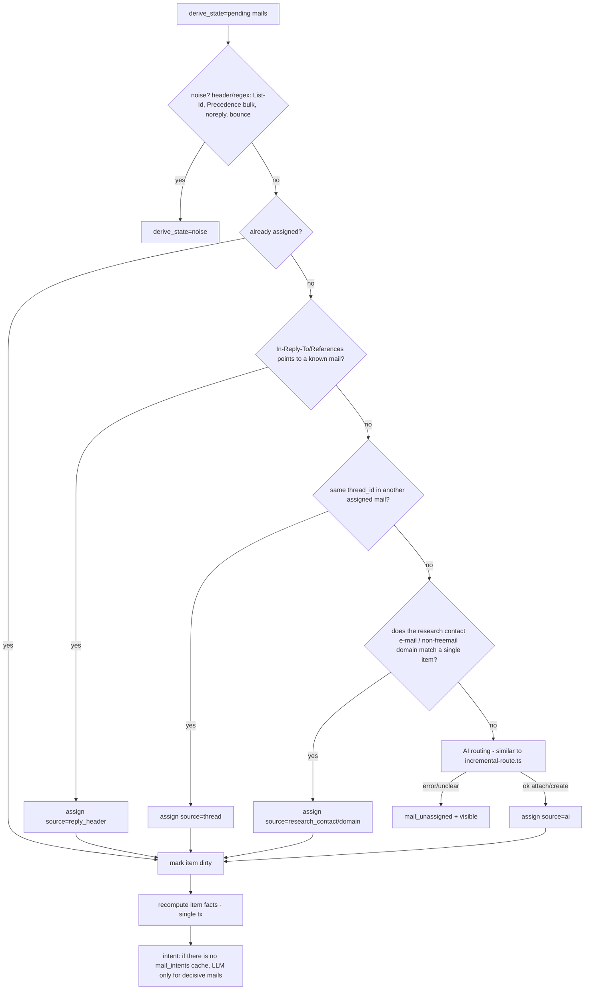
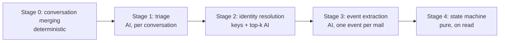
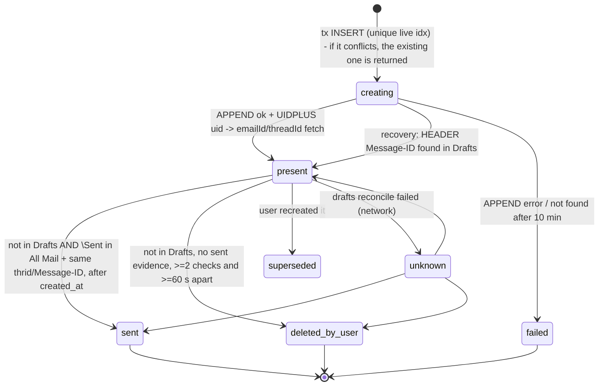
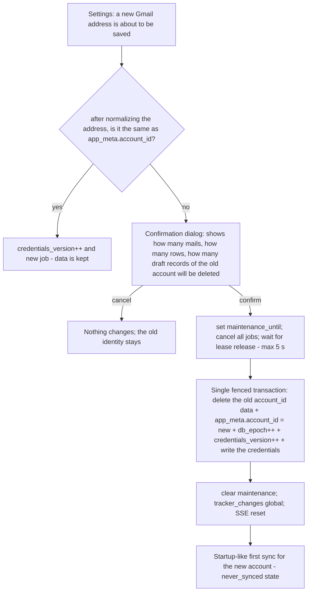

# CMAE Tracker — Target Architecture for Synchronization and Data Freshness

| | |
|---|---|
| **Date** | 2026-10-20 |
| **Status** | Draft / with approved product decisions |
| **Scope** | Tracker list, Gmail synchronization, item derivation, mutations, change propagation, draft lifecycle |
| **Goal** | The list must **always** show correct and up-to-date data; it must never mislead. If there is uncertainty, it must be shown explicitly. |

> File:line references refer to the working tree at the time this document was written (including uncommitted changes). They may drift as the code changes.

## Table of Contents

- [0. Summary](#0-summary)
- [Product decisions](#product-decisions)
- [1. Sanity check](#1-sanity-check)
  - [1.1 Verification of earlier claims](#11-verification-of-earlier-claims)
  - [1.2 New findings (those affecting architectural decisions)](#12-new-findings-those-affecting-architectural-decisions)
  - [1.3 Feasibility checks](#13-feasibility-checks)
  - [1.4 What I am changing from the earlier proposal](#14-what-i-am-changing-from-the-earlier-proposal)
- [2. Target architecture](#2-target-architecture)
  - [2.1 Core principles](#21-core-principles)
  - [2.2 Process topology](#22-process-topology)
  - [2.3 Data model](#23-data-model)
    - [2.3.1 Infrastructure](#231-infrastructure)
    - [2.3.2 Jobs and the lock](#232-jobs-and-the-lock)
    - [2.3.3 Mail layer](#233-mail-layer)
    - [2.3.4 Item layer](#234-item-layer)
    - [2.3.5 Drafts and workspace](#235-drafts-and-workspace)
    - [2.3.6 Lossless migration of existing data](#236-lossless-migration-of-existing-data)
  - [2.4 Source of truth and freshness](#24-source-of-truth-and-freshness)
  - [2.5 Sync engine](#25-sync-engine)
    - [2.5.1 Job state machine](#251-job-state-machine)
    - [2.5.2 Lease, heartbeat, stuck detection](#252-lease-heartbeat-stuck-detection)
    - [2.5.3 Triggers, coalescing and scheduling](#253-triggers-coalescing-and-scheduling)
    - [2.5.4 Atomic upsert + cursor (ordering guarantee)](#254-atomic-upsert--cursor-ordering-guarantee)
    - [2.5.5 Labels, moves, deletion, archiving](#255-labels-moves-deletion-archiving)
    - [2.5.6 Error classes](#256-error-classes)
  - [2.6 Item derivation](#26-item-derivation)
    - [2.6.1 Normal path: persistent assignment and dirty queue](#261-normal-path-persistent-assignment-and-dirty-queue)
    - [2.6.2 Explicit regrouping: stable-id diff](#262-explicit-regrouping-stable-id-diff)
    - [2.6.3 Time-dependent status: computed on read](#263-time-dependent-status-computed-on-read)
    - [2.6.4 LLM intent cache](#264-llm-intent-cache)
    - [2.6.5 Conversation-based classification: Stage 0 — conversation merging](#265-conversation-based-classification-stage-0--conversation-merging)
    - [2.6.6 Stage 1: triage (AI)](#266-stage-1-triage-ai)
    - [2.6.7 Stage 2: identity resolution](#267-stage-2-identity-resolution)
    - [2.6.8 Stage 3: event extraction](#268-stage-3-event-extraction)
    - [2.6.9 Stage 4: state machine](#269-stage-4-state-machine)
    - [2.6.10 Fingerprint cache and prompt_version](#2610-fingerprint-cache-and-prompt_version)
  - [2.7 Mutations](#27-mutations)
    - [2.7.1 Gmail draft: creating exactly once](#271-gmail-draft-creating-exactly-once)
    - [2.7.2 Switching to a different Gmail account (K2)](#272-switching-to-a-different-gmail-account-k2)
  - [2.8 Change propagation](#28-change-propagation)
  - [2.9 State derived from disk](#29-state-derived-from-disk)
  - [2.10 Observability and testing](#210-observability-and-testing)
- [3. Edge-case catalog](#3-edge-case-catalog)
- [4. Implementation roadmap](#4-implementation-roadmap)
  - [Phase 0: Urgent safety fixes (within the existing architecture, small diffs)](#phase-0-urgent-safety-fixes-within-the-existing-architecture-small-diffs)
  - [Phase 1: Migration framework, revision, SSE, ETag, client store](#phase-1-migration-framework-revision-sse-etag-client-store)
  - [Phase 2: Persistent jobs, lease, scheduler, freshness](#phase-2-persistent-jobs-lease-scheduler-freshness)
  - [Phase 3: MailSource, All Mail, gm_msgid, labels, deletion](#phase-3-mailsource-all-mail-gm_msgid-labels-deletion)
  - [Phase 4: Derivation rewrite](#phase-4-derivation-rewrite)
  - [Phase 5: Gmail draft lifecycle](#phase-5-gmail-draft-lifecycle)
  - [Phase 6: Mutation layer](#phase-6-mutation-layer)
  - [Phase 7: Workspace index](#phase-7-workspace-index)
  - [Phase 8: Latency and operations](#phase-8-latency-and-operations)
- [5. Remaining uncertainties](#5-remaining-uncertainties)

---

## 0. Summary

I have high confidence in the proposed system, with a few important corrections. All of the load-bearing claims of the earlier analysis were verified against the code line by line. In addition, ~16 new findings emerged that "make the list misleading" (see §1.2). The most critical ones are:

- On macOS, when the window is closed and reopened from the Dock, **a second Next server** starts, and two processes write to the same SQLite file.
- The 45-second "stuck" rule **kills a healthy sync** during a long-running LLM call.
- On an LLM error, mails **silently drop out of the list** and are never processed again.
- Onboarding reset does not cancel a running sync; old data is written back into the empty database.

**The core of the proposal stays:** persistent jobs + lease, atomic commits, revision + SSE + ETag, a client store, and Gmail All Mail for identity.

**Removed:**
- `node-cron`
- Electron `utilityProcess` (ABI incompatibility)
- QRESYNC (Gmail does not support it)

**Changed:**
- "Stable-id diff rebuild" stops being the main path. It is replaced by persistent mail→item assignments; the diff is used only for an explicitly requested "regroup with AI".
- Status is computed on every read (computed-on-read).
- Instead of atomic JSON patches for `notesJson`, fields move into columns/tables (column ownership).
- Draft identity is determined by Message-ID / X-GM-MSGID instead of the subject.

---

## Product decisions

The decisions below were approved by the user and are incorporated into the relevant sections of the design.

| # | Topic | Decision | Affected sections |
|---|---|---|---|
| K1 | A mail trashed / moved to spam / permanently deleted in Gmail | The mail **STAYS in fact computation** (a sent application or a received rejection is not considered undone). On the detail page it is marked **"Deleted in Gmail"**. | §2.3.3 (`gone_at`), §2.5.5, §2.6.1, edge-case #40 |
| K2 | Switching to a different Gmail account | The old account's data is **DELETED** after **obtaining user confirmation** (no hiding). After the confirmation dialog, inside a fenced maintenance transaction, the old account's mails, assignments, intents, cursors, draft records, and the items derived solely from those mails are deleted. The `account_id` column remains as a **safeguard** that prevents data belonging to the old account from mixing with the new account's data. | §2.3.3, §2.3.6, §2.4, §2.5.2, §2.7, edge-case #30, Phase 6 |
| K3 | User-field conflict during a merge (selected recipient, inactive, etc.) | The user is **ASKED**; no silent choice is made. The merge is not applied until the conflict is resolved. | §2.6.2 step 6, §2.7, Phase 4 / Phase 6 |

---

## 1. Sanity check

### 1.1 Verification of earlier claims

| Claim | Result | Evidence |
|---|---|---|
| Sync is manual only; on mount it only attaches to a running session | ✅ | `components/TrackerList.tsx:1513-1526` (toolbar), `1538-1551` (pending banner), `1790-1798` (empty state), `725-745` (mount) |
| Focus/visibility only refreshes the list | ✅ | `TrackerList.tsx:544-558` |
| `node-cron` is not used | ✅ | It exists only in `package.json`; no import in the code |
| Electron starts the standalone server as a single Node process | ✅ | `desktop/main.cjs:324-355` (spawn `338`). The bundled `node` binary is used (`main.cjs:266-272`), not Electron's own Node |
| SQLite WAL, no `transaction(` at all | ✅ | `lib/db/client.ts:26-28`; zero matches for `transaction(` across the repo. **Additionally:** there is no `busy_timeout` either |
| Session: `globalThis`, join-if-running, 45 s stuck, 1.5 s forced cancel | ✅ | `lib/tracker/session.ts:11, 155-174, 188, 251-257` |
| The cursor is written **before** the upsert | ✅ and worse | `lib/tracker/imap.ts:555` writes the cursor, `lib/tracker/sync.ts:182` upserts. The INBOX cursor is committed before SENT is read (`imap.ts:635-644` → `660`). If SENT fails or the process dies, the INBOX mails remain in memory and are lost |
| Incremental patch: row exists and new mails ≤ 25 | ✅ | `lib/tracker/run.ts:56-62`, `lib/tracker/incremental.ts:43` |
| Status is recomputed only on touched rows | ✅ | `incremental.ts:645-647` |
| Full rebuild: the whole inbox goes through the LLM, DELETE + INSERT, ids are unstable | ✅ | `lib/tracker/rebuild.ts:92-127` (LLM), `170-171` (DELETE), `395-441` (INSERT); `lib/db/schema.ts:108-111` explicitly acknowledges this |
| `reconcile(force)` → `pruneOrphan` | ✅ | `run.ts:85-89` |
| GET `/api/tracker` goes to IMAP; debounce is 12 s and the timestamp is written **after** IMAP | ✅ and worse | `app/api/tracker/route.ts:14`, `lib/tracker/pending-draft.ts:229-247, 285`. On an IMAP error the timestamp is never written (`281-284`), so while offline **every** GET goes to IMAP again |
| The drafts scan has no timeout, and `maxScan=120` is applied to the oldest UIDs | ✅ | `imap.ts:825-855`. It also contradicts its own comment: `imap.ts:248` says "never FETCH {since}", but `841` does exactly that |
| `listTrackerSections` reads from disk per row **and writes to the DB** | ✅ | `lib/tracker/list.ts:58, 159` → `pending-draft.ts:186-216` |
| `drafts.ts` does read-modify-write with stale data | ✅ | `lib/tracker/drafts.ts:153` reads → 4 `await`s → `257` / `39` writes with the stale `item.notesJson` |
| Other write paths | ✅ | `inactive.ts:50, 83, 140-152`; `set-recipient.ts:49`; `agents/followup.ts:123, 340`; `light-merge.ts:38, 97`; `research/folder-refs.ts:33-66`; `research/events.ts:105-120` |
| The client `load()` has no ordering protection; `busyId` is a single value | ✅ | `TrackerList.tsx:530-537`, `356` |

### 1.2 New findings (those affecting architectural decisions)

1. **Multiple processes are a real condition.** On macOS the `activate` event calls `boot()` again (`main.cjs:436-445`). `boot()` in turn calls `startProductionServer` and overwrites the `serverProcess` variable **without killing the previous one** (`338`). When the window is closed, the server keeps running (`432-434`); when it is opened from the Dock, a second server starts. There is also no `requestSingleInstanceLock`. Result: there are two separate `globalThis` instances, i.e. two separate "single sync" locks, but only one database. **This is why a DB-level lease is mandatory.**
2. **The 45 s rule kills a healthy sync.** If no log line is written while an LLM batch is in progress (`mail-signals.ts:147`, `match.ts:384`), a second click on "Sync" aborts the sync and restarts it from scratch (`session.ts:157-174`).
3. **The LLM has no timeout** (`lib/tracker/llm.ts:21`).
4. **Silent corruption on LLM errors.**
   - A classification error falls back to regex (`mail-signals.ts:157-176`) and is flagged nowhere.
   - On a grouping error, the whole list is rebuilt with heuristic grouping (`match.ts:438-447`).
   - If a batch cannot be parsed, **the mails in that batch end up in no group and drop out of the list** (`match.ts:422-424`).
5. **If the patch fails, the mails are never processed again.** If the patch/rebuild errors out after the upsert has been committed, those mails are not counted as "new" in the next sync (`insertedIds` contains only newly inserted rows, `sync.ts:103`). They are permanently left out of the incremental path.
6. **`lastSyncAt` is written too early.** It is written before derivation starts (`sync.ts:203`). A SENT error is only logged (`imap.ts:671-679`) and the sync looks "successful". The user wrongly sees an "up to date" message.
7. **A poison UID is silently skipped.** When the connection drops, the cursor is forced past the dead UID (`imap.ts:454-459, 515-519`). That mail is silently and permanently skipped.
8. **A research row that finishes during a rebuild disappears.** If research finishes during the rebuild's LLM wait time, it adds a light-merge row (`light-merge.ts:38`). The rebuild, however, took the candidate list **beforehand** (`rebuild.ts:105`) and deletes and rebuilds everything at `170-171`. The new research row is not visible until the next sync.
9. **Onboarding reset does not cancel the sync.** `app/api/onboarding/reset/route.ts:10` → `lib/onboarding/reset.ts:22-55` does not perform a busy check. The running sync writes the old account's data into the deleted DB.
10. **Draft matching is done with a substring comparison** (`imap.ts:816-819`). Short subjects such as "Application" match the wrong rows. Because the 120 limit is applied to the oldest drafts, new drafts are invisible and pending can be cleared by mistake.
11. **"Inactive" twin merging swallows user data.** The same `primaryTo` (for example an agency recruiter) or a similar company name causes an active row to be deleted and absorbed into the inactive row (`inactive.ts:110-155`, `rebuild.ts:446-473`). If a new position application is made to a paused company, the new application is hidden.
12. **Self-sent mail and synthetic Message-IDs.** When the same Message-ID is in both INBOX and SENT, the upsert flips the `folder` field every time (`sync.ts:70`). If the Message-ID header is missing, the synthetic id is tied to the UID (`imap.ts:217-219`); when UIDVALIDITY changes, duplicate rows are created.
13. **Comment and code contradict each other.** The comment says "bodyStructure + maxBytes" (`imap.ts:693-697`), but the code fetches the whole RFC822 content including attachments with `source: true` (`imap.ts:281`). This is the source of the hang and memory risk.
14. **The date can drift.** If the Date header is missing, `new Date()` is used (`imap.ts:215`) and the upsert updates `dateIso` every time (`sync.ts:75`). On a hard sync the mail date "drifts".
15. **Unmatched SENT mails are never tracked.** A mail sent from a phone to a new company never becomes a row on the incremental path (`incremental.ts:561-571`).
16. **DST inconsistency.** Elapsed time is computed in milliseconds (`status.ts:62-66`), while the next date is computed with local `setDate` (`status.ts:323-324`). A 1-hour inconsistency arises at a DST transition.

### 1.3 Feasibility checks

**`instrumentation.ts` / `register()`: ✅ works.**
- It already exists in the repo (`instrumentation.ts`, `instrumentation.node.ts`).
- `.next/standalone/.next/server/instrumentation.js` has been generated in the standalone output.
- `NextNodeServer.prepareImpl` → calls `ensureInstrumentationRegistered` (`node_modules/next/dist/server/next-server.js:573-579`).
- Docs: "called **once** when a new Next.js server instance is initiated, and **must complete before** the server is ready" (`node_modules/next/dist/docs/01-app/03-api-reference/03-file-conventions/instrumentation.md:18`).

This has three consequences:
- The scheduler must be started **without awaiting** (non-blocking) inside `register()`.
- The instrumentation bundle and the route bundles may be separate module instances. Therefore state must be kept in `globalThis` or in the DB; the existing code already uses this pattern (`session.ts:54-61`).
- In dev mode a `globalThis` guard against HMR is needed.

**imapflow 2.4.0: ✅ largely supported.**
- `emailId` ↔ X-GM-MSGID: `dist/cjs/commands/fetch.js:106-111`, `tools.js:862-868`
- `threadId` ↔ X-GM-THRID: `fetch.js:114-119`. It is already fetched today (`imap.ts:282`).
- `labels` ↔ X-GM-LABELS: `fetch.js:123-125`, `tools.js:876-878`
- `changedSince` (CONDSTORE): `fetch.js:183-202`, `types.d.ts:694`
- Optional `qresync` (`types.d.ts:99`, `imap-flow.js:1314`)
- IDLE: `idle()`, `maxIdleTime`, `missingIdleCommand`
- Gmail label search (X-GM-RAW): `search-compiler.js:298-332`
- APPEND returns `uid` / `uidValidity` with UIDPLUS: `types.d.ts:670-679`

**Gmail QRESYNC: ❌ not usable.** Gmail's CAPABILITY list has CONDSTORE but not QRESYNC (this information is from outside the code, publicly known behavior). A UID set difference (set diff) is needed to detect deletions/moves. The design will perform a CAPABILITY check at runtime.

**better-sqlite3 transaction: ✅ available, but synchronous.**
- `db.transaction(fn)` (`@types/better-sqlite3/index.d.ts:62`) and drizzle `transaction(tx => T)` (`drizzle-orm/better-sqlite3/session.d.ts:28-32`) exist.
- The callback **must be synchronous**. IMAP and LLM work must stay outside the transaction. The pattern is always: "outer work → short transaction".
- `sqlite.backup()` can be used for the pre-migration backup.

**Electron `utilityProcess`: ❌ dropped.**
- better-sqlite3 is compiled against the ABI of the packaged `node` binary (`scripts/prepare-desktop.mjs:87, 243`).
- `utilityProcess` runs with Electron's Node ABI. The native module would have to be compiled a second time; this increases package size and the failure surface.
- If needed, a second child process could be spawned with the same bundled `node` instead. But a separate process is not needed for this IO-heavy workload.

### 1.4 What I am changing from the earlier proposal

| Earlier proposal | Decision | Rationale |
|---|---|---|
| Scheduling with `node-cron` | **Removed** | Wall-clock cron does not fit sleep/wake and "since the last success" logic. It is replaced by a `setTimeout` loop + clock-jump detection + backoff. The package can be removed. |
| `utilityProcess` worker | **Removed** | ABI incompatibility (§1.3) |
| QRESYNC | **Removed** (for Gmail) | Not supported; UID set diff + CONDSTORE will be used |
| Label changes via CONDSTORE | **Kept, but with redundancy** | I am not sure that an X-GM-LABELS change bumps the MODSEQ. A periodic metadata scan will be the fallback. |
| sync_jobs + lease/heartbeat | **Strengthened** | Multiple processes are real (§1.2-1). The lock will be held in the DB with a partial unique index. |
| Stable-id diff rebuild (on every sync) | **Changed** | No regrouping on the normal path. There will be persistent `mail_assignments`; the diff is only for an explicitly requested "regroup". |
| Time-dependent status: on read or ticker | **Computed on read** | Rationale in §2.6.3 |
| Atomic update for `notesJson` | **Changed** | Fields will move to columns/tables (column ownership). JSON stays only for AI notes. |
| Draft reconcile: single-flight + timeout, outside GET | **Kept and extended** | Identity by Message-ID / X-GM-MSGID instead of the subject; a `gmail_drafts` table |
| Revision + SSE + ETag | **Kept and extended** | A changelog for backfill; `PRAGMA data_version` for cross-process change detection; a time bound will be added to the ETag |
| IMAP IDLE | **Deferred to the last phase, optional** | Not needed for correctness, it only reduces latency |
| **New additions** | — | `busy_timeout`; migration framework + backup; account safeguard (`account_id`) and confirmed account-switch deletion (K2); epoch fencing for reset; `derive_state` dirty queue; poison mail table; freshness model; single-instance lock |

---

## 2. Target architecture

### 2.1 Core principles

1. **The source of truth is Gmail.** SQLite is a committed mirror of it. The disk (workspace) is the source of research and draft files. Everything else is derived.
2. **The list is always a consistent snapshot.** The user never sees a half-finished rebuild. Every write is a single transaction.
3. **Uncertainty is shown, not hidden.** States such as "Not classified", "Gmail unreachable", "draft could not be verified" are never silently filled in with a guess.
4. **Column ownership.** Sync writes only to derived columns; user actions write only to user columns. This structurally eliminates conflicts.
5. **GET is a pure read.** It does not go to the network and does not write to the DB.
6. **Every write increments `tracker_revision`.** The client accepts only a newer revision.
7. **No silent decisions about user data.** Merge conflicts and account-switch deletion are asked of the user (K2, K3).

### 2.2 Process topology


- **Electron fixes** (Phase 0):
  - `app.requestSingleInstanceLock()` will be added; on the `second-instance` event the existing window will be brought to the front.
  - On the `activate` event, if the server is running, only a window will be created and `boot()` will not be called.
  - A server crash (`exit`, `main.cjs:351-354`) will be restarted once and the user will be notified.
- **Wake bridge.** On `powerMonitor.on('resume' | 'unlock-screen')` events, Electron main POSTs to `127.0.0.1:port/api/internal/wake` with the `CMAE_INTERNAL_TOKEN` env. As a defensive layer on the server side there is also drift detection: if on a scheduler tick the wall clock has jumped forward by more than 2× the interval, it counts as a "wake".

### 2.3 Data model

#### 2.3.1 Infrastructure

```sql
-- Migration framework (replaces ensureSchema; client.ts:108-271)
CREATE TABLE schema_migrations (version INTEGER PRIMARY KEY, applied_at TEXT NOT NULL);

CREATE TABLE app_meta (key TEXT PRIMARY KEY, value TEXT NOT NULL);
-- keys: tracker_revision (int), db_epoch (int, incremented on reset and account switch),
--       account_id (normalized form of the gmail address), credentials_version (int),
--       maintenance_until (iso | ''), schema_backup_path

-- Change log: SSE backfill + diagnostics
CREATE TABLE tracker_changes (
  rev        INTEGER PRIMARY KEY,           -- = the new value of tracker_revision
  at         TEXT NOT NULL,
  source     TEXT NOT NULL,                 -- sync|mutation|research|fs|drafts|migration|reset|account_switch
  kind       TEXT NOT NULL,                 -- upsert|delete|merge|global
  item_ids   TEXT NOT NULL DEFAULT '[]'     -- JSON; [] = global (refetch everything)
);
-- The last 2000 rows are kept; older ones are deleted at the end of each job.
```

Pragmas at connection open (to be added at `client.ts:26-28`):

```sql
PRAGMA journal_mode = WAL;
PRAGMA foreign_keys = ON;
PRAGMA busy_timeout = 5000;
PRAGMA synchronous = NORMAL;
```

#### 2.3.2 Jobs and the lock

```sql
CREATE TABLE sync_jobs (
  id              TEXT PRIMARY KEY,               -- uuid
  kind            TEXT NOT NULL,                  -- mail_sync|drafts_reconcile|classify_retry|workspace_scan|regroup
  mode            TEXT NOT NULL DEFAULT 'incremental', -- incremental|window_rescan|hard
  state           TEXT NOT NULL,                  -- queued|running|succeeded|partial|failed|canceled|interrupted
  phase           TEXT,                           -- connecting|fetch:all|fetch:drafts|commit|derive|reconcile_drafts|finalize
  reasons         TEXT NOT NULL DEFAULT '[]',     -- coalesced triggers: startup|interval|resume|manual|focus|post_mutation|idle|retry
  rerun_requested INTEGER NOT NULL DEFAULT 0,
  rerun_mode      TEXT,
  attempt         INTEGER NOT NULL DEFAULT 1,
  owner           TEXT,                           -- process instance id (uuid + pid)
  db_epoch        INTEGER NOT NULL,               -- fencing
  credentials_version INTEGER NOT NULL,           -- fencing
  account_id      TEXT NOT NULL,                  -- fencing (K2)
  error_kind      TEXT,                           -- auth|network|throttle|server|llm|disk|db|stuck|bug|canceled_by_reset|canceled_by_account_switch
  error_message   TEXT,
  stats_json      TEXT,                           -- {fetched, committed, derived, needsClass, poison, gone}
  queued_at TEXT NOT NULL, started_at TEXT, heartbeat_at TEXT, progress_at TEXT,
  finished_at TEXT, next_retry_at TEXT
);
CREATE UNIQUE INDEX sync_jobs_one_running ON sync_jobs(kind) WHERE state = 'running';
CREATE INDEX sync_jobs_kind_state ON sync_jobs(kind, state, queued_at);
```

The lock itself is the partial unique index. Two processes cannot create a `running` row at the same time. The lease, on the other hand, is maintained through `heartbeat_at` (§2.5.2).

#### 2.3.3 Mail layer

```sql
-- replaces mail_folder_cursors
CREATE TABLE mail_sources (
  account_id       TEXT NOT NULL,
  role             TEXT NOT NULL,      -- all|inbox|sent|drafts   (all = SPECIAL-USE \All)
  mailbox_path     TEXT NOT NULL,
  uid_validity     TEXT NOT NULL,
  last_uid         INTEGER NOT NULL DEFAULT 0,   -- highest committed UID only
  highest_modseq   TEXT,                         -- bigint string
  last_meta_scan_at TEXT,                        -- label/deletion scan
  last_success_at  TEXT,
  last_error_kind  TEXT,
  PRIMARY KEY (account_id, role)
);

ALTER TABLE mail_messages ADD COLUMN account_id     TEXT;      -- guard: only the active account's data is read/written (K2)
ALTER TABLE mail_messages ADD COLUMN gm_msgid       TEXT;      -- X-GM-MSGID (emailId)
ALTER TABLE mail_messages ADD COLUMN labels_json    TEXT;      -- ["\\Inbox","\\Sent",...]
ALTER TABLE mail_messages ADD COLUMN direction      TEXT;      -- in|out|self (based on the from address)
ALTER TABLE mail_messages ADD COLUMN internal_date  TEXT;      -- server time, canonical ordering
ALTER TABLE mail_messages ADD COLUMN header_date    TEXT;
ALTER TABLE mail_messages ADD COLUMN in_reply_to    TEXT;
ALTER TABLE mail_messages ADD COLUMN references_hdr TEXT;
ALTER TABLE mail_messages ADD COLUMN auto_flags     TEXT;      -- {autoSubmitted, bulk, listId, bounce}
ALTER TABLE mail_messages ADD COLUMN gone_at        TEXT;      -- no longer in All Mail (trash/spam/deleted) — STAYS in the facts (K1)
ALTER TABLE mail_messages ADD COLUMN gone_reason    TEXT;      -- trash|spam|expunged|unknown
ALTER TABLE mail_messages ADD COLUMN derive_state   TEXT NOT NULL DEFAULT 'done';
                                   -- pending|done|needs_classification|noise
ALTER TABLE mail_messages ADD COLUMN body_state     TEXT NOT NULL DEFAULT 'ok'; -- ok|truncated|failed
CREATE UNIQUE INDEX mail_messages_gm_uq ON mail_messages(account_id, gm_msgid) WHERE gm_msgid IS NOT NULL;
CREATE INDEX mail_messages_thread_idx ON mail_messages(thread_id);
CREATE INDEX mail_messages_derive_idx ON mail_messages(derive_state) WHERE derive_state <> 'done';
CREATE INDEX mail_messages_msgid_idx ON mail_messages(message_id);
CREATE INDEX mail_messages_account_idx ON mail_messages(account_id);
-- The old unique message_id index is converted to non-unique once the gm_msgid backfill is complete (Phase 3).

CREATE TABLE mail_fetch_failures (
  account_id TEXT NOT NULL, role TEXT NOT NULL, uid INTEGER NOT NULL,
  attempts INTEGER NOT NULL DEFAULT 1, last_error TEXT, first_at TEXT, last_at TEXT,
  abandoned INTEGER NOT NULL DEFAULT 0,
  PRIMARY KEY (account_id, role, uid)
);

CREATE TABLE mail_intents (
  mail_id        INTEGER PRIMARY KEY REFERENCES mail_messages(id) ON DELETE CASCADE,
  intent         TEXT NOT NULL,           -- human_reply|rejection|ack|auto_ack|ooo|click_action|optional_portal|non_job|bounce|unknown
  waiting_until  TEXT,
  confidence     REAL,
  source         TEXT NOT NULL,           -- ai|regex|header
  model          TEXT NOT NULL,
  prompt_version INTEGER NOT NULL,
  created_at     TEXT NOT NULL
);
```

**`account_id` is a guard (K2).** When the account is switched, the old account's data is **deleted** after confirmation; `account_id` prevents mixing in two situations:
1. Between the deletion and the new account's first sync, no read/write path may see the old rows.
2. If the deletion is left half-done (crash), on startup the rows with `account_id ≠ app_meta.account_id` are detected and the deletion is completed.

#### 2.3.4 Item layer

```sql
-- replaces tracker_item_mails: a mail belongs to at most one item (today's uq (item_id, mail_id) did not allow this)
CREATE TABLE mail_assignments (
  mail_id     INTEGER PRIMARY KEY REFERENCES mail_messages(id) ON DELETE CASCADE,
  item_id     INTEGER NOT NULL REFERENCES tracker_items(id),
  source      TEXT NOT NULL,     -- thread|reply_header|research_contact|domain|ai|user|legacy
  confidence  REAL,
  locked      INTEGER NOT NULL DEFAULT 0,   -- 1 if it comes from the user: AI can never move it
  assigned_rev INTEGER NOT NULL
);
CREATE INDEX mail_assignments_item_idx ON mail_assignments(item_id);

-- Job mail that could not be assigned (visible queue; never silently dropped)
CREATE TABLE mail_unassigned (
  mail_id INTEGER PRIMARY KEY REFERENCES mail_messages(id) ON DELETE CASCADE,
  reason  TEXT NOT NULL,         -- ai_unavailable|ambiguous|unmatched_outbound
  since   TEXT NOT NULL,
  attempts INTEGER NOT NULL DEFAULT 0
);

-- tracker_items: user columns
ALTER TABLE tracker_items ADD COLUMN user_state         TEXT NOT NULL DEFAULT 'active'; -- active|inactive|dismissed
ALTER TABLE tracker_items ADD COLUMN selected_recipient TEXT;
ALTER TABLE tracker_items ADD COLUMN user_version       INTEGER NOT NULL DEFAULT 1;
-- derived "fact" columns (time-independent)
ALTER TABLE tracker_items ADD COLUMN ai_status                 TEXT;
ALTER TABLE tracker_items ADD COLUMN last_meaningful_inbound_at TEXT;
ALTER TABLE tracker_items ADD COLUMN waiting_until             TEXT;
ALTER TABLE tracker_items ADD COLUMN last_intent               TEXT;
ALTER TABLE tracker_items ADD COLUMN flags_json                TEXT; -- {autoReply, ackOnly, clickAction, rejected, thanksSent, bounced}
ALTER TABLE tracker_items ADD COLUMN needs_classification      INTEGER NOT NULL DEFAULT 0;
ALTER TABLE tracker_items ADD COLUMN derived_version           INTEGER NOT NULL DEFAULT 1;
ALTER TABLE tracker_items ADD COLUMN derived_at                TEXT;
-- lifecycle
ALTER TABLE tracker_items ADD COLUMN origin_research_job_id TEXT;   -- light-merge idempotency
ALTER TABLE tracker_items ADD COLUMN deleted_at     TEXT;
ALTER TABLE tracker_items ADD COLUMN deleted_reason TEXT;           -- folder_deleted|merged|orphan|user
ALTER TABLE tracker_items ADD COLUMN merged_into_id INTEGER;
CREATE UNIQUE INDEX tracker_items_origin_job_uq ON tracker_items(origin_research_job_id)
  WHERE origin_research_job_id IS NOT NULL AND deleted_at IS NULL;
-- the existing `status` column stays as "status_cached" during the transition (so old code paths can still read it); the list does not use it.

CREATE TABLE item_lineage (old_id INTEGER, new_id INTEGER, kind TEXT, at TEXT); -- merge|split

-- Merge conflicts that must be asked of the user (K3)
CREATE TABLE merge_proposals (
  id            TEXT PRIMARY KEY,
  winner_id     INTEGER NOT NULL REFERENCES tracker_items(id),
  loser_id      INTEGER NOT NULL REFERENCES tracker_items(id),
  origin        TEXT NOT NULL,          -- regroup|twin_suggestion|user
  conflicts_json TEXT NOT NULL,         -- [{field:'selected_recipient', winner:'a@x', loser:'b@y'}, {field:'user_state', ...}]
  state         TEXT NOT NULL,          -- pending|applied|rejected|stale
  created_rev   INTEGER NOT NULL,
  created_at    TEXT NOT NULL,
  resolved_at   TEXT
);

CREATE TABLE item_ops (                  -- per-row long-operation lock (replaces busyId + draft-inflight)
  item_id INTEGER NOT NULL, op TEXT NOT NULL,       -- prepare:follow_up, draft:application ...
  owner TEXT NOT NULL, started_at TEXT NOT NULL, expires_at TEXT NOT NULL,
  PRIMARY KEY (item_id, op)
);
```

#### 2.3.5 Drafts and workspace

```sql
CREATE TABLE gmail_drafts (
  id               TEXT PRIMARY KEY,                    -- uuid; also written to the X-CMAE-Draft-Id header
  item_id          INTEGER NOT NULL REFERENCES tracker_items(id),
  account_id       TEXT NOT NULL,                       -- K2 guard
  kind             TEXT NOT NULL,                       -- application|follow_up|thanks|reply
  state            TEXT NOT NULL,                       -- creating|present|sent|deleted_by_user|failed|unknown|superseded
  message_id_hdr   TEXT NOT NULL,                       -- <cmae-{uuid}@cmae.local>
  gm_msgid         TEXT, gm_thrid TEXT, drafts_uid INTEGER, drafts_uidvalidity TEXT,
  subject          TEXT NOT NULL, to_addr TEXT NOT NULL, content_hash TEXT NOT NULL,
  created_at       TEXT NOT NULL, confirmed_at TEXT, last_seen_at TEXT, last_checked_at TEXT,
  missing_since    TEXT, missing_checks INTEGER NOT NULL DEFAULT 0,
  sent_mail_id     INTEGER REFERENCES mail_messages(id),
  error            TEXT
);
CREATE UNIQUE INDEX gmail_drafts_live_uq ON gmail_drafts(item_id, kind)
  WHERE state IN ('creating','present','unknown');

CREATE TABLE workspace_files (
  folder TEXT NOT NULL, name TEXT NOT NULL, kind TEXT,   -- email|follow_up_n|thanks|reply|contact|summary|other
  mtime_ms INTEGER, size INTEGER, subject TEXT,
  PRIMARY KEY (folder, name)
);
CREATE TABLE workspace_folders (folder TEXT PRIMARY KEY, present INTEGER NOT NULL, scanned_at TEXT);
```

The `has_*_draft` columns are no longer written from now on. These flags are derived at read time from the `workspace_files` and `gmail_drafts` tables.

#### 2.3.6 Lossless migration of existing data

Each migration takes a `cmae.db.pre-v{n}` backup with `sqlite.backup()` and then runs **inside a single transaction**.

1. **`mail_folder_cursors` → `mail_sources`.** The `INBOX` row becomes `inbox`, the `SENT` row becomes `sent`. `account_id` = `settings.gmail_address` (lowercase).
2. **`mail_messages`.**
   - `account_id` is filled with the current `settings.gmail_address`. Since there is no account scope today, the DB of a user who has switched accounts in the past may also contain the old account's mails; these cannot be told apart and are written to the current account. This is a known limitation (§5).
   - `direction` becomes `out` if `from_addr` equals the user's address, otherwise `in`.
   - `derive_state='done'` (existing rows are already derived).
   - `gm_msgid` stays empty. Mails inside the window are filled in on the next sync by matching `message_id`; those outside the window keep the old identity.
3. **`tracker_item_mails` → `mail_assignments`** (`source='legacy'`). If a mail is linked to more than one item, there is a conflict: the item with the most mails wins, the others become `mail_unassigned(reason='ambiguous')` and are logged.
4. **Rows with `status='inactive'`** become `user_state='inactive'`. `notesJson.statusBeforeInactive` is no longer needed because status is computed on read; the key is not deleted, it is just not read.
5. **`notesJson.selectedRecipient`** (the key in `recipients.ts`) is moved to the `selected_recipient` column.
6. **`notesJson.pendingGmailDraft`** → `gmail_drafts(state='unknown', subject, kind, created_at=at, message_id_hdr='legacy:'+uuid)`. When the first draft reconcile runs, this record is resolved to `present` or `deleted_by_user` by subject + recipient (once, with low confidence).
7. **Fact columns** are filled during the first derivation. Until then the list shows `status_cached` with an "unverified" badge.
8. **`tracker_timelines`** stays as it is, since it is fingerprint-based.

**Rollback strategy:**
- Throughout Phases 1-5, migrations only **add** (new tables/columns). The old app version keeps working by ignoring the new columns.
- Destructive steps (dropping the old unique index, deleting `tracker_item_mails`, the `has_*` columns) are left to the last phase and the minimum version is enforced via `version-policy.json`.
- In case of a serious bug, the "Restore previous database" option in settings puts the `pre-v{n}` backup back.

### 2.4 Source of truth and freshness

| Data | Authoritative source | Local representation | How it is updated |
|---|---|---|---|
| Mails, labels, threads | Gmail (only the **active** account) | `mail_messages`, `mail_sources` | Mail sync job |
| Gmail Drafts presence | Gmail | `gmail_drafts` | Drafts reconcile job |
| Research and draft files | Disk | `workspace_files`, `workspace_folders` | Index at write time + `fs.watch` + periodic scan |
| User preferences (inactive, recipient) | SQLite | User columns | Mutation transactions |
| Grouping (mail → item) | SQLite (derived, but persistent) | `mail_assignments` | Derivation, user |
| Intent | SQLite cache | `mail_intents` | Derivation / classify_retry |
| Effective status, ordering, sections | **Not stored** | — | On every read via `effective(facts, settings, now)` |

All read paths run with an `account_id = app_meta.account_id` filter. This way, a row belonging to the old account never appears in the list before the confirmed deletion completes (K2).

**Freshness definition:**
- `dataAsOf`: The oldest of the last **fully successful** (including derivation) jobs of the mail and drafts sources.
- **Fresh:** `now - dataAsOf ≤ 2 × active interval` (5 min in the foreground → 10 min).
- **Stale:** Above this threshold.
- **Very stale:** Above 24 hours.

**UI states and text intent** (i18n keys `tracker.freshness.*`):

| State | Condition | Display (example text) |
|---|---|---|
| `never_synced` | No successful job at all | Instead of an empty list: "Running the first sync — scanning the last 30 days (120/480)". It never says "No records yet". |
| `fresh` | Definition above | Sync terminal / meta; no page banner |
| `syncing` | Job is `running` | Sync terminal: "Updating…". The list is shown **in full** as of the last commit. |
| `stale_offline` | Last error is `network` | Sync terminal (line when sync ends): "Cannot reach Gmail…" |
| `auth_failed` | Last error is `auth` | Sync terminal (error line): "Gmail sign-in was rejected…" |
| `partial` | A source failed (e.g. drafts) | Sync terminal line |
| `ai_degraded` | `needs_classification > 0` or `mail_unassigned > 0` | Sync terminal line; row badge: "Unverified" |
| `throttled` | Gmail limit | Sync terminal line |
| `account_switching` | Account-switch deletion in progress | "Deleting the previous account's data…" (list temporarily locked) |
| (merge) | `merge_proposals.state='pending'` | A **single** banner on the Tracker page: "N merge decision(s)…" + **Manage** → `/tracker/merge`. Not a freshness state. |
| Row: `updating` | The row has a dirty mail and a job is running | Small spinner on the row: "Updating" |
| Row: draft | `gmail_drafts.state` | "Draft in Gmail (verified 1 min ago)" / "Draft status unknown" / "Draft was deleted from Gmail" |
| Detail: mail | `gone_at` is set | "Deleted in Gmail" label on the mail card; its contribution to the facts continues (K1) |

**Rule:** If a piece of data is based on a guess (regex fallback, legacy subject match), the UI says so.

### 2.5 Sync engine

#### 2.5.1 Job state machine

```mermaid
stateDiagram-v2
  [*] --> queued: trigger (coalesced)
  queued --> running: lease acquired (BEGIN IMMEDIATE + partial unique)
  queued --> canceled: reset / account switch
  running --> succeeded: all sources + derivation committed
  running --> partial: mail OK, drafts/LLM partially failed
  running --> failed: auth|network|throttle|disk|db|stuck|bug
  running --> canceled: user cancel / reset / identity or account change (fencing)
  running --> interrupted: heartbeat expired (process died/slept)
  failed --> queued: retry (backoff; except auth)
  interrupted --> queued: automatic resume (from the cursor commit point)
  partial --> queued: classify_retry / drafts_reconcile as separate jobs
  succeeded --> queued: if rerun_requested=1, one more immediately
  succeeded --> [*]
  canceled --> [*]
```



**Phase order (`mail_sync`):** `connecting → fetch:all (or inbox+sent) → meta_scan (periodic) → derive → reconcile_drafts → finalize`

- Each `fetch` batch is committed in its own short transaction.
- The `derive` step consumes the dirty queue and runs in its own transactions.
- `finalize` writes the `mail_sources.last_success_at` value and the job `state`, and increments the revision.

#### 2.5.2 Lease, heartbeat, stuck detection

- **Acquisition** (inside a single `BEGIN IMMEDIATE`):
  1. `running` jobs with `heartbeat_at < now-30s` are marked `interrupted`.
  2. A `queued` job is moved to `running` (`owner`, `db_epoch`, `credentials_version`, `account_id` are written).
  3. The partial unique index prevents a second `running` job.
  4. If `app_meta.maintenance_until` points to the future, no job is started.
- **Heartbeat:** `heartbeat_at` is updated every 5 s. While the laptop sleeps, the heartbeat stops. On wake, if the 30 s threshold has been exceeded and no other process has taken over, the same owner may continue by matching `owner`. However, since the IMAP socket is most likely dead, the job is aborted and goes `interrupted → queued`.
- **Stuck detection looks at progress, not at log lines.** Each phase has a budget and a `progress_at`:
  - IMAP batch: 180 s (existing `FETCH_BATCH_MS`, `imap.ts:19`)
  - LLM call: 90 s × 2 attempts
  - Derivation transaction: 10 s

  If the budget is exceeded, the `AbortController` fires and the job becomes `failed(stuck)`. **A user click never kills a healthy job**; a click only means "join".
- **Fencing:** At the start of every write transaction, `app_meta.db_epoch == job.db_epoch && credentials_version == job.credentials_version && account_id == job.account_id` is checked. If they do not match, `throw FencedError` happens and the job falls to `canceled`. This definitively prevents the old job from writing on reset and account switch.

#### 2.5.3 Triggers, coalescing and scheduling

`requestSync({reason, mode})` behaves as follows:
- If a `running` job exists → `rerun_requested=1`, `rerun_mode=max(mode)`, append to the `reasons` list. No new job is opened.
- If a `queued` job exists → the reasons are merged.
- If neither exists → a `queued` job is created.

A 3 s debounce is applied to non-manual triggers.

| Trigger | When | Mode | Note |
|---|---|---|---|
| `startup` | 2 s after `register()` | incremental | Recovery first: old `running` -> `interrupted`; an interrupted account-switch deletion is completed |
| `interval` | Since the last success: 5 min if the window is visible, 15 min if hidden (the renderer reports visibility) | incremental | ±10% jitter |
| `resume` | `powerMonitor` + drift detection | incremental | Old IMAP connections are closed first |
| `focus` / `online` | Renderer | incremental | Ignored if the last success was < 60 s ago |
| `manual` | Button click | incremental / hard | Always joins; if hard, it upgrades the running job |
| `post_mutation` | Draft creation, "sent" detection | `drafts_reconcile` (+ mail after 60 s) | To catch sends from Gmail quickly |
| `idle` | Phase 8, IMAP IDLE `exists` | incremental | 10 s debounce |
| `retry` | `next_retry_at` | Previous mode | Backoff: 1, 2, 5, 15, 30 min (max) |

- On an `auth` error there is no automatic retry. The scheduler does not open mail jobs until `credentials_version` changes.
- `drafts_reconcile` is a separate job type. It runs at the end of a mail sync; if there are pending drafts it additionally runs every 2 minutes.

#### 2.5.4 Atomic upsert + cursor (ordering guarantee)

Gmail has an `\All` mailbox; if it is missing, we fall back to INBOX + Sent. For every batch of 50 UIDs:

```text
1. FETCH (IMAP, outside the tx): uid, emailId, threadId, labels, flags, internalDate, envelope,
   headers[In-Reply-To, References, Auto-Submitted, Precedence, List-Id, Content-Type],
   bodyParts: text/plain|text/html  maxBytes=64KB   ← source:true IS REMOVED (imap.ts:281)
2. BEGIN IMMEDIATE (fencing check: epoch + credentials_version + account_id)
     upsert mail_messages  ON CONFLICT(account_id, gm_msgid)   -- if absent, match by message_id and fill in gm_msgid
       new row or content changed → derive_state='pending'
       only the label changed → derive_state='pending' (may affect status), body is kept
     failed UIDs → mail_fetch_failures (attempts++)
     mail_sources.last_uid = max(contiguous committed uid)     -- if a UID was skipped, only up to just before it
     bumpRevision('sync', [])   -- only if there is anything pending
   COMMIT
```

- **Contiguity rule:** If UID 101 could not be fetched but 102-150 were, 102-150 are still committed but `last_uid` stays at 100. The next round retries 101; re-fetching 102-150 is harmless because the upsert is idempotent.
- **Broken mail:** After 3 attempts it becomes `abandoned=1`, `last_uid` may advance, and the UI shows "1 mail could not be read (subject: …)". Today's silent skip (`imap.ts:454-459`) is removed.
- **Direction:** If `from` is the user's address or an alias, the direction is `out`; if `to` is also the user, it is `self`. The folder/label does not determine direction. This fixes the problem of the folder being flipped for a mail sent to oneself.
- **Date:** `internal_date` is canonical; `header_date` is kept for display. The `new Date()` fallback is removed.

#### 2.5.5 Labels, moves, deletion, archiving

- **All Mail** also contains archived and filtered mails. Today's INBOX+SENT model never sees them.
- **Label change:** If CONDSTORE is available, `fetch('1:*', {uid, labels, flags}, {changedSince: highest_modseq})` is used.
- **Deletion (trash/spam/permanent):** Since Gmail does not support QRESYNC, a set difference of `UID SEARCH SINCE <window>` is taken periodically per window (every 6 hours, or in `window_rescan` mode). Missing ones are marked with `gone_at` and `gone_reason`.
  - **Product decision K1:** `gone` mails **stay** in the fact computation; a sent application or a received rejection is not considered undone. The detail page shows them as **"Deleted in Gmail"**. The row is not deleted and the status does not change. For an inbound mail moved to spam, the intent may be re-evaluated; however, the mail is still not removed from the facts.
  - If a mail is restored in Gmail (taken out of the trash), `gone_at` is cleared at the next set-difference scan.
- **UIDVALIDITY change:** Since the key is `gm_msgid`, no duplicates are created. `last_uid=0` is set and the window is rescanned; UID mappings are updated.
- **If All Mail is hidden in IMAP** (a Gmail setting): we fall back to INBOX+Sent and the UI shows a permanent notice ("Archived mails may not be visible — Gmail > Labels > show All Mail in IMAP").

#### 2.5.6 Error classes

| Class | Detection | Behavior | UI |
|---|---|---|---|
| auth | imapflow `authenticationFailed` / `AUTHENTICATIONFAILED` | `failed(auth)`, scheduler stops, GET never goes to IMAP | Red banner |
| network | ECONNRESET, ENOTFOUND, timeout | Backoff | Amber "Cannot reach Gmail" |
| throttle | `[THROTTLED]`, `Too many simultaneous connections`, bandwidth limit | 15-60 min backoff, single-connection pool | Amber |
| server | Other NO/BAD | 2 retries, then `failed(server)` | Amber |
| llm | Timeout / 429 / parse error | The job **does not fail**: mails become `needs_classification`, with a `classify_retry` job | Info banner + row badge |
| disk | SQLITE_FULL / ENOSPC | Transaction rollback, `failed(disk)` | Red: "Disk full — data cannot be updated" |
| db | SQLITE_BUSY (after busy_timeout) | 3 retries, then `failed(db)` | Amber |
| identity / account switch | Fencing | `canceled`; new job with the new identity | — |

IMAP connection management: at most 2 connections per process (1 sync/drafts, 1 IDLE). Today every GET can open its own connection (`pending-draft.ts:277`).

### 2.6 Item derivation

#### 2.6.1 Normal path: persistent assignment and dirty queue



- **The threshold of 25 is dropped** (`incremental.ts:43`). Work is always incremental; for large inputs, in chunks of 200.
- **Only decisive mails are classified:** each item's last inbound mail, the last meaningful inbound candidate, and unassigned inbound mails. Today a full rebuild runs the entire inbox through the LLM (`rebuild.ts:115`).
- **Fact computation** is pure per item: `facts = computeFacts({ assignedMails, intents, events, researchCandidate })`. The core of the output is the per-mail event timeline (§2.6.8); it is stored as `tracker_items.events_json`. The old `resolveStatus` (`status.ts`) has been removed; everything time-dependent lives in `effective()` (§2.6.9). Mails with `gone_at` set are **included** in the computation (K1).
- **User columns are never written.** Derivation does not touch `user_state`, `selected_recipient`, or user assignments (`locked=1`).
- **Twin merging is no longer automatic.** `collapseInactiveActiveTwins` (`inactive.ts:110`) is removed. The same identity suspicion is shown as a `merge_proposals(origin='twin_suggestion')` record with the suggestion "These two rows may be the same company — merge?". An e-mail match alone is never a reason to merge.
- **Assignment is conversation-level** (§2.6.5): if any mail of a conversation is attached to an item, all unassigned mails of the conversation (including SENT) are attached to that item in the same transaction.
- **Unmatched outbound mails** are deferred first; after all chunks are processed, conversation merging runs again and those that still cannot be attached become `mail_unassigned(reason='unmatched_outbound')`. This queue is retried at the start of every derive. The UI asks: "2 sent mails are not tracked — create a row?". (The old `incremental.ts` / `patchTrackerWithNewMails` path has been removed.)

#### 2.6.2 Explicit regrouping: stable-id diff

This path runs only on the "Regroup with AI" action or when the prompt version changes significantly. The LLM proposal is the groups `G`; the existing items are `I`.

1. **Weight:** `w(g,i) = 1.0·[same origin_research_job_id] + J(threads(g), threads(i)) + 0.3·[same primary e-mail]`. Here `J` is the Jaccard similarity of the thread sets.
2. **Matching:** Greedy maximum-weight matching, threshold 0.35. Since the number of rows is limited to hundreds, O(n·m) is enough.
3. Matched pair → **in-place update** (id preserved).
4. Unmatched new group → new item.
5. **Split:** If an old item is spread across two groups, the largest overlap keeps the id, the other gets a new id and `item_lineage(split)` is written. User fields (selected recipient, inactive) stay on the item that keeps the id; whether they are copied to the new item is asked of the user (K3).
6. **Merge (K3):** If two old items go into a single group:
   - If there is **no** conflict in user fields (at most one side has a value, or the values are the same), the merge is applied: the winner keeps the id, the other gets `deleted_at`, `deleted_reason='merged'`, `merged_into_id`, and `item_lineage(merge)` is written.
   - If there **is** a conflict (e.g. two different `selected_recipient`s, one `inactive` and the other `active`, two different live drafts), the merge is **not applied**. A `merge_proposals(state='pending', conflicts_json)` record is created and the user is asked, for each conflicting field, which value to keep. **No silent choice is made.** Until the user answers, the two rows stay separate and both show a "Waiting for your merge decision" badge.
   - The user's answer is applied in a single transaction. If one of the rows changed in the meantime (`user_version` increased after `created_rev`), the proposal becomes `stale` and is asked again.
7. If an unmatched old item has user traces (inactive, selected recipient, draft), it is kept.
8. `locked=1` assignments are not moved by the AI.
9. **Preview:** The diff is shown to the user first ("4 rows will be updated, 1 will be merged, 1 is waiting for your merge decision, 2 new"). After approval, the conflict-free part is applied in a **single transaction**.

#### 2.6.3 Time-dependent status: computed on read

The choice is **computation on read**. Reasons:
- It is correct at any moment. When the laptop wakes from sleep, when the follow-up days setting changes, or when the day rolls over, it gives the correct result immediately; today all of these wait for the sync (`status.ts:62, 214, 318`).
- The number of rows is limited to hundreds; computing it as a pure function takes < 5 ms.
- A ticker does not write to the DB; it produces no revision noise and no write conflicts.

```text
effective(facts, user_state, settings, now) -> { status, waitingOn, nextFollowUpAt, nextTransitionAt }
```

- `settings` = `followUpDays`, `rejectionCloseDays` (default 10), `staleCloseDays` (default 20). Everywhere that calls `effective()`, including the list, the detail API, and the inactive path, reads the same settings. The rules are in §2.6.9.

- `nextTransitionAt`: The nearest moment at which this row's status will change on its own (follow-up time, OOO end, rejected → closed, etc.).
- The GET response returns `validUntil = min(nextTransitionAt)`. The client sets a timer for that moment and requests again with `If-None-Match`. The server also schedules a `tick` SSE event for that moment.
- `user_state='inactive'` is an overlay: the status is shown as `inactive` but facts continue to be computed. When it is reactivated, the correct status is visible without needing to store the old status.
- **Date arithmetic is gathered in a single helper:** "N days" = calendar days in the user's time zone (via Intl). Elapsed time and target date are computed by the same function, which ends DST inconsistencies.
- **Clock skew:** If a newly arrived mail's `internal_date` is more than 10 minutes ahead of or behind local time, a diagnostic warning is raised.

#### 2.6.4 LLM intent cache

- Key: `(mail_id, prompt_version, model)`. `prompt_version` is a constant in code; it is incremented when the prompt changes.
- **Invalidation:** On a version mismatch, not all mails are reclassified at once, only the **decisive** ones, lazily.
- Hard sync bypasses the cache.
- `source='header'`: `Auto-Submitted: auto-replied` (RFC 3834) or `multipart/report; report-type=delivery-status` (bounce) is determined deterministically; no LLM is needed.
- A `source='regex'` result is considered **temporary**: the item gets `needs_classification=1` and a `classify_retry` job retries with backoff.
- Every LLM call gets a 90 s timeout (wrapping `llm.ts:21`) and invalid JSON is rejected via a schema (zod).
- On the conversation-based line (§2.6.5–§2.6.9), `mail_intents` is only a **fallback** source: for inbound mails that have no Stage 3 `mail_events` record, the intent → event mapping is used.

#### 2.6.5 Conversation-based classification: Stage 0 — conversation merging

Classifying mail by mail could not see the sending, acknowledgement, follow-up, and rejection of an application as the same process (duplicate rows, SENT mails not attached to a row, wrong status). The new pipeline has five stages:



**Stage 0** (`lib/tracker/derive/conversations.ts`, pure part `conversation-graph.ts`) is deterministic and uses no LLM:

- Union-find: the same Gmail `thread_id` → the same conversation; if message-ids in `In-Reply-To` / `References` point to a known mail, they are merged. The conversation key is `account|t:<smallest thread_id>` or `account|m:<smallest mail id>`.
- `mail_conversations(id, account_id, thread_key, mail_ids, fingerprint, item_id)` is updated at the start and end of every derive; unchanged rows are not written.
- **Conversation-level assignment:** if the conversation has an assigned mail, the majority item (smallest id on a tie) owns the conversation; unassigned mails are attached to that item with `source='thread'` in a single transaction and the `mail_unassigned` records are deleted. An assigned mail is never moved (splitting/merging is the job of §2.6.2).
- `fingerprint = sha256(sorted mail ids | latest mail time)`; it is the key of the Stage 1 and 3 caches (§2.6.10).
- **Order** (`derivePendingMails`, `lib/tracker/derive/run-derive.ts`): repair at the start of derive (`repairConversations`) → structural assignment only for dirty mails (`reply_header` / `thread`; domain/person matching is now Stage 2's job) → `runConversationStages` (`lib/tracker/derive/stages.ts`: Stage 1 → 2 → 3) → conversation repair again → facts of the touched items (Stage 4 input) are refreshed → merge proposals. Conversations with only `List-Id` / bulk headers are counted as noise without going to the AI. On the first run, a one-time pass (`app_meta: derive_events_timeline_v1`) refreshes all live items so that `events_json` gets filled. The old per-mail AI routing (`incremental-route`) has been removed.

#### 2.6.6 Stage 1: triage (AI)

`lib/tracker/agents/conversation-triage.ts` (pure; the LLM is injected, and the eval runs the same code). Input: a cleaned transcript (`lib/tracker/derive/transcript.ts`: quoted history is dropped by word-shingle overlap with earlier messages, and the user's signature is dropped by learning it from the latest SENT bodies; includes SENT, direction/date/from/to/subject/body, with a character budget per message and per conversation). Several conversations are asked in a single call (≤ 8 conversations, ≤ 24k characters, concurrency 3); conversations with no or invalid answers are retried once more with a smaller call, and if that still fails, `conversation_analysis.state='failed'` — **no fabricated data is written**, the mails stay visible as `mail_unassigned(ai_unavailable)` and are retried with backoff (immediately on a hard sync). When the AI is unavailable, the only fallback is the old regex noise filter, and it can only decide "noise". The output (`TriageResult`) is written to the `conversation_analysis` table:

| Field | Meaning |
|------|-------|
| `is_job_process` | Whether the conversation is a job application process (not a newsletter, job alert, or account verification) |
| `employer` | **The real employer.** An agency or platform is never the employer |
| `intermediary`, `intermediary_kind` | Channel: `ats` (personio, ashby, greenhouse…), `agency` (acmestaffing…), `job_board` (examplejobboard…) |
| `position`, `ref_code` | Position and posting/reference code (Stage 2 key) |
| `counterpart_email` | The human counterpart in the process |

The model also returns the role of the domains it sees; these are written to the `sender_roles(account_id, domain, role, source)` table. A user decision (`source='user'`) is not overridden by the AI. Interface: `ConversationTriageProvider` + `saveTriage` / `getCachedTriage` (`lib/tracker/derive/stage-store.ts`).

#### 2.6.7 Stage 2: identity resolution

Product decision: **one row per real employer**; the agency/platform is the row's channel.

`lib/tracker/derive/identity.ts` (pure) + `stages.ts` (DB).

1. **Deterministic keys** (in order): the conversation already has an item (Stage 0); `ref_code`; normalized employer name (exact match); employer domain; counterpart e-mail. Domains marked in `sender_roles` as intermediaries (`ats` / `agency` / `job_board`) and free mail domains are **never** used as identity keys — this is why two different companies coming through personio.de or smartrecruiters.com do not merge.
2. If a key points to a single item, it is attached. If there is none, **top-k** candidates (k ≤ 6) are chosen by similarity and a small AI call (8 questions/call) decides "is it one of these, or new?"; if there are no candidates, a new row is opened. Structural veto: if both sides have their own employer domain, none is shared, and the names do not resemble each other, the AI's "same" answer is not applied. On an AI error or an unclear employer → `mail_unassigned(ambiguous)`, no silent guessing.
3. The intermediary is the row's **channel** (`tracker_items.channel`, `channel_kind`; migration `011_conversation_ai`); if it has the same name as the employer (the agency's own process), no channel is written.
4. **Hard sync repairs:** conversations split across several rows and conversations that contradict the row's own employer (old domain/ATS/agency merges) are re-resolved; only unlocked assignments not owned by the user are moved, and an emptied row that has left no trace is soft-deleted as `orphan`. Old rows carrying an intermediary's name take the employer name. Existing duplicate rows that point to the same/similar employer are **never merged automatically**; the user is asked via `merge_proposals` (K3), and a rejected proposal is not reopened.
5. Different positions at the same employer stay on the same row; the number of rows converges to the number of employers.

#### 2.6.8 Stage 3: event extraction

One LLM call per conversation returns **one event for every mail** in the transcript (`ExtractedEvent`) and is written to the `mail_events(mail_id, conversation_id, event, waiting_until, confidence, source, model, prompt_version)` table (`saveMailEvents`). The event set (`lib/tracker/derive/events.ts`):

| Direction | Events |
|-----|---------|
| Outbound | `application_sent`, `follow_up_sent`, `thanks_sent`, `withdrawn`, `other` |
| Inbound | `ack`, `auto_ack`, `ooo`, `info_request`, `interview_invite`, `assessment`, `action_required`, `rejection`, `offer`, `other` |

An event is a time-independent fact; the chronological timeline per item is stored as `tracker_items.events_json`. Priority: `mail_events` record → (outbound) structural rule → (inbound) intent mapping.

- **Inbound fallback** (`eventFromIntent`): `human_reply→info_request`, `rejection→rejection`, `ack`/`optional_portal→ack`, `auto_ack→auto_ack`, `ooo→ooo`, `click_action→action_required`, `unknown→other`; `non_job` / `bounce` do not enter the timeline.
- AI: `lib/tracker/agents/event-extract.ts`, the full transcript per conversation (including SENT) + row context (employer, position, the latest events in the row's other conversations). The answer is validated all-or-nothing for the conversation (a direction-compatible event for every mail). If it fails, `mail_conversations.events_state='failed'` is set and the fallback below is used.
- **Unverified badge:** If the timeline contains an event with no AI record (coming from the fallback), `flags.unverified` is set; the list and detail show an "Unverified" badge. When the AI succeeds in a later sync, the badge goes away.
- **Outbound fallback** (`structuralOutboundEvent`, within the same conversation, looking at the inbound mails after the last outbound): if the last meaningful inbound is a `rejection`, `thanks_sent`; if there is another meaningful inbound, a thank-you pattern → `thanks_sent`, otherwise `other`; if there is no inbound but there is an earlier outbound, `follow_up_sent`; if there is nothing, `application_sent`.

#### 2.6.9 Stage 4: state machine

`effective()` (`lib/tracker/derive/effective.ts`) folds the timeline chronologically (`foldTimeline`) and returns the result given `now`. It is pure; it does not write to the DB.

| Order | Condition | Status |
|------|-------|--------|
| 1 | `user_state` inactive/dismissed | `inactive` |
| 2 | Research only, no outbound | `ready_to_send` |
| 3 | `withdrawn`, or `thanks_sent` while the rejection latch is set | `closed` (immediately) |
| 4 | Rejection latch set | `rejected`; closing anchor `max(rejectedAt, aftermathAt) + rejectionCloseDays`. **Our** outbound `other` / `follow_up_sent` does not set the latch (chasing feedback); only `application_sent`, AI `interview_invite`/`offer`/`assessment`, or AI `info_request`/`action_required` set it |
| 5 | Our reply after an offer (not withdrawn) | `waiting` (positive); `closed` after `staleCloseDays` — `follow_up_due` is not produced |
| 6 | `action_required` / `assessment` after the last outbound | `needs_action`; `closed` after `staleCloseDays` |
| 7 | `interview_invite` / `info_request` / `offer` after the last outbound | `needs_reply` (invite/offer are positive) |
| 8 | `scheduledAt` (interview day) is in the future | `waiting` until the end of the day (`waitingReason=interview`); after that day the silence anchor = the interview day (not the last outbound) |
| 9 | Silence anchor = last outbound; if none, the last `ack`/`auto_ack`; if none, the last inbound (`min(at, now)`). `staleCloseDays` (20) have passed since the anchor | `closed` (no `ignored`) |
| 10 | Last inbound is `ooo` and a return date exists | `waiting` until the end of the day, then `follow_up_due` |
| 11 | `followUpDays` have passed since the anchor (7-day wait if there are consecutive follow-ups) | `follow_up_due`, otherwise `in_progress` |

- Passive inbound events (`ack`, `auto_ack`, `ooo`, `other`) only start/preserve the silence clock; they do not change the status themselves. While the rejection latch is set, they only extend `aftermathAt`.
- Several positions at the same employer: the timeline is grouped by `pos`; the row status is the result of the most active group (so that one role's rejection does not bury the other).
- A human mail arriving later on a closed row → the status stays `closed`, with a `mailAfterClose` badge.
- `user_state = inactive` does not wake up on its own on a new mail (user decision).
- `nextTransitionAt` is the next clock-based transition in every branch (rejection close, stale close, follow-up time, end of OOO/interview); `GET /api/tracker` computes `validUntil` from these.
- `rejectionCloseDays` and `staleCloseDays` can be changed in Settings (1–90 days, validated by the API).
- `refreshItemFacts` no longer writes `ai_status`; the cache columns (status, waitingOn…) are only for sorting/backward compatibility, and the value that is read is always `effective()`. The detail API also uses `effective()`.

#### 2.6.10 Fingerprint cache and prompt_version

- Stage 1 and 3 results are cached by `(conversation_id, fingerprint, prompt_version)`. As long as no new mail arrives in a conversation, the fingerprint does not change and the LLM is not called; when the prompt version is bumped, only the affected conversations are lazily re-analyzed.
- `mail_events.source`: `ai` | `regex` | `header` | `rule`; `model` + `prompt_version` are stored on every row. Hard sync bypasses the cache.
- The tables arrive with migration `010_conversations`; they were added to the list of tables deleted on an account switch. `011_conversation_ai`: `conversation_analysis.state/attempts/error`, `mail_conversations.events_*` (Stage 3 cache key), `tracker_items.channel/channel_kind`.
- **Limits:** at most 300 conversations per run go to the AI (those coming from the cache are unlimited in incremental), the remaining ownerless mails stay `derive_state='pending'`; LLM concurrency is 3, 90 s per call. A cancel/fencing check is done after every LLM call; each batch writes a progress row (heartbeat). **Hard sync** = re-fetch the last 30 days from Gmail + give every conversation to the AI again without cache (a build like the first sync); mails older than 30 days and existing rows are not deleted, rows are re-attached/updated. If there are more than 300 conversations, the rest continues in the next hard sync.

### 2.7 Mutations

**Shared helper:**

```ts
withItemTx(itemId, { expectUserVersion?, source }, (tx, row) => patch)
// BEGIN IMMEDIATE → fencing → read row (if deleted/merged, redirect to merged_into or 410)
// → if expectUserVersion mismatches, 409 {current}
// → apply patch → user_version++ → bumpRevision(tx, source, [itemId]) → COMMIT
```

| Write path | Today | New |
|---|---|---|
| Recipient PATCH (`set-recipient.ts:49`) | Read-write, overwrites `notesJson` | `withItemTx`, `selected_recipient` column, `expectUserVersion` |
| Bulk inactive/active (`inactive.ts:33-93`) | Row by row, no transaction | All ids in a single transaction; `user_state` |
| Prepare (`agents/followup.ts:123, 296, 340`) | LLM → file → flag; the flag can diverge from `workspace_files` | `item_ops` lock (`prepare:kind`) → LLM (outside the tx) → write the file atomically (tmp + rename) → transaction: `workspace_files` upsert + revision. Flags are derived at read time. |
| Gmail draft (`drafts.ts:134-267`) | Check by subject, write to a stale row, double click creates two drafts | §2.7.1 |
| Research light-merge (`light-merge.ts`) | Races with rebuild | Transaction; idempotent because `origin_research_job_id` is unique. Derivation does not delete. |
| Folder rename/delete (`folder-refs.ts:21-76`) | No transaction | Single transaction; the deleted row gets `deleted_at`, `deleted_reason='folder_deleted'` |
| Orphan cleanup (`orphans.ts`, `rebuild.ts:501-515`) | Hard delete | Soft delete + lineage; cleanup after 30 days |
| Merge decision (new) | — | The `merge_proposals` answer is applied in a single transaction; for each conflicting field the value the user chose is written; if the proposal has gone `stale`, the user is asked again (K3) |
| Onboarding reset (`reset.ts:22`) | Does not cancel sync | Set `maintenance_until` → cancel all jobs → wait for the lease to be released (max 5 s) → `db_epoch++` → wipe → clear maintenance |
| Settings/credential change — **same address** (`settings/route.ts:13`) | 409 while sync is running | Instead of 409: cancel the running mail job → `credentials_version++` → new job |
| Settings/credential change — **different Gmail address** (K2) | The old account's mails and rows stay mixed with the new ones | Confirmed deletion flow in §2.7.2 |

**Concurrent sync and the same row:** Derivation writes only fact columns and `derived_version`; mutations write only user columns and `user_version`. Because there are two version counters, pointless conflicts such as "sync updated the row, so the user's recipient change got a 409" do not occur. A conflict happens only within the same column group.

#### 2.7.1 Gmail draft: creating exactly once



1. **Identity:**
   - The `Message-ID: <cmae-{uuid}@cmae.local>` and `X-CMAE-Draft-Id: {uuid}` that we generate ourselves are stored. Today they are generated and then discarded (`imap.ts:750`).
   - The `emailId` (X-GM-MSGID) and `threadId` (X-GM-THRID) are obtained using the `uid` returned from APPEND.
   - Subject matching remains only for legacy records and as "low confidence".
2. **Reconcile:**
   - The **entire** Drafts mailbox is scanned (it is usually small): `uid`, `emailId`, `threadId`, `headers[Message-ID, X-CMAE-Draft-Id]`.
   - Matching order: gm_msgid → Message-ID → X-CMAE-Draft-Id → thrid.
   - A draft edited in the Gmail web UI may get a new msgid; it is matched by thrid.
3. **"Sent" evidence:** A message in All Mail labelled `\Sent`, after `created_at`, with the same thrid, or the same Message-ID, or (for an application) the same recipient + subject. As soon as evidence is found, a mail sync is triggered immediately. This way the "Create draft" button on the row does not become active again when the user sent the application from Gmail.
4. **Double click and two windows:** The unique live index rejects the second request at the DB level; the API returns the existing record.
5. **Crash:** A record left in the `creating` state is resolved during recovery with `SEARCH HEADER Message-ID`.

#### 2.7.2 Switching to a different Gmail account (K2)



- **Confirmation dialog text (intent):** "You are switching to a different Gmail account. 1,240 mails, 38 follow-up rows and 3 draft records belonging to the account `old@…` will be **permanently deleted** from this device. Your mails in Gmail are not affected. Continue?"
- **Deleted inside the transaction** (`account_id = old`):
  - `mail_messages` → `mail_intents`, `mail_assignments`, `mail_unassigned` via `ON DELETE CASCADE`
  - `mail_sources`, `mail_fetch_failures`, `gmail_drafts`
  - `tracker_items` whose assigned mails **all** belong to the old account (hard delete), and their `item_ops`, `merge_proposals`, `item_lineage`
  - `tracker_timelines` (because the fingerprint is based on the old mails)
- **Preserved:** Research-originated `ready_to_send` rows with no mail history and workspace folders are preserved, because they are tied to the disk rather than the account. Their `selected_recipient` value and inactive state are also kept.
- **Crash resilience:** Because the deletion is a single transaction, it either happens completely or not at all. Even so, if at startup any row with `account_id ≠ app_meta.account_id` remains (e.g. data left over from an older version), the same deletion is completed automatically and logged.
- **Old job protection:** A job running or queued for the old account cannot write a single row, because of fencing (`account_id` mismatch).
- **Pre-delete backup:** Right before the transaction, a `cmae.db.pre-account-switch` backup is taken with `sqlite.backup()`; it is deleted after 7 days. This is a safety net for recovery, not an "undo" feature offered to the user (§5).

### 2.8 Change propagation

- **Revision:** Every write transaction increments `app_meta.tracker_revision` and writes a row to `tracker_changes`.
- **Cross-process change detection:** The SSE server reads `PRAGMA data_version`, a cheap query, once per second. If another connection has committed, the revision is read again. Within a single process, the in-process bus notifies immediately.
- **SSE `/api/tracker/events`** (the existing `/api/tracker/live` and the sync stream are merged under this). Event schema:

```ts
type TrackerEvent =
  | { type: "hello"; rev: number; serverNow: string; freshness: Freshness }
  | { type: "changed"; rev: number; itemIds: number[] | "all"; source: string }
  | { type: "merged"; rev: number; fromId: number; intoId: number }
  | { type: "deleted"; rev: number; itemId: number; reason: string }
  | { type: "merge_proposal"; rev: number; proposalId: string; itemIds: number[] }
  | { type: "job"; jobId: string; kind: string; state: string; phase?: string; progress?: { done: number; total: number } }
  | { type: "freshness"; freshness: Freshness }
  | { type: "tick"; reason: "time_transition" }   // the moment of nextTransitionAt
  | { type: "reset"; rev: number }                 // backfill not possible / account changed → refetch everything
  | { type: "ping" };
```

  - Every event carries an `id: <rev>` field.
  - On reconnect, if `Last-Event-ID` is still in the changelog, the missing `changed` events are sent; otherwise `reset` is sent.
  - While SSE is disconnected, the client polls every 30 s with `If-None-Match`.
- **GET `/api/tracker`:** Pure read; the response is `{rev, serverNow, validUntil, freshness, sections, total}`.
  - `ETag: W/"r{rev}-v{validUntilEpoch}"`.
  - If `If-None-Match` matches and `now < validUntil`, it returns **304**.
  - `Cache-Control: no-store` (ETag is used only on the client side).
- **Client `TrackerStore`** (`useSyncExternalStore`):
  - **Single-flight fetch:** At most one GET is in flight at a time; pending requests are coalesced.
  - **Ordering guard:** A response with `rev < store.rev` is discarded. Today `TrackerList.tsx:530-537` applies every incoming response.
  - **Optimistic update:** A mutation is applied as `{mutationId, itemId, patch}`. The server response `{rev, item}` overwrites it. On error it is rolled back and shown inline on the row.
  - **Per-row busy state:** `Map<itemId, Set<op>>`. This replaces the singular `busyId` value (`TrackerList.tsx:356`). The server-side `item_ops` is also synchronized via `hello` / `changed`; an operation in progress in another window also appears as a spinner.
  - Focus/visibility no longer blindly calls `load()`; it sends a conditional request with `If-None-Match` and sends a sync trigger.
- **Multiple windows:** All follow the same SSE and revision stream. Because locks are held on the server, consistency is independent of the number of windows.
- **Detail page** (`components/TrackerDetail.tsx:152-155`):
  - Refetches on a `changed` event for its own id.
  - On a `merged` event, redirects to `merged_into_id` and shows a "This record was merged with X" notice.
  - On a `deleted` event, instead of an empty 404 it shows a page with a reason, such as "This record was removed: the research folder was deleted".
  - On a `merge_proposal` event, shows a "A merge decision is awaiting you for this row" banner.
  - Because ids are now stable, the URL never breaks during normal sync.

### 2.9 State derived from disk

- **At write time:** Every file write the app performs (prepare, research, folder creation) updates the `workspace_files` index with a transaction in the same code path and increments the revision.
- **External changes:** `fs.watch(workspaceRoot, {recursive: true})` (supported on macOS and Windows). After a 500 ms debounce, the affected parent folder is rescanned → `workspace_files` diff → revision.
- **Safety net:** A full scan at startup + a `workspace_scan` job every 10 min (the watcher may miss events, e.g. on network drives).
- **Deleted folder:** The semantics of `folder-refs.ts:38-68` are preserved. A `ready_to_send` row without mail history is soft deleted. For one with mail history, the workspace link is severed and the row shows "Research folder not found".
- **Externally edited `.md`:** Since the draft identity no longer depends on the subject, the pending state is not broken. The row shows a "Draft file differs from the draft in Gmail" warning (content_hash difference).
- **GET no longer writes to disk.** `reconcileDraftFlagsForRow` (`pending-draft.ts:173-218`) is removed.

### 2.10 Observability and testing

**Logs:**
- One line per entry, `{at, jobId, kind, phase, event, durMs, counts, errorKind}`, is written to `userData/logs/sync-YYYYMMDD.jsonl`. Rotated over 7 days; passwords and mail bodies are never logged.
- The `sync_jobs` history keeps the last 200 records.
- Account switch deletion is logged with its counts (mails/rows/drafts); addresses are written hashed.

**Metrics (on the diagnostics page):**
- Job durations (p50/p95)
- Counts of `pending` / `needs_classification` / `unassigned` / `poison`
- Number of pending `merge_proposals`
- Draft status distribution
- Last success time (per source)
- Number of IMAP connections
- LLM error rate

**Invariants:** Checked at the end of every derivation transaction; on a violation it rolls back and logs `failed(bug)`.
1. Every mail of a job in the `done` state is in either `mail_assignments` or `mail_unassigned` (no silent drops).
2. A mail is assigned to at most one item (guaranteed by the PK).
3. Every non-deleted item has at least one assigned mail, an origin research, or a `user_state ≠ active` state.
4. `mail_sources.last_uid` is not greater than the largest committed contiguous UID.
5. `tracker_revision` increases monotonically.
6. There is no `creating` draft older than 10 min.
7. `merged_into_id` chains are acyclic.
8. There is no mail, source, or draft row with `account_id ≠ app_meta.account_id` (K2).
9. No merge with a user-field conflict has been applied without a `merge_proposals` confirmation (K3).

**Test plan:**
- **Infrastructure:** `vitest` is added; there is no test runner in the repo. `playwright` is already among the dependencies.
- **`MailSource` interface:** `listChanges` / `fetchBatch` / `drafts.*` / `append`. Implementations are `GmailImapSource` and `FakeMailSource` (in-memory; X-GM fields, UIDVALIDITY change, latency, random disconnects, throttle).
- **Unit tests:**
  - Property-based tests for `effective()` with a fake clock: DST transitions (Europe/Istanbul does not use DST; also Europe/Berlin and America/New_York), end of month, changes in follow-up days.
  - Diff matcher: split, merge, locked-assignment scenarios; when a user-field conflict exists, the merge is not applied and a proposal is produced instead (K3).
  - Intent cache version invalidation.
  - `gone` mails keep contributing to facts (K1).
- **Integration:** Real SQLite temp file + `FakeMailSource` + fake LLM (timeout / 429 / malformed JSON / correct).
- **Account switch (K2):** With an unconfirmed save nothing is deleted; with a confirmed save all of the old account's data is deleted and research-only rows are preserved; an old job running during deletion cannot write anything; after a SIGKILL in the middle of the transaction the DB is in either the old or the new state.
- **Crash consistency:** The server is started as a child process with `CMAE_FAULT=<checkpoint>:<n>` and is SIGKILLed at each checkpoint (fetch batch, commit, derive tx, after draft APPEND, account switch deletion). It is restarted and sync completes. The result must be **identical** to an uninterrupted oracle sync, and all invariants must hold.
- **Concurrency:** Two server processes on the same DB → only one `running` job at a time. For drafts, two parallel POSTs → a single APPEND.
- **Fault injection:**
  - SQLITE_BUSY by holding a write lock from another connection.
  - ENOSPC via an `fs` wrapper.
  - Auth rejection and connection drop on the fake IMAP.
- **IMAP protocol level (optional):** Dovecot + TCP proxy (latency/disconnects) in Docker. Since Dovecot does not support X-GM, Gmail-specific behavior is verified with contract tests.
- **Contract tests:** Manual or nightly runs against a real test Gmail account:
  - CAPABILITY check
  - All Mail SPECIAL-USE
  - APPEND UIDPLUS
  - msgid/thrid behavior after editing/sending a draft
  - Whether a label change increments MODSEQ
- **UI (Playwright):** Freshness banners, the list not flickering during sync, two-window consistency, merge redirect on the detail page, merge conflict dialog, account switch confirmation dialog, offline mode.

---

## 3. Edge-case catalog

| # | Scenario | Today's behavior | New design | What the user sees |
|---|---|---|---|---|
| 1 | The app quits in the middle of sync (SIGTERM, `main.cjs:167`) | INBOX cursor was written (`imap.ts:555`), upsert was not done (`sync.ts:182`): **mails are lost permanently** | Batch transaction (mail + cursor together); at startup `interrupted → queued` | "Updating" at startup; no mail is lost |
| 2 | SIGKILL / crash during rebuild | Half-built list after DELETE (`rebuild.ts:170`) | Single transaction, rollback | The previous complete list |
| 3 | The laptop goes to sleep during an IMAP fetch | The socket waits 300 s (`imap.ts:155`); the 45 s rule applies only on click | Heartbeat stops → resume event → old connection is closed, job `interrupted` → new job | "Updating" for a few seconds after waking |
| 4 | Overnight sleep; the follow-up time passes | Status stays stale until sync (`status.ts:318-356` computes at sync time) | Compute on read + `validUntil` timer | "Follow-up time" as soon as it opens |
| 5 | On macOS the window is closed and reopened from the Dock | A second server (`main.cjs:436-445, 338`); two separate `globalThis` locks | Single-instance + `activate` fix + DB lease | No difference; a single sync |
| 6 | Pressing "Sync" again during a long LLM batch | A healthy sync is killed (`session.ts:157-174`) | The click joins the existing job; stuck detection based on the phase budget | The ongoing progress is shown |
| 7 | Sync and draft on the same row | Draft writes the stale row (`drafts.ts:153→257`); if rebuild changed the id, pending is lost | Column ownership + `gmail_drafts` + stable id | The draft badge stays correct |
| 8 | Double-click on "Create draft" / two windows | Two APPENDs, two drafts (`drafts.ts:187-245`) | Unique live index | Single draft; the second click returns the same result |
| 9 | User deletes the draft in Gmail | Noticed only if it is within the oldest 120 scanned; either late or wrong (`imap.ts:841-848`) | All Drafts by msgid, 2 checks + 60 s | "Draft deleted from Gmail" + recreate |
| 10 | User sends the draft from Gmail | When the draft disappears, pending is cleared and "Create draft" becomes active again → **double-application risk**, until the SENT sync | `sent` evidence (thrid/Message-ID) + immediate mail sync | "Sent" → row moves to "Awaiting reply" |
| 11 | A reply arrives during sync | Arrives on the next sync. On an empty incremental the cursor parks at `hw` (`imap.ts:550-551`); if `uidNext` is updated via EXISTS, a new UID could be skipped (not verified) | Cursor is only the committed UID; the next round (or IDLE) catches it | Within 5 min (within seconds with IDLE) |
| 12 | UIDVALIDITY is reset | The 30-day window is rescanned; synthetic ids create duplicates (`imap.ts:217-219`) | gm_msgid key; UID mappings are refreshed | Unnoticeable |
| 13 | Multiple companies in one thread (recruiter forwards) | LLM grouping is random | Thread is the default; AI/user can split per mail (`mail_assignments` is at mail level) | "Move this mail to another row" |
| 14 | Same company, multiple people or positions | Matching by company name carries over state (`rebuild.ts:152-158, 280-283`) | Identity = assignments + research; company name is not a key | Separate rows, "may be the same company" suggestion |
| 15 | Agency recruiter with the same email for two companies | `samePrimaryEmail` deletes the active row (`inactive.ts:119-153`) | No automatic merging | Both rows remain |
| 16 | New application to a paused company | The new application is swallowed into the inactive row (`rebuild.ts:451-455`) | New research = new item | New row "Ready to send" |
| 17 | Bounce (mailer-daemon) | Counted as a normal inbound, may become `needs_reply` | `source='header'` bounce intent → `flags.bounced` | "Delivery failed — check the recipient" |
| 18 | OOO auto-reply | Falls back to regex if AI fails (`mail-signals.ts:176`) | `Auto-Submitted` header first (deterministic); `needs_classification` if the date cannot be extracted | "Out of office, until date X" or "Unverified" |
| 19 | LLM hangs | No timeout (`llm.ts:21`); sync hangs | 90 s × 2 → `needs_classification` | List updates; row shows "Unverified" |
| 20 | LLM quota exhausted / invalid key | The whole list is rebuilt with heuristic grouping (`match.ts:438-447`) | Assignments are preserved; new mails are `unassigned` | "AI unavailable — 3 mails awaiting matching" |
| 21 | Grouping batch cannot be parsed | Mails drop out of the list (`match.ts:422-424`) | Impossible thanks to invariant 1 | Visible queue |
| 22 | Patch fails (after upsert) | Mails are never processed again (`sync.ts:103` returns only new ones) | `derive_state='pending'` is processed again in the next job | Fixes itself |
| 23 | DB locked (SQLITE_BUSY) | No `busy_timeout`; immediate error, GET 500 | 5 s wait + retry | No delay or "Will retry shortly" |
| 24 | Disk full | Partial write because there is no transaction | Rollback, `failed(disk)` | "Disk full — data cannot be updated"; the old complete list stays visible |
| 25 | System clock is wrong | Status and dates are wrong; `new Date()` is used when the Date header is missing (`imap.ts:215`) | `internal_date` is canonical + drift warning | "System clock appears to be 2 hours ahead" |
| 26 | DST transition | Mismatch between ms and local `setDate` (`status.ts:62-66` vs `323-324`) | Single date helper, timezone-aware | Consistent |
| 27 | Huge first sync (thousands of mails) | Everything in memory (`imap.ts:684`), the whole inbox goes through the LLM, written in one go | Batch commit + header/regex pre-filter + only decisive mails go to the LLM | Progress indicator; rows appear gradually with an "Unverified" badge |
| 28 | Return from vacation (> 25 new mails) | Full LLM rebuild + DELETE (`run.ts:73-81`): ids change, detail URLs break | Always incremental | Only changed rows are updated |
| 29 | Credentials change during sync (same address) | 409 block (`settings/route.ts:13`); frequently blocked by automatic sync | Cancel + `credentials_version` fencing | Save works immediately; sync starts with the new credentials |
| 30 | Switching to a different Gmail account | No account scoping; the old account's mails and rows remain mixed with the new ones; the window is rescanned because of the cursor UIDVALIDITY difference | **K2:** Confirmation dialog → maintenance → old `account_id` data is **deleted** in a single fenced transaction (§2.7.2); research-only rows are kept; `account_id` remains as a safeguard; initial sync for the new account | "1,240 mails and 38 rows belonging to old@… will be deleted — Continue?" → after confirmation "Initial sync in progress"; if cancelled, nothing changes |
| 31 | App password revoked | Every manual sync errors; every GET goes to IMAP and slows down (`pending-draft.ts:281-284`) | `auth_failed` state; all IMAP stops | Red banner + Settings button |
| 32 | Offline | GET waits for the IMAP connection attempt (slow list) | GET does not go to the network; backoff | List opens instantly + amber "Cannot reach Gmail" |
| 33 | Onboarding reset during sync | Sync writes stale data to the deleted DB (`reset.ts:22`) | Maintenance + `db_epoch` fencing | Clean setup |
| 34 | Research finishes during sync | Light-merge row is deleted on rebuild (`rebuild.ts:105, 170`) | Transaction + idempotent + non-deleting derivation | Row appears immediately and stays |
| 35 | Folder deleted from Finder | Pruned only on sync (`run.ts:89`); ghost row in the meantime | `fs.watch` → soft delete | Row disappears within seconds or shows "Folder missing" |
| 36 | `.md` edited externally | Pending may be cleared wrongly when the subject changes | Identity is msgid; content_hash difference warning | "File differs from the Gmail draft" |
| 37 | Same draft subject in two companies | Substring match marks the wrong row as pending (`imap.ts:816-819`) | msgid | Correct row |
| 38 | Gmail delay after APPEND | 5 × 450 ms poll, then error (`imap.ts:870-885`); user retries | Immediate confirmation via UIDPLUS uid | "Draft created" |
| 39 | Gmail filter archives the mail (Inbox is skipped) | Never seen (`imap.ts:635-681` only INBOX/Sent) | All Mail | Reply is in the list |
| 40 | Mail moved to trash or spam / permanently deleted | Stays in the DB forever like a normal mail, no marker | **K1:** `gone_at` + `gone_reason`; **stays** in fact computation; marker is removed if restored | Row and status do not change; "Deleted in Gmail" on the mail card in the detail view |
| 41 | Mail to yourself / with yourself in cc | `folder` is flipped on every upsert (`sync.ts:70`); direction is wrong | `direction` from the from address | Correct direction |
| 42 | Mail with a large attachment breaks the socket | Cursor is forcibly advanced, mail is skipped (`imap.ts:454-459`) | Text parts only (maxBytes) + broken mail table | "1 mail could not be read" (visible) |
| 43 | INBOX succeeds, SENT fails | Sync is "successful", `lastSyncAt` is updated (`sync.ts:203`) | Per-source freshness; `partial` | "Sent mails have not been updated for 1 hour" |
| 44 | Row is merged or deleted while the detail page is open | "Not found" (`TrackerDetail.tsx:152-155`) | `merged` / `deleted` events | Redirect or a message with the reason |
| 45 | SSE drops (sleep / server restarts) | Missed events are lost (`TrackerList.tsx:748-761`) | `Last-Event-ID` backfill / `reset` | Unnoticeable |
| 46 | Out-of-order responses (focus + SSE + sync finished) | Old response overwrites the new one (`TrackerList.tsx:530-537`) | Revision guard | No flicker |
| 47 | Concurrent operations on two rows | `busyId` is singular; the second extinguishes the first's spinner | Per-row `Set` + server-side `item_ops` | Correct spinners |
| 48 | User changes the recipient while reconcile waits on IMAP | Reconcile overwrites with the old `notesJson` (`pending-draft.ts:250→337/357`) | Separate columns + transaction | Selection is preserved |
| 49 | Follow-up days setting changes | Old status until the next sync | Computed on read | Instant |
| 50 | Mail sent to a new company from a phone | The incremental path never creates a row (`incremental.ts:561-571`) | `unmatched_outbound` queue + AI routing | "Sent mail not being tracked — create a row?" |
| 51 | All Mail hidden in IMAP | — | INBOX+Sent fallback + persistent notice | "Archived mails may not be visible" |
| 52 | Gmail concurrent connection limit | GET, sync, and draft poll open separate connections | Pool of at most 2 connections + throttle backoff | "Gmail temporarily rate-limited" if needed |
| 53 | On regroup two rows would merge, but they have different selected recipients / inactive states | Today the inactive twin wins and the recipient is silently taken from the old row (`rebuild.ts:142-151, 383-393`, `inactive.ts:110-155`) | **K3:** The merge is not applied; `merge_proposals` is created; the user chooses for each conflicting field | "These two rows can be merged — which recipient should stay? a@x / b@y"; until a decision is made the two rows stay separate and badged |

---

## 4. Implementation roadmap

Each phase can be released independently. Acceptance criteria are proven by automated tests.

### Phase 0: Urgent safety fixes (within the existing architecture, small diffs)

1. `lib/db/client.ts`: `busy_timeout=5000`, `synchronous=NORMAL`.
2. `desktop/main.cjs`: `requestSingleInstanceLock`; on `activate`, if the server exists just open a window; restart the server once on its `exit` event.
3. `lib/tracker/imap.ts` + `sync.ts`: `fetchFolder` does not write the cursor, it returns it. `syncMailsFromGmail` writes the upsert + cursor in a **single `transaction`**. A SENT error is returned as `partial`.
4. `lib/tracker/rebuild.ts:136-519`: the DELETE + INSERT section is wrapped in a single `transaction` (there is no `await` in this section, so it is feasible).
5. `sync.ts:203`: `lastSyncAt` is written when derivation finishes (at the end of `run.ts`); `lastError` is filled on SENT/derivation errors.
6. `llm.ts`: 90 s timeout wrapper. `match.ts:422-424`: mails from an unparseable batch go to heuristic grouping instead of being dropped.
7. Simple dirty flag: `mail_messages.derive_state` is added. If patch/rebuild fails it stays `pending`; `run.ts` processes `pending` mails instead of `insertedIds`.
8. `pending-draft.ts`: reconcile is removed from GET (only at the end of sync and after creating a draft). Single-flight promise; the timestamp is written **before** IMAP; 15 s timeout; rows are re-read and merged right before writing.
9. `drafts.ts`: `markPendingOnItem` re-reads the row before writing. Server-side in-memory lock for `(itemId, kind)` (temporary).
10. `session.ts`: The stuck rule looks at the phase budget instead of the "last log line"; a click does not kill a healthy job.
11. `onboarding/reset/route.ts`: `cancelTrackerSyncSession` is called first and awaited.
12. `TrackerList.tsx`: request counter for `load()` (the last started wins); `busyId` → `Set`.

**Acceptance criteria:**
- SIGKILL test: when killed after the INBOX fetch and restarted, no mail is lost.
- When killed mid-rebuild, the list is complete in either its old or new state.
- GET < 200 ms while offline.
- On an LLM timeout the sync finishes and no mail drops out of the list.

### Phase 1: Migration framework, revision, SSE, ETag, client store

- `lib/db/migrations/*.ts` + `schema_migrations`; backup via `sqlite.backup()`; `ensureSchema` is frozen as the first migration.
- `app_meta`, `tracker_changes`, `bumpRevision(tx, …)` helper. **All** write paths (the §1.1 list) call it.
- `/api/tracker/events` SSE (`/api/tracker/live` and the sync stream are merged) + `data_version` poller.
- GET: pure read, `rev`/ETag/304. `listTrackerSections` does not write to disk.
- `lib/tracker/client-store.ts` + `TrackerList` / `TrackerDetail` switch to it.

**Dependency:** Phase 0.

**Acceptance criteria:**
- A mutation in one of two windows is reflected in the other within 1 s.
- When SSE is dropped and reconnected, missed changes arrive.
- With 20 concurrent GETs, an old response does not overwrite a new one.
- 304 rate > 90% (idle).

### Phase 2: Persistent jobs, lease, scheduler, freshness

- `sync_jobs` + partial unique index; `lib/sync/engine.ts` (state machine, heartbeat, fencing — epoch + credentials_version + account_id, retry/backoff, error classifier).
- `lib/sync/scheduler.ts`: from `instrumentation.node.ts` via `void import(...).then(s => s.start())`; `globalThis` guard; drift detection.
- `/api/internal/wake` (token) + Electron `powerMonitor` + renderer `online`/`visibility` signals.
- `session.ts` becomes a thin wrapper around the engine (API compatibility is preserved).
- Freshness calculator + UI banners (i18n keys in `locales/en.json` and the overrides).

**Acceptance criteria:**
- With two processes running on the same DB, there are never two `running` jobs.
- With a fake clock, the 5 min interval and wake trigger are correct.
- On an auth error the scheduler stops and resumes when the credentials change.
- During a reset the old job cannot write (fencing test).

### Phase 3: MailSource, All Mail, gm_msgid, labels, deletion

- `lib/mail/source.ts` interface; `gmail-imap-source.ts` (`imap.ts` moves here); `fake-source.ts`.
- `\All` discovery + fallback; `emailId`, `threadId`, `labels`, `internalDate`, headers; `bodyParts` + `maxBytes` (`source:true` is removed).
- `mail_sources` migration, `account_id` population, gm_msgid backfill, `direction`, `mail_fetch_failures`, contiguous cursor.
- CONDSTORE label delta + periodic UID set difference → `gone_at` / `gone_reason` (K1: stays in the facts, "Deleted in Gmail" in the detail view).

**Acceptance criteria:**
- An archived reply is caught with `FakeMailSource`.
- No duplicates on a UIDVALIDITY change.
- A broken mail is visible and abandoned after 3 attempts.
- The direction of a mail sent to oneself is correct.
- After a mail is trashed, the row's status does not change and "Deleted in Gmail" appears in the detail view (K1).

### Phase 4: Derivation rewrite

- `mail_assignments`, `mail_unassigned`, `mail_intents` + legacy backfill.
- `lib/tracker/derive/` modules: rule-based assignment → AI routing; `computeFacts` (pure); `effective()` (pure, on read).
- `status.ts` is split in two: fact and effective status.
- `user_state` and `selected_recipient` columns; `collapseInactiveActiveTwins` → `merge_proposals` suggestion.
- `rebuild.ts` becomes the "regroup" job: diff + preview + single transaction; on a user-field conflict, `merge_proposals` (K3).
- `needs_classification` and the `classify_retry` job; header-based bounce/OOO.

**Acceptance criteria:**
- No item id changes on a normal sync (snapshot test).
- With the LLM off, rows are preserved and new mails wait in a visible queue.
- With a fake clock, the follow-up transition happens without a sync.
- Invariants 1-9 hold on every derivation.
- No merge with a conflicting user field is applied without confirmation (K3).

### Phase 5: Gmail draft lifecycle

- `gmail_drafts` + legacy pending migration.
- `drafts.ts`: creation flow (§2.7.1).
- `drafts_reconcile` job; "sent" evidence; `post_mutation` trigger.

**Acceptance criteria:**
- 2 parallel POSTs → 1 APPEND.
- Delete / send / edit scenarios on the fake source move to the correct state.
- When killed after APPEND and restarted, `creating` → `present`.

### Phase 6: Mutation layer

- `withItemTx`, `item_ops`; all routes (`[id]/route.ts` PATCH, `bulk`, `prepare`, `draft`, `light-merge`, `folder-refs`, `reset`, `settings`) move to the new layer.
- Optimistic updates and the 409 resolution UI; merged/deleted behavior on the detail page.
- Merge conflict dialog and the `merge_proposals` response endpoint (K3).
- Account switch flow (K2, §2.7.2): address-difference detection in the settings save path, a pre-check endpoint that returns the counts to be deleted, confirmation dialog, maintenance + backup + single fenced delete transaction, completing a half-finished delete at startup.

**Acceptance criteria:**
- In sync-versus-mutation race tests on the same row, a user field is never lost.
- On a merge, the detail page redirects.
- On an account switch nothing is deleted without confirmation; on confirmation the old account's data is fully gone, research-only rows remain, and the old job cannot write (K2).

### Phase 7: Workspace index

- `workspace_files`, `workspace_folders`; update at write time; `fs.watch` + periodic scan.
- Disk reads in GET (`loadRecipientsForItem`, draft flags) are read from the index.

**Acceptance criteria:**
- Deletion from Finder is reflected within 2 s.
- An external `.md` edit produces a warning.
- Zero `fs` calls in GET (spy test).

### Phase 8: Latency and operations

- IMAP IDLE (All Mail, `maxIdleTime` 25 min, separate connection; paused during sync).
- Diagnostics (Settings subsection + `/api/diagnostics`), JSONL logs (`userData/logs`, 7 days).
- Destructive cleanup migration 009 (`tracker_item_mails` drop, `has_*` drop, `message_id` non-unique) + `minSupported` bump.

**Acceptance criteria:**
- A new reply is in the list within ≤ 30 s (while IDLE is running).
- FakeMailSource smoke + `tsc --noEmit` green.

---

## 5. Remaining uncertainties

1. **Does an X-GM-LABELS change in Gmail increment MODSEQ?** I am not sure. The design backs this up with a periodic metadata scan; it will be measured in the Phase 3 contract test.
2. **Gmail QRESYNC support:** According to public information it is not supported (a claim from outside the code). It will be checked at runtime via CAPABILITY and used if available.
3. **Whether a draft edited or sent in Gmail web preserves its Message-ID / X-GM-MSGID** is unclear. That is why there is multi-key matching and a thrid fallback. It must be verified with a real account in Phase 5.
4. **`@cursor/sdk` `Agent.prompt` cancellation support:** I did not verify whether it accepts a signal. A Promise.race-based timeout may leave the background work running (cost risk).
5. **`register()` runtime:** The code path is verified (`prepareImpl`). Since Electron's `waitForServer` already sends a request to `/`, it runs before the window. In dev mode it may run again on HMR, so the `globalThis` guard is mandatory.
6. **macOS `activate` second-server bug:** Inferred from the code; I did not reproduce it manually.
7. **The high-water parking skipping a UID because `uidNext` is updated via EXISTS** (edge-case #11) is unverified. This path no longer exists in the new design anyway.
8. **`fs.watch` recursive** may miss events on network drives and in some Windows scenarios; that is why the periodic scan exists.
9. **The exact figures for Gmail bandwidth and connection limits** are approximate; the values will be tuned empirically with backoff.
10. **`TrackerList.tsx` line numbers** have shifted 1-3 lines from the earlier analysis (current values are in this document).
11. **Product decisions are closed** (see [Product decisions](#product-decisions)): a trashed mail stays in the facts (K1); on an account switch the old data is deleted with confirmation (K2); on a merge conflict the user is asked (K3). Small implementation questions arising from these decisions that are still open:
    - **Past account switches:** The DB of a user who switched accounts before the migration may contain mixed data from two accounts, and `account_id` cannot be distinguished retroactively (§2.3.6 step 2). My recommendation: everything is assigned to the current account, and a "hard sync" makes mails not found in Gmail (`gone`) visible. Whether to also offer a bulk cleanup must be decided separately.
    - **Research-only rows on account switch:** They are kept because they are tied to disk (§2.7.2). Whether to offer a "Also delete research rows" option in the confirmation dialog is open.
    - **Account switch backup:** The `cmae.db.pre-account-switch` file is kept for 7 days, but there is no "undo" in the UI. This is a deliberate choice; if a separate undo is to be offered to the user, it needs a separate decision.
    - **Pending merge proposals:** When proposals should be considered `stale` and removed if the user does not respond for a long time (suggestion: when one of the related rows changes, or after 30 days).

## Addendum: Merge management page and operations SSE

- **Merge management:** The tracker list now shows a single "N merge decisions pending" strip and a `Manage` button. Decisions are made on the `/tracker/merge` page (`GET/POST /api/tracker/merge-proposals`; GET is enriched with each row's latest mails and `mailCount`). When all proposals are done the page returns to `/tracker`.
- **Operations SSE:** `/api/operations/events` (SSE) is used instead of polling `/api/operations/status`. `lib/operations/bus.ts` runs a 1 s in-memory watcher only while there are subscribers and emits only on change; `notifyOperationsChanged()` triggers immediately on draft, research, and sync transitions. The client connects only on pages that use `useOperations` (ref counter), reconnects with exponential backoff, and falls back to 10 s polling if EventSource does not work. The real protection remains on the server as `settingsBusyResponse` (409).
