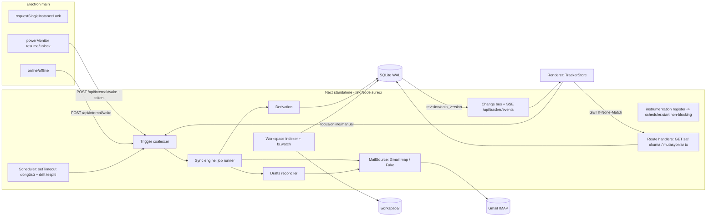
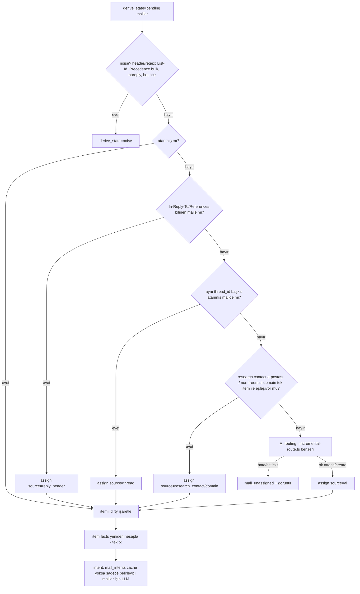
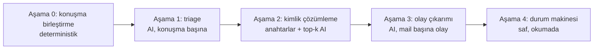
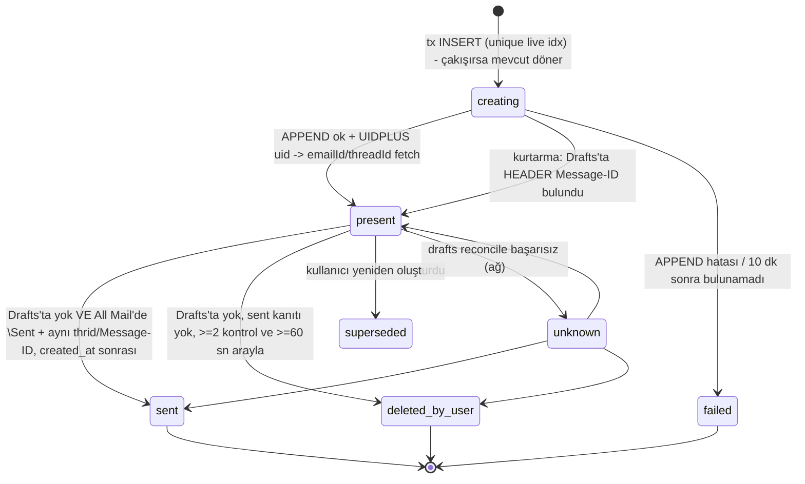
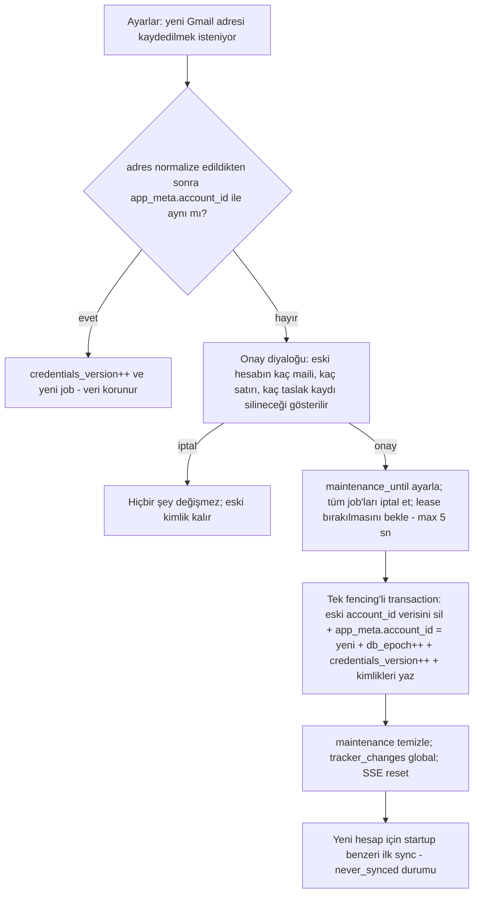

# CMAE Tracker — Senkronizasyon ve Veri Tazeliği Hedef Mimarisi

| | |
|---|---|
| **Tarih** | 2026-10-20 |
| **Durum** | Taslak / onaylanmış ürün kararlarıyla |
| **Kapsam** | Tracker listesi, Gmail senkronizasyonu, item türetme, mutasyonlar, değişiklik yayılımı, draft yaşam döngüsü |
| **Hedef** | Liste **her zaman** doğru ve güncel veriyi göstersin; asla yanıltmasın. Belirsizlik varsa açıkça gösterilsin. |

> Dosya:satır atıfları bu belgenin yazıldığı tarihteki çalışma ağacına (commit edilmemiş değişiklikler dahil) aittir. Kod değiştikçe kayabilir.

## İçindekiler

- [0. Özet](#0-özet)
- [Ürün kararları](#ürün-kararları)
- [1. Güven kontrolü](#1-güven-kontrolü)
  - [1.1 Önceki iddiaların doğrulanması](#11-önceki-iddiaların-doğrulanması)
  - [1.2 Yeni bulgular (mimari kararları etkileyenler)](#12-yeni-bulgular-mimari-kararları-etkileyenler)
  - [1.3 Fizibilite doğrulamaları](#13-fizibilite-doğrulamaları)
  - [1.4 Önceki öneride neyi değiştiriyorum](#14-önceki-öneride-neyi-değiştiriyorum)
- [2. Hedef mimari](#2-hedef-mimari)
  - [2.1 Temel ilkeler](#21-temel-ilkeler)
  - [2.2 Süreç topolojisi](#22-süreç-topolojisi)
  - [2.3 Veri modeli](#23-veri-modeli)
    - [2.3.1 Altyapı](#231-altyapı)
    - [2.3.2 Job'lar ve kilit](#232-joblar-ve-kilit)
    - [2.3.3 Mail katmanı](#233-mail-katmanı)
    - [2.3.4 Item katmanı](#234-item-katmanı)
    - [2.3.5 Draft ve workspace](#235-draft-ve-workspace)
    - [2.3.6 Mevcut verinin kayıpsız taşınması](#236-mevcut-verinin-kayıpsız-taşınması)
  - [2.4 Doğruluk kaynağı ve tazelik](#24-doğruluk-kaynağı-ve-tazelik)
  - [2.5 Sync motoru](#25-sync-motoru)
    - [2.5.1 Job durum makinesi](#251-job-durum-makinesi)
    - [2.5.2 Lease, heartbeat, stuck tespiti](#252-lease-heartbeat-stuck-tespiti)
    - [2.5.3 Tetikleyiciler, birleştirme ve zamanlama](#253-tetikleyiciler-birleştirme-ve-zamanlama)
    - [2.5.4 Atomik upsert + cursor (sıra garantisi)](#254-atomik-upsert--cursor-sıra-garantisi)
    - [2.5.5 Etiket, taşıma, silme, arşivleme](#255-etiket-taşıma-silme-arşivleme)
    - [2.5.6 Hata sınıfları](#256-hata-sınıfları)
  - [2.6 Item türetme](#26-item-türetme)
    - [2.6.1 Normal yol: kalıcı atama ve kirli kuyruk](#261-normal-yol-kalıcı-atama-ve-kirli-kuyruk)
    - [2.6.2 Açık yeniden gruplama: stable-id diff](#262-açık-yeniden-gruplama-stable-id-diff)
    - [2.6.3 Zamana bağlı status: okumada hesaplama](#263-zamana-bağlı-status-okumada-hesaplama)
    - [2.6.4 LLM intent önbelleği](#264-llm-intent-önbelleği)
    - [2.6.5 Konuşma bazlı sınıflandırma: Aşama 0 — konuşma birleştirme](#265-konuşma-bazlı-sınıflandırma-aşama-0--konuşma-birleştirme)
    - [2.6.6 Aşama 1: triage (AI)](#266-aşama-1-triage-ai)
    - [2.6.7 Aşama 2: kimlik çözümleme](#267-aşama-2-kimlik-çözümleme)
    - [2.6.8 Aşama 3: olay çıkarımı](#268-aşama-3-olay-çıkarımı)
    - [2.6.9 Aşama 4: durum makinesi](#269-aşama-4-durum-makinesi)
    - [2.6.10 Fingerprint önbelleği ve prompt_version](#2610-fingerprint-önbelleği-ve-prompt_version)
    - [2.6.11 Değerlendirme düzeneği (eval)](#2611-değerlendirme-düzeneği-eval)
  - [2.7 Mutasyonlar](#27-mutasyonlar)
    - [2.7.1 Gmail draft: tam olarak bir kez oluşturma](#271-gmail-draft-tam-olarak-bir-kez-oluşturma)
    - [2.7.2 Farklı Gmail hesabına geçiş (K2)](#272-farklı-gmail-hesabına-geçiş-k2)
  - [2.8 Değişikliğin yayılması](#28-değişikliğin-yayılması)
  - [2.9 Diskten türetilen durum](#29-diskten-türetilen-durum)
  - [2.10 Gözlemlenebilirlik ve test](#210-gözlemlenebilirlik-ve-test)
- [3. Edge-case kataloğu](#3-edge-case-kataloğu)
- [4. Uygulama yol haritası](#4-uygulama-yol-haritası)
  - [Faz 0: Acil güvenlik düzeltmeleri](#faz-0-acil-güvenlik-düzeltmeleri-mevcut-mimari-içinde-küçük-diffler)
  - [Faz 1: Migration çerçevesi, revision, SSE, ETag, istemci store](#faz-1-migration-çerçevesi-revision-sse-etag-istemci-store)
  - [Faz 2: Kalıcı job'lar, lease, zamanlayıcı, tazelik](#faz-2-kalıcı-joblar-lease-zamanlayıcı-tazelik)
  - [Faz 3: MailSource, All Mail, gm_msgid, etiketler, silinme](#faz-3-mailsource-all-mail-gm_msgid-etiketler-silinme)
  - [Faz 4: Derivation yeniden yazımı](#faz-4-derivation-yeniden-yazımı)
  - [Faz 5: Gmail draft yaşam döngüsü](#faz-5-gmail-draft-yaşam-döngüsü)
  - [Faz 6: Mutasyon katmanı](#faz-6-mutasyon-katmanı)
  - [Faz 7: Workspace indeksi](#faz-7-workspace-indeksi)
  - [Faz 8: Gecikme ve operasyon](#faz-8-gecikme-ve-operasyon)
- [5. Kalan belirsizlikler](#5-kalan-belirsizlikler)

---

## 0. Özet

Önerilen sisteme güvenim yüksek, ama birkaç önemli düzeltmeyle. Önceki analizin yük taşıyan iddialarının hepsi kodla birebir doğrulandı. Buna ek olarak, "listeyi yanıltıcı gösteren" ~16 yeni bulgu çıktı (bkz. §1.2). En kritikleri şunlar:

- macOS'ta pencere kapatılıp Dock'tan tekrar açıldığında **ikinci bir Next sunucusu** başlıyor ve aynı SQLite dosyasına iki süreç yazıyor.
- 45 saniyelik "takıldı" (stuck) kuralı, uzun süren LLM çağrısı sırasındaki **sağlıklı bir sync'i öldürüyor**.
- LLM hatasında mailler **sessizce listeden düşüyor** ve bir daha işlenmiyor.
- Onboarding reset, çalışan sync'i iptal etmiyor; eski veri boş veritabanına geri yazılıyor.

**Önerinin özü kalıyor:** kalıcı job + lease, atomik commit, revision + SSE + ETag, istemci store, Gmail All Mail ile kimlik.

**Çıkarılanlar:**
- `node-cron`
- Electron `utilityProcess` (ABI uyumsuzluğu)
- QRESYNC (Gmail desteklemiyor)

**Değiştirilenler:**
- "Stable-id diff rebuild" ana yol olmaktan çıkıyor. Yerine kalıcı mail→item atamaları geliyor; diff sadece açıkça istenen "AI ile yeniden grupla" için kullanılıyor.
- Status her okumada hesaplanıyor (computed-on-read).
- `notesJson` için atomik JSON yaması yerine, alanlar sütunlara/tablolara taşınıyor (kolon sahipliği).
- Draft kimliği konu (subject) yerine Message-ID / X-GM-MSGID ile belirleniyor.

---

## Ürün kararları

Aşağıdaki kararlar kullanıcı tarafından onaylanmıştır ve tasarımın ilgili bölümlerine işlenmiştir.

| # | Konu | Karar | Etkilenen bölümler |
|---|---|---|---|
| K1 | Gmail'de çöpe atılan / spam'e taşınan / kalıcı silinen mail | Mail **fact hesabında KALIR** (gönderilmiş bir başvuru ya da gelmiş bir red geri alınmış sayılmaz). Detay sayfasında **"Gmail'de silinmiş"** olarak işaretlenir. | §2.3.3 (`gone_at`), §2.5.5, §2.6.1, edge-case #40 |
| K2 | Farklı bir Gmail hesabına geçiş | Eski hesabın verisi kullanıcıdan **onay alınarak SİLİNİR** (gizleme yok). Onay diyaloğundan sonra, fencing'li bir maintenance transaction'ı içinde eski hesabın mailleri, atamaları, intent'leri, cursor'ları, draft kayıtları ve sadece o maillerden türeyen item'lar silinir. `account_id` kolonu, eski hesaba ait verinin yeni hesap verisine karışmasını engelleyen bir **koruma** olarak kalır. | §2.3.3, §2.3.6, §2.4, §2.5.2, §2.7, edge-case #30, Faz 6 |
| K3 | Birleştirmede kullanıcı alanı çakışması (seçili alıcı, inactive, vb.) | Kullanıcıya **SORULUR**; sessiz seçim yapılmaz. Çakışma çözülene kadar birleştirme uygulanmaz. | §2.6.2 adım 6, §2.7, Faz 4 / Faz 6 |

---

## 1. Güven kontrolü

### 1.1 Önceki iddiaların doğrulanması

| İddia | Sonuç | Kanıt |
|---|---|---|
| Sync sadece manuel; mount'ta sadece çalışan oturuma bağlanıyor | ✅ | `components/TrackerList.tsx:1513-1526` (toolbar), `1538-1551` (pending banner), `1790-1798` (boş durum), `725-745` (mount) |
| Focus/visibility sadece listeyi yeniliyor | ✅ | `TrackerList.tsx:544-558` |
| `node-cron` kullanılmıyor | ✅ | Sadece `package.json`'da var; kodda import yok |
| Electron standalone sunucuyu tek Node süreci olarak başlatıyor | ✅ | `desktop/main.cjs:324-355` (spawn `338`). Bundled `node` binary kullanılıyor (`main.cjs:266-272`), Electron'un kendi Node'u değil |
| SQLite WAL, `transaction(` hiç yok | ✅ | `lib/db/client.ts:26-28`; repo genelinde `transaction(` sıfır eşleşme. **Ek:** `busy_timeout` da yok |
| Session: `globalThis`, join-if-running, 45 sn stuck, 1,5 sn zorla iptal | ✅ | `lib/tracker/session.ts:11, 155-174, 188, 251-257` |
| Cursor, upsert'ten **önce** yazılıyor | ✅ ve daha kötü | `lib/tracker/imap.ts:555` cursor'ı yazıyor, `lib/tracker/sync.ts:182` upsert ediyor. INBOX cursor'ı SENT okunmadan önce commit ediliyor (`imap.ts:635-644` → `660`). SENT patlarsa veya süreç ölürse INBOX mailleri bellekte kalıp kayboluyor |
| Incremental patch: satır var ve yeni mail ≤ 25 | ✅ | `lib/tracker/run.ts:56-62`, `lib/tracker/incremental.ts:43` |
| Status sadece dokunulan satırlarda yeniden hesaplanıyor | ✅ | `incremental.ts:645-647` |
| Full rebuild: tüm inbox LLM'den geçiyor, DELETE + INSERT, id'ler kararsız | ✅ | `lib/tracker/rebuild.ts:92-127` (LLM), `170-171` (DELETE), `395-441` (INSERT); `lib/db/schema.ts:108-111` bunu açıkça kabul ediyor |
| `reconcile(force)` → `pruneOrphan` | ✅ | `run.ts:85-89` |
| GET `/api/tracker` IMAP'e gidiyor; debounce 12 sn ve zaman damgası IMAP'ten **sonra** yazılıyor | ✅ ve daha kötü | `app/api/tracker/route.ts:14`, `lib/tracker/pending-draft.ts:229-247, 285`. IMAP hatasında damga hiç yazılmıyor (`281-284`), yani çevrimdışıyken **her** GET yeniden IMAP'e gidiyor |
| Drafts taraması timeout'suz, `maxScan=120` en eski UID'lere uygulanıyor | ✅ | `imap.ts:825-855`. Ayrıca kendi yorumuyla çelişiyor: `imap.ts:248` "never FETCH {since}" diyor, ama `841`'de tam olarak bunu yapıyor |
| `listTrackerSections` satır başına diskten okuyor **ve DB'ye yazıyor** | ✅ | `lib/tracker/list.ts:58, 159` → `pending-draft.ts:186-216` |
| `drafts.ts` eski veriyle oku-değiştir-yaz yapıyor | ✅ | `lib/tracker/drafts.ts:153` okuyor → 4 adet `await` → `257` / `39` eski `item.notesJson` ile yazıyor |
| Diğer yazma yolları | ✅ | `inactive.ts:50, 83, 140-152`; `set-recipient.ts:49`; `agents/followup.ts:123, 340`; `light-merge.ts:38, 97`; `research/folder-refs.ts:33-66`; `research/events.ts:105-120` |
| İstemci `load()` sıra koruması yok; `busyId` tek değer | ✅ | `TrackerList.tsx:530-537`, `356` |

### 1.2 Yeni bulgular (mimari kararları etkileyenler)

1. **Çoklu süreç gerçek bir durum.** macOS'ta `activate` olayı `boot()`'u tekrar çağırıyor (`main.cjs:436-445`). `boot()` da `startProductionServer`'ı çağırıp `serverProcess` değişkenini **eskisini öldürmeden** üzerine yazıyor (`338`). Pencere kapatılınca sunucu çalışmaya devam ediyor (`432-434`), Dock'tan açılınca ikinci sunucu başlıyor. `requestSingleInstanceLock` de yok. Sonuç: iki ayrı `globalThis` var, yani iki ayrı "tek sync" kilidi, ama veritabanı tek. **Bu yüzden DB-seviyesi lease zorunlu.**
2. **45 sn kuralı sağlıklı sync'i öldürüyor.** LLM batch'i sürerken log satırı yazılmazsa (`mail-signals.ts:147`, `match.ts:384`) ikinci bir "Senkronize et" tıklaması sync'i abort edip baştan başlatıyor (`session.ts:157-174`).
3. **LLM'in timeout'u yok** (`lib/tracker/llm.ts:21`).
4. **LLM hatasında sessiz bozulma.**
   - Sınıflandırma hatası regex'e düşüyor (`mail-signals.ts:157-176`) ve hiçbir yerde işaretlenmiyor.
   - Gruplama hatasında tüm liste sezgisel (heuristic) gruplamayla yeniden kuruluyor (`match.ts:438-447`).
   - Bir batch parse edilemezse **o batch'in mailleri hiçbir gruba girmiyor ve listeden düşüyor** (`match.ts:422-424`).
5. **Patch başarısız olursa mailler bir daha işlenmiyor.** Upsert commit edildikten sonra patch/rebuild hata verirse, bu mailler bir sonraki sync'te "yeni" sayılmıyor (`insertedIds` sadece yeni eklenen satırları içeriyor, `sync.ts:103`). Incremental yolda kalıcı olarak dışarıda kalıyorlar.
6. **`lastSyncAt` erken yazılıyor.** Türetme (derivation) başlamadan önce yazılıyor (`sync.ts:203`). SENT hatası sadece loglanıyor (`imap.ts:671-679`) ve sync "başarılı" görünüyor. Kullanıcı yanlış biçimde "güncel" mesajı görüyor.
7. **Bozuk (poison) UID sessizce atlanıyor.** Bağlantı kopunca cursor, ölü UID'nin ötesine zorlanıyor (`imap.ts:454-459, 515-519`). O mail sessizce ve kalıcı olarak atlanıyor.
8. **Rebuild sırasında biten research satırı kayboluyor.** Research, rebuild'in LLM bekleme süresi içinde biterse light-merge satırı ekliyor (`light-merge.ts:38`). Rebuild ise aday listesini **önceden** almış (`rebuild.ts:105`) ve `170-171`'de her şeyi silip yeniden kuruyor. Yeni research satırı bir sonraki sync'e kadar görünmüyor.
9. **Onboarding reset sync'i iptal etmiyor.** `app/api/onboarding/reset/route.ts:10` → `lib/onboarding/reset.ts:22-55` meşgul kontrolü yapmıyor. Çalışan sync, silinen DB'ye eski hesabın verisini yazıyor.
10. **Draft eşleştirmesi alt-dize (substring) karşılaştırmasıyla yapılıyor** (`imap.ts:816-819`). "Application" gibi kısa konular yanlış satırlarla eşleşiyor. 120 sınırı en eskilere uygulandığı için yeni draft'lar görünmüyor ve pending yanlışlıkla temizlenebiliyor.
11. **"Inactive" ikiz birleştirme kullanıcı verisini yutuyor.** Aynı `primaryTo` (örneğin bir ajans recruiter'ı) veya benzer şirket adı, aktif satırın silinip inactive satıra yutulmasına yol açıyor (`inactive.ts:110-155`, `rebuild.ts:446-473`). Duraklatılmış şirkete yeni pozisyon başvurusu yapılırsa yeni başvuru gizleniyor.
12. **Kendine gönderilen mail ve sentetik Message-ID.** Aynı Message-ID hem INBOX'ta hem SENT'te olunca upsert her seferinde `folder` alanını çeviriyor (`sync.ts:70`). Message-ID başlığı yoksa sentetik id UID'ye bağlı (`imap.ts:217-219`); UIDVALIDITY değişince kopya satırlar oluşuyor.
13. **Yorum ile kod çelişiyor.** Yorum "bodyStructure + maxBytes" diyor (`imap.ts:693-697`), ama kod `source: true` ile ekler dahil tüm RFC822 içeriğini çekiyor (`imap.ts:281`). Takılma ve bellek riskinin kaynağı bu.
14. **Tarih kayabiliyor.** Date başlığı yoksa `new Date()` kullanılıyor (`imap.ts:215`) ve upsert `dateIso`'yu her seferinde güncelliyor (`sync.ts:75`). Hard sync'te mail tarihi "kayıyor".
15. **Eşleşmeyen SENT mailleri hiç takip edilmiyor.** Telefondan yeni bir şirkete gönderilen mail, incremental yolda hiçbir zaman satıra dönüşmüyor (`incremental.ts:561-571`).
16. **DST tutarsızlığı.** Geçen süre milisaniyeyle (`status.ts:62-66`), bir sonraki tarih ise yerel `setDate` ile hesaplanıyor (`status.ts:323-324`). DST geçişinde 1 saatlik tutarsızlık oluşuyor.

### 1.3 Fizibilite doğrulamaları

**`instrumentation.ts` / `register()`: ✅ çalışıyor.**
- Repoda zaten var (`instrumentation.ts`, `instrumentation.node.ts`).
- Standalone çıktıda `.next/standalone/.next/server/instrumentation.js` üretilmiş.
- `NextNodeServer.prepareImpl` → `ensureInstrumentationRegistered` çağrılıyor (`node_modules/next/dist/server/next-server.js:573-579`).
- Doküman: "called **once** when a new Next.js server instance is initiated, and **must complete before** the server is ready" (`node_modules/next/dist/docs/01-app/03-api-reference/03-file-conventions/instrumentation.md:18`).

Bunun üç sonucu var:
- `register()` içinde **beklemeden** (non-blocking) zamanlayıcı başlatılmalı.
- Instrumentation bundle'ı ile route bundle'ları ayrı modül örnekleri olabilir. Bu yüzden durum `globalThis`'te veya DB'de tutulmalı; mevcut kod da bu kalıbı kullanıyor (`session.ts:54-61`).
- Dev modda HMR'a karşı `globalThis` koruması gerekiyor.

**imapflow 2.4.0: ✅ büyük ölçüde destekliyor.**
- `emailId` ↔ X-GM-MSGID: `dist/cjs/commands/fetch.js:106-111`, `tools.js:862-868`
- `threadId` ↔ X-GM-THRID: `fetch.js:114-119`. Bugün zaten çekiliyor (`imap.ts:282`).
- `labels` ↔ X-GM-LABELS: `fetch.js:123-125`, `tools.js:876-878`
- `changedSince` (CONDSTORE): `fetch.js:183-202`, `types.d.ts:694`
- Opsiyonel `qresync` (`types.d.ts:99`, `imap-flow.js:1314`)
- IDLE: `idle()`, `maxIdleTime`, `missingIdleCommand`
- Gmail etiket araması (X-GM-RAW): `search-compiler.js:298-332`
- APPEND UIDPLUS ile `uid` / `uidValidity` döndürüyor: `types.d.ts:670-679`

**Gmail QRESYNC: ❌ kullanılamaz.** Gmail'in CAPABILITY listesinde CONDSTORE var, QRESYNC yok (bu bilgi kod dışı, kamuya açık davranış). Silme/taşıma tespiti için UID küme farkı (set diff) gerekiyor. Tasarımda çalışma anında CAPABILITY kontrolü yapılacak.

**better-sqlite3 transaction: ✅ var, ama senkron.**
- `db.transaction(fn)` (`@types/better-sqlite3/index.d.ts:62`) ve drizzle `transaction(tx => T)` (`drizzle-orm/better-sqlite3/session.d.ts:28-32`) mevcut.
- Callback **senkron olmak zorunda**. IMAP ve LLM işleri transaction dışında kalmalı. Desen her zaman şu: "dış iş → kısa transaction".
- `sqlite.backup()` migration öncesi yedek için kullanılabilir.

**Electron `utilityProcess`: ❌ bırakılıyor.**
- better-sqlite3, paketlenmiş `node` binary'sinin ABI'sine göre derleniyor (`scripts/prepare-desktop.mjs:87, 243`).
- `utilityProcess` Electron'un Node ABI'siyle çalışır. Native modülü ikinci kez derlemek gerekir; bu da paket boyutunu ve hata yüzeyini büyütür.
- Gerekirse yerine aynı bundled `node` ile ikinci bir child process açılabilir. Ancak IO ağırlıklı bu iş yükü için ayrı süreç gerekmiyor.

### 1.4 Önceki öneride neyi değiştiriyorum

| Önceki öneri | Karar | Gerekçe |
|---|---|---|
| `node-cron` ile zamanlama | **Çıkarıldı** | Duvar saati cron'u uyku/uyanma ve "son başarıdan bu yana" mantığına uymuyor. Yerine `setTimeout` döngüsü + saat sıçraması tespiti + backoff geliyor. Paket kaldırılabilir. |
| `utilityProcess` worker | **Çıkarıldı** | ABI uyumsuzluğu (§1.3) |
| QRESYNC | **Çıkarıldı** (Gmail için) | Desteklenmiyor; UID küme farkı + CONDSTORE kullanılacak |
| CONDSTORE ile etiket değişikliği | **Tutuldu, ama yedekli** | X-GM-LABELS değişikliğinin MODSEQ'i artırdığından emin değilim. Periyodik metadata taraması bunun yedeği olacak. |
| sync_jobs + lease/heartbeat | **Güçlendirildi** | Çoklu süreç gerçek (§1.2-1). Kilit, partial unique index ile DB'de tutulacak. |
| Stable-id diff rebuild (her sync'te) | **Değiştirildi** | Normal yolda yeniden gruplama yapılmayacak. Kalıcı `mail_assignments` olacak; diff sadece açıkça istenen "yeniden grupla" için. |
| Zamana bağlı status: okumada mı, ticker mı | **Okumada hesaplanacak** | Gerekçe §2.6.3 |
| `notesJson` için atomik güncelleme | **Değiştirildi** | Alanlar kolon/tablolara taşınacak (kolon sahipliği). JSON sadece AI notları için kalacak. |
| Draft reconcile: single-flight + timeout, GET dışında | **Tutuldu ve genişletildi** | Kimlik konu yerine Message-ID / X-GM-MSGID ile; `gmail_drafts` tablosu |
| Revision + SSE + ETag | **Tutuldu ve genişletildi** | Backfill için changelog; süreçler arası değişiklik tespiti için `PRAGMA data_version`; ETag'e zaman sınırı eklenecek |
| IMAP IDLE | **En son faza ertelendi, opsiyonel** | Doğruluk için gerekli değil, sadece gecikmeyi azaltıyor |
| **Yeni eklenenler** | — | `busy_timeout`; migration çerçevesi + yedek; hesap koruması (`account_id`) ve onaylı hesap değişimi silmesi (K2); reset için epoch fencing; `derive_state` kirli kuyruğu; bozuk mail tablosu; tazelik modeli; single-instance lock |

---

## 2. Hedef mimari

### 2.1 Temel ilkeler

1. **Gerçek kaynak Gmail'dir.** SQLite onun commit edilmiş bir yansımasıdır. Disk (workspace) research ve draft dosyalarının kaynağıdır. Diğer her şey türetilmiştir.
2. **Liste her zaman tutarlı bir anlık görüntüdür.** Kullanıcı yarım rebuild'i asla görmez. Her yazma tek bir transaction'dır.
3. **Belirsizlik gizlenmez, gösterilir.** "Sınıflandırılmadı", "Gmail'e ulaşılamıyor", "taslak doğrulanamadı" gibi durumlar sessizce tahminle doldurulmaz.
4. **Kolon sahipliği.** Sync sadece türetilmiş (derived) kolonlara yazar, kullanıcı aksiyonları sadece kullanıcı kolonlarına yazar. Böylece çakışma yapısal olarak ortadan kalkar.
5. **GET saf okumadır.** Ağa çıkmaz ve DB'ye yazmaz.
6. **Her yazma `tracker_revision`'ı artırır.** İstemci sadece daha yeni revizyonu kabul eder.
7. **Kullanıcı verisi hakkında sessiz karar verilmez.** Birleştirme çakışmaları ve hesap değişimi silmesi kullanıcıya sorulur (K2, K3).

### 2.2 Süreç topolojisi



- **Electron düzeltmeleri** (Faz 0):
  - `app.requestSingleInstanceLock()` eklenecek; `second-instance` olayında mevcut pencere öne getirilecek.
  - `activate` olayında sunucu çalışıyorsa sadece pencere oluşturulacak, `boot()` çağrılmayacak.
  - Sunucu çöküşü (`exit`, `main.cjs:351-354`) bir kez yeniden başlatılacak ve kullanıcıya bildirilecek.
- **Wake köprüsü.** Electron main, `powerMonitor.on('resume' | 'unlock-screen')` olaylarında `127.0.0.1:port/api/internal/wake` adresine `CMAE_INTERNAL_TOKEN` env'iyle POST atar. Sunucu tarafında savunma katmanı olarak drift tespiti de var: zamanlayıcı tikinde duvar saati beklenenden > 2× aralık ileri sıçradıysa "uyanma" sayılır.

### 2.3 Veri modeli

#### 2.3.1 Altyapı

```sql
-- Migration çerçevesi (ensureSchema'nın yerine; client.ts:108-271)
CREATE TABLE schema_migrations (version INTEGER PRIMARY KEY, applied_at TEXT NOT NULL);

CREATE TABLE app_meta (key TEXT PRIMARY KEY, value TEXT NOT NULL);
-- keys: tracker_revision (int), db_epoch (int, reset ve hesap değişiminde artar),
--       account_id (gmail adresinin normalize hali), credentials_version (int),
--       maintenance_until (iso | ''), schema_backup_path

-- Değişiklik günlüğü: SSE backfill + teşhis
CREATE TABLE tracker_changes (
  rev        INTEGER PRIMARY KEY,           -- = tracker_revision'ın yeni değeri
  at         TEXT NOT NULL,
  source     TEXT NOT NULL,                 -- sync|mutation|research|fs|drafts|migration|reset|account_switch
  kind       TEXT NOT NULL,                 -- upsert|delete|merge|global
  item_ids   TEXT NOT NULL DEFAULT '[]'     -- JSON; [] = global (tamamını yeniden çek)
);
-- Son 2000 satır tutulur; daha eskisi her job sonunda silinir.
```

Bağlantı açılışındaki pragmalar (`client.ts:26-28`'e eklenecek):

```sql
PRAGMA journal_mode = WAL;
PRAGMA foreign_keys = ON;
PRAGMA busy_timeout = 5000;
PRAGMA synchronous = NORMAL;
```

#### 2.3.2 Job'lar ve kilit

```sql
CREATE TABLE sync_jobs (
  id              TEXT PRIMARY KEY,               -- uuid
  kind            TEXT NOT NULL,                  -- mail_sync|drafts_reconcile|classify_retry|workspace_scan|regroup
  mode            TEXT NOT NULL DEFAULT 'incremental', -- incremental|window_rescan|hard
  state           TEXT NOT NULL,                  -- queued|running|succeeded|partial|failed|canceled|interrupted
  phase           TEXT,                           -- connecting|fetch:all|fetch:drafts|commit|derive|reconcile_drafts|finalize
  reasons         TEXT NOT NULL DEFAULT '[]',     -- birleştirilmiş tetikleyiciler: startup|interval|resume|manual|focus|post_mutation|idle|retry
  rerun_requested INTEGER NOT NULL DEFAULT 0,
  rerun_mode      TEXT,
  attempt         INTEGER NOT NULL DEFAULT 1,
  owner           TEXT,                           -- süreç örnek id'si (uuid + pid)
  db_epoch        INTEGER NOT NULL,               -- fencing
  credentials_version INTEGER NOT NULL,           -- fencing
  account_id      TEXT NOT NULL,                  -- fencing (K2)
  error_kind      TEXT,                           -- auth|network|throttle|server|llm|disk|db|stuck|bug|canceled_by_reset|canceled_by_account_switch
  error_message   TEXT,
  stats_json      TEXT,                           -- {fetched, committed, derived, needsClass, poison, gone}
  queued_at TEXT NOT NULL, started_at TEXT, heartbeat_at TEXT, progress_at TEXT,
  finished_at TEXT, next_retry_at TEXT
);
CREATE UNIQUE INDEX sync_jobs_one_running ON sync_jobs(kind) WHERE state = 'running';
CREATE INDEX sync_jobs_kind_state ON sync_jobs(kind, state, queued_at);
```

Kilidin kendisi partial unique index. İki süreç aynı anda `running` satırı oluşturamaz. Lease ise `heartbeat_at` ile tutulur (§2.5.2).

#### 2.3.3 Mail katmanı

```sql
-- mail_folder_cursors'ın yerine
CREATE TABLE mail_sources (
  account_id       TEXT NOT NULL,
  role             TEXT NOT NULL,      -- all|inbox|sent|drafts   (all = SPECIAL-USE \All)
  mailbox_path     TEXT NOT NULL,
  uid_validity     TEXT NOT NULL,
  last_uid         INTEGER NOT NULL DEFAULT 0,   -- sadece commit edilmiş en yüksek UID
  highest_modseq   TEXT,                         -- bigint string
  last_meta_scan_at TEXT,                        -- etiket/silinme taraması
  last_success_at  TEXT,
  last_error_kind  TEXT,
  PRIMARY KEY (account_id, role)
);

ALTER TABLE mail_messages ADD COLUMN account_id     TEXT;      -- koruma: yalnızca aktif hesabın verisi okunur/yazılır (K2)
ALTER TABLE mail_messages ADD COLUMN gm_msgid       TEXT;      -- X-GM-MSGID (emailId)
ALTER TABLE mail_messages ADD COLUMN labels_json    TEXT;      -- ["\\Inbox","\\Sent",...]
ALTER TABLE mail_messages ADD COLUMN direction      TEXT;      -- in|out|self (from adresine göre)
ALTER TABLE mail_messages ADD COLUMN internal_date  TEXT;      -- sunucu zamanı, kanonik sıralama
ALTER TABLE mail_messages ADD COLUMN header_date    TEXT;
ALTER TABLE mail_messages ADD COLUMN in_reply_to    TEXT;
ALTER TABLE mail_messages ADD COLUMN references_hdr TEXT;
ALTER TABLE mail_messages ADD COLUMN auto_flags     TEXT;      -- {autoSubmitted, bulk, listId, bounce}
ALTER TABLE mail_messages ADD COLUMN gone_at        TEXT;      -- All Mail'de artık yok (çöp/spam/silindi) — fact'te KALIR (K1)
ALTER TABLE mail_messages ADD COLUMN gone_reason    TEXT;      -- trash|spam|expunged|unknown
ALTER TABLE mail_messages ADD COLUMN derive_state   TEXT NOT NULL DEFAULT 'done';
                                   -- pending|done|needs_classification|noise
ALTER TABLE mail_messages ADD COLUMN body_state     TEXT NOT NULL DEFAULT 'ok'; -- ok|truncated|failed
CREATE UNIQUE INDEX mail_messages_gm_uq ON mail_messages(account_id, gm_msgid) WHERE gm_msgid IS NOT NULL;
CREATE INDEX mail_messages_thread_idx ON mail_messages(thread_id);
CREATE INDEX mail_messages_derive_idx ON mail_messages(derive_state) WHERE derive_state <> 'done';
CREATE INDEX mail_messages_msgid_idx ON mail_messages(message_id);
CREATE INDEX mail_messages_account_idx ON mail_messages(account_id);
-- Eski unique message_id index'i, gm_msgid backfill tamamlandıktan sonra non-unique'e çevrilir (Faz 3).

CREATE TABLE mail_fetch_failures (
  account_id TEXT NOT NULL, role TEXT NOT NULL, uid INTEGER NOT NULL,
  attempts INTEGER NOT NULL DEFAULT 1, last_error TEXT, first_at TEXT, last_at TEXT,
  abandoned INTEGER NOT NULL DEFAULT 0,
  PRIMARY KEY (account_id, role, uid)
);

CREATE TABLE mail_intents (
  mail_id        INTEGER PRIMARY KEY REFERENCES mail_messages(id) ON DELETE CASCADE,
  intent         TEXT NOT NULL,           -- human_reply|rejection|ack|auto_ack|ooo|click_action|optional_portal|non_job|bounce|unknown
  waiting_until  TEXT,
  confidence     REAL,
  source         TEXT NOT NULL,           -- ai|regex|header
  model          TEXT NOT NULL,
  prompt_version INTEGER NOT NULL,
  created_at     TEXT NOT NULL
);
```

**`account_id` bir korumadır (K2).** Hesap değişiminde eski hesabın verisi onayla **silinir**; `account_id` ise iki durumda karışmayı engeller:
1. Silme ile yeni hesabın ilk sync'i arasında hiçbir okuma/yazma yolunun eski satırları görmemesi.
2. Silme yarıda kalırsa (çökme), açılışta `account_id ≠ app_meta.account_id` satırların tespit edilip silmenin tamamlanması.

#### 2.3.4 Item katmanı

```sql
-- tracker_item_mails'in yerine: bir mail en fazla bir item'a ait (bugünkü uq (item_id, mail_id) buna izin vermiyordu)
CREATE TABLE mail_assignments (
  mail_id     INTEGER PRIMARY KEY REFERENCES mail_messages(id) ON DELETE CASCADE,
  item_id     INTEGER NOT NULL REFERENCES tracker_items(id),
  source      TEXT NOT NULL,     -- thread|reply_header|research_contact|domain|ai|user|legacy
  confidence  REAL,
  locked      INTEGER NOT NULL DEFAULT 0,   -- user kaynaklıysa 1: AI asla taşıyamaz
  assigned_rev INTEGER NOT NULL
);
CREATE INDEX mail_assignments_item_idx ON mail_assignments(item_id);

-- Atanamayan job maili (görünür kuyruk; asla sessizce düşmez)
CREATE TABLE mail_unassigned (
  mail_id INTEGER PRIMARY KEY REFERENCES mail_messages(id) ON DELETE CASCADE,
  reason  TEXT NOT NULL,         -- ai_unavailable|ambiguous|unmatched_outbound
  since   TEXT NOT NULL,
  attempts INTEGER NOT NULL DEFAULT 0
);

-- tracker_items: kullanıcı kolonları
ALTER TABLE tracker_items ADD COLUMN user_state         TEXT NOT NULL DEFAULT 'active'; -- active|inactive|dismissed
ALTER TABLE tracker_items ADD COLUMN selected_recipient TEXT;
ALTER TABLE tracker_items ADD COLUMN user_version       INTEGER NOT NULL DEFAULT 1;
-- türetilmiş "fact" kolonları (zamandan bağımsız)
ALTER TABLE tracker_items ADD COLUMN ai_status                 TEXT;
ALTER TABLE tracker_items ADD COLUMN last_meaningful_inbound_at TEXT;
ALTER TABLE tracker_items ADD COLUMN waiting_until             TEXT;
ALTER TABLE tracker_items ADD COLUMN last_intent               TEXT;
ALTER TABLE tracker_items ADD COLUMN flags_json                TEXT; -- {autoReply, ackOnly, clickAction, rejected, thanksSent, bounced}
ALTER TABLE tracker_items ADD COLUMN needs_classification      INTEGER NOT NULL DEFAULT 0;
ALTER TABLE tracker_items ADD COLUMN derived_version           INTEGER NOT NULL DEFAULT 1;
ALTER TABLE tracker_items ADD COLUMN derived_at                TEXT;
-- yaşam döngüsü
ALTER TABLE tracker_items ADD COLUMN origin_research_job_id TEXT;   -- light-merge idempotency
ALTER TABLE tracker_items ADD COLUMN deleted_at     TEXT;
ALTER TABLE tracker_items ADD COLUMN deleted_reason TEXT;           -- folder_deleted|merged|orphan|user
ALTER TABLE tracker_items ADD COLUMN merged_into_id INTEGER;
CREATE UNIQUE INDEX tracker_items_origin_job_uq ON tracker_items(origin_research_job_id)
  WHERE origin_research_job_id IS NOT NULL AND deleted_at IS NULL;
-- mevcut `status` kolonu geçiş boyunca "status_cached" olarak kalır (eski kod yolları okuyabilsin); liste kullanmaz.

CREATE TABLE item_lineage (old_id INTEGER, new_id INTEGER, kind TEXT, at TEXT); -- merge|split

-- Kullanıcıya sorulması gereken birleştirme çakışmaları (K3)
CREATE TABLE merge_proposals (
  id            TEXT PRIMARY KEY,
  winner_id     INTEGER NOT NULL REFERENCES tracker_items(id),
  loser_id      INTEGER NOT NULL REFERENCES tracker_items(id),
  origin        TEXT NOT NULL,          -- regroup|twin_suggestion|user
  conflicts_json TEXT NOT NULL,         -- [{field:'selected_recipient', winner:'a@x', loser:'b@y'}, {field:'user_state', ...}]
  state         TEXT NOT NULL,          -- pending|applied|rejected|stale
  created_rev   INTEGER NOT NULL,
  created_at    TEXT NOT NULL,
  resolved_at   TEXT
);

CREATE TABLE item_ops (                  -- satır bazlı uzun işlem kilidi (busyId + draft-inflight'ın yerine)
  item_id INTEGER NOT NULL, op TEXT NOT NULL,       -- prepare:follow_up, draft:application ...
  owner TEXT NOT NULL, started_at TEXT NOT NULL, expires_at TEXT NOT NULL,
  PRIMARY KEY (item_id, op)
);
```

#### 2.3.5 Draft ve workspace

```sql
CREATE TABLE gmail_drafts (
  id               TEXT PRIMARY KEY,                    -- uuid; X-CMAE-Draft-Id başlığına da yazılır
  item_id          INTEGER NOT NULL REFERENCES tracker_items(id),
  account_id       TEXT NOT NULL,                       -- K2 koruması
  kind             TEXT NOT NULL,                       -- application|follow_up|thanks|reply
  state            TEXT NOT NULL,                       -- creating|present|sent|deleted_by_user|failed|unknown|superseded
  message_id_hdr   TEXT NOT NULL,                       -- <cmae-{uuid}@cmae.local>
  gm_msgid         TEXT, gm_thrid TEXT, drafts_uid INTEGER, drafts_uidvalidity TEXT,
  subject          TEXT NOT NULL, to_addr TEXT NOT NULL, content_hash TEXT NOT NULL,
  created_at       TEXT NOT NULL, confirmed_at TEXT, last_seen_at TEXT, last_checked_at TEXT,
  missing_since    TEXT, missing_checks INTEGER NOT NULL DEFAULT 0,
  sent_mail_id     INTEGER REFERENCES mail_messages(id),
  error            TEXT
);
CREATE UNIQUE INDEX gmail_drafts_live_uq ON gmail_drafts(item_id, kind)
  WHERE state IN ('creating','present','unknown');

CREATE TABLE workspace_files (
  folder TEXT NOT NULL, name TEXT NOT NULL, kind TEXT,   -- email|follow_up_n|thanks|reply|contact|summary|other
  mtime_ms INTEGER, size INTEGER, subject TEXT,
  PRIMARY KEY (folder, name)
);
CREATE TABLE workspace_folders (folder TEXT PRIMARY KEY, present INTEGER NOT NULL, scanned_at TEXT);
```

`has_*_draft` kolonları bundan sonra yazılmaz. Bu bayraklar okuma anında `workspace_files` ve `gmail_drafts` tablolarından türetilir.

#### 2.3.6 Mevcut verinin kayıpsız taşınması

Her migration, `sqlite.backup()` ile `cmae.db.pre-v{n}` yedeği aldıktan sonra **tek transaction içinde** çalışır.

1. **`mail_folder_cursors` → `mail_sources`.** `INBOX` satırı `inbox`, `SENT` satırı `sent` olur. `account_id` = `settings.gmail_address` (lowercase).
2. **`mail_messages`.**
   - `account_id` mevcut `settings.gmail_address` ile doldurulur. Bugün hesap kapsamı olmadığı için, geçmişte hesap değiştirmiş bir kullanıcının DB'sinde eski hesabın mailleri de olabilir; bunlar ayırt edilemez ve mevcut hesaba yazılır. Bu bilinen bir sınırlamadır (§5).
   - `direction`, `from_addr` kullanıcı adresine eşitse `out`, değilse `in` olur.
   - `derive_state='done'` (mevcut satırlar zaten türetilmiş).
   - `gm_msgid` boş kalır. Pencere içindeki mailler bir sonraki sync'te `message_id` eşleşmesiyle doldurulur; pencere dışındakiler eski kimlikle kalır.
3. **`tracker_item_mails` → `mail_assignments`** (`source='legacy'`). Bir mail birden çok item'a bağlıysa çatışma vardır: en çok maile sahip item kazanır, diğerleri `mail_unassigned(reason='ambiguous')` olur ve loglanır.
4. **`status='inactive'` satırları** `user_state='inactive'` olur. `notesJson.statusBeforeInactive` artık gerekmiyor çünkü status okumada hesaplanıyor; anahtar silinmez, sadece okunmaz.
5. **`notesJson.selectedRecipient`** (`recipients.ts` içindeki anahtar) `selected_recipient` kolonuna taşınır.
6. **`notesJson.pendingGmailDraft`** → `gmail_drafts(state='unknown', subject, kind, created_at=at, message_id_hdr='legacy:'+uuid)`. İlk draft reconcile çalıştığında bu kayıt konu + alıcı ile (bir kereliğine, düşük güvenle) `present` veya `deleted_by_user` durumuna çözülür.
7. **Fact kolonları** ilk derivation'da doldurulur. O zamana kadar liste `status_cached`'i "doğrulanmadı" rozetiyle gösterir.
8. **`tracker_timelines`** fingerprint tabanlı olduğu için olduğu gibi kalır.

**Rollback stratejisi:**
- Faz 1-5 boyunca migration'lar sadece **ekleme** yapar (yeni tablo/kolon). Eski uygulama sürümü yeni kolonları görmezden gelerek çalışmaya devam eder.
- Yıkıcı adımlar (eski unique index'in düşürülmesi, `tracker_item_mails`'in silinmesi, `has_*` kolonları) en son faza bırakılır ve `version-policy.json` ile minimum sürüm zorlanır.
- Ciddi bir hatada, ayarlardaki "Önceki veritabanını geri yükle" seçeneği `pre-v{n}` yedeğini geri koyar.

### 2.4 Doğruluk kaynağı ve tazelik

| Veri | Yetkili kaynak | Yerel temsil | Nasıl güncellenir |
|---|---|---|---|
| Mailler, etiketler, thread'ler | Gmail (yalnızca **aktif** hesap) | `mail_messages`, `mail_sources` | Mail sync job'u |
| Gmail Drafts varlığı | Gmail | `gmail_drafts` | Drafts reconcile job'u |
| Research ve draft dosyaları | Disk | `workspace_files`, `workspace_folders` | Yazma anında indeks + `fs.watch` + periyodik tarama |
| Kullanıcı tercihleri (inactive, alıcı) | SQLite | Kullanıcı kolonları | Mutasyon transaction'ları |
| Gruplama (mail → item) | SQLite (türetilmiş, ama kalıcı) | `mail_assignments` | Derivation, kullanıcı |
| Intent | SQLite önbelleği | `mail_intents` | Derivation / classify_retry |
| Etkin status, sıralama, bölümler | **Saklanmaz** | — | Her okumada `effective(facts, settings, now)` ile |

Bütün okuma yolları `account_id = app_meta.account_id` filtresiyle çalışır. Böylece onaylı silme tamamlanmadan önce eski hesaba ait bir satır listede asla görünmez (K2).

**Tazelik tanımı:**
- `dataAsOf`: Mail ve drafts kaynaklarının **tam başarılı** (derivation dahil) son job'larının en eskisi.
- **Güncel:** `now - dataAsOf ≤ 2 × aktif aralık` (ön planda 5 dk → 10 dk).
- **Eskimiş:** Bu eşiğin üstünde.
- **Çok eskimiş:** 24 saatin üstünde.

**UI durumları ve metin niyeti** (i18n anahtarları `tracker.freshness.*`):

| Durum | Koşul | Gösterim (örnek TR) |
|---|---|---|
| `never_synced` | Hiç başarılı job yok | Boş liste yerine: "İlk senkronizasyon yapılıyor — son 30 gün taranıyor (120/480)". Asla "Henüz kayıt yok" denmez. |
| `fresh` | Yukarıdaki tanım | Küçük gri metin: "2 dk önce güncellendi" |
| `syncing` | Job `running` | "Güncelleniyor… (Gelen kutusu 50/120)". Liste son commit'teki haliyle **tam** görünür. |
| `stale_offline` | Son hata `network` | Amber: "Gmail'e ulaşılamıyor. Liste en son 14:05 itibarıyla doğru; yeni yanıtlar görünmüyor olabilir." + "Tekrar dene" |
| `auth_failed` | Son hata `auth` | Kırmızı: "Gmail girişi reddedildi — uygulama şifresini yenileyin. Otomatik senkronizasyon durduruldu." + "Ayarlar" |
| `partial` | Bir kaynak başarısız (örn. drafts) | Amber: "Mailler güncel; Gmail taslak durumu 1 saattir doğrulanamadı." |
| `ai_degraded` | `needs_classification > 0` veya `mail_unassigned > 0` | Bilgi bandı: "3 mail henüz sınıflandırılmadı — ilgili satırların durumu geçici." Satır rozeti: "Doğrulanmadı" |
| `throttled` | Gmail limit | "Gmail geçici olarak istekleri sınırladı; 15 dk sonra tekrar denenecek." |
| `account_switching` | Hesap değişimi silmesi sürüyor | "Önceki hesabın verileri siliniyor…" (liste geçici olarak kilitli) |
| `merge_pending` | `merge_proposals.state='pending'` var | Bilgi bandı: "2 birleştirme kararınızı bekliyor" + "İncele" |
| Satır: `updating` | Satırın kirli (dirty) maili var ve job çalışıyor | Satırda küçük spinner: "Güncelleniyor" |
| Satır: draft | `gmail_drafts.state` | "Gmail'de taslak (1 dk önce doğrulandı)" / "Taslak durumu bilinmiyor" / "Taslak Gmail'den silinmiş" |
| Detay: mail | `gone_at` dolu | Mail kartında "Gmail'de silinmiş" etiketi; fact'lere katkısı sürer (K1) |

**Kural:** Bir veri tahmine dayanıyorsa (regex yedeği, legacy konu eşleşmesi) UI bunu söyler.

### 2.5 Sync motoru

#### 2.5.1 Job durum makinesi

```mermaid
stateDiagram-v2
  [*] --> queued: trigger (birleştirilmiş)
  queued --> running: lease alındı (BEGIN IMMEDIATE + partial unique)
  queued --> canceled: reset / hesap değişimi
  running --> succeeded: tüm kaynaklar + derivation commit
  running --> partial: mail OK, drafts/LLM kısmen başarısız
  running --> failed: auth|network|throttle|disk|db|stuck|bug
  running --> canceled: kullanıcı iptali / reset / kimlik veya hesap değişimi (fencing)
  running --> interrupted: heartbeat süresi doldu (süreç öldü/uyudu)
  failed --> queued: retry (backoff; auth hariç)
  interrupted --> queued: otomatik devam (cursor commit noktasından)
  partial --> queued: classify_retry / drafts_reconcile ayrı job olarak
  succeeded --> queued: rerun_requested=1 ise hemen bir tane daha
  succeeded --> [*]
  canceled --> [*]
```



**Faz sırası (`mail_sync`):** `connecting → fetch:all (veya inbox+sent) → meta_scan (periyodik) → derive → reconcile_drafts → finalize`

- Her `fetch` batch'i kendi kısa transaction'ında commit edilir.
- `derive` adımı kirli kuyruğu tüketir ve kendi transaction'larında çalışır.
- `finalize`, `mail_sources.last_success_at` değerini ve job `state`'ini yazar ve revision'ı artırır.

#### 2.5.2 Lease, heartbeat, stuck tespiti

- **Edinme** (tek `BEGIN IMMEDIATE` içinde):
  1. `heartbeat_at < now-30s` olan `running` job'lar `interrupted` yapılır.
  2. `queued` job `running`'e çekilir (`owner`, `db_epoch`, `credentials_version`, `account_id` yazılır).
  3. Partial unique index ikinci bir `running`'i engeller.
  4. `app_meta.maintenance_until` geleceği gösteriyorsa job açılmaz.
- **Heartbeat:** 5 sn'de bir `heartbeat_at` güncellenir. Laptop uykudayken heartbeat durur. Uyanınca 30 sn eşiği geçilmişse ve başka süreç devralmamışsa, aynı sahip `owner` eşleşmesiyle devam edebilir. Ancak IMAP soketi büyük olasılıkla ölü olduğundan job abort edilip `interrupted → queued` yapılır.
- **Stuck tespiti log satırına değil, ilerlemeye bakar.** Her fazın bir bütçesi ve `progress_at`'i var:
  - IMAP batch: 180 sn (mevcut `FETCH_BATCH_MS`, `imap.ts:19`)
  - LLM çağrısı: 90 sn × 2 deneme
  - Derivation transaction'ı: 10 sn

  Bütçe aşılırsa `AbortController` tetiklenir ve job `failed(stuck)` olur. **Kullanıcı tıklaması asla sağlıklı bir job'u öldürmez**; tıklama sadece "katıl" anlamına gelir.
- **Fencing:** Her yazma transaction'ının başında `app_meta.db_epoch == job.db_epoch && credentials_version == job.credentials_version && account_id == job.account_id` kontrol edilir. Eşleşmezse `throw FencedError` olur ve job `canceled`'a düşer. Bu, reset ve hesap değişiminde eski job'un yazmasını kesin olarak engeller.

#### 2.5.3 Tetikleyiciler, birleştirme ve zamanlama

`requestSync({reason, mode})` şöyle davranır:
- `running` job varsa → `rerun_requested=1`, `rerun_mode=max(mode)`, `reasons` listesine ekleme. Yeni job açılmaz.
- `queued` job varsa → nedenler birleştirilir.
- Hiçbiri yoksa → `queued` job oluşturulur.

Manuel olmayan tetikleyicilerde 3 sn debounce uygulanır.

| Tetikleyici | Ne zaman | Mod | Not |
|---|---|---|---|
| `startup` | `register()`'dan 2 sn sonra | incremental | Önce kurtarma: eski `running` → `interrupted`; yarım kalmış hesap değişimi silmesi tamamlanır |
| `interval` | Son başarıdan bu yana: pencere görünürse 5 dk, gizliyse 15 dk (renderer visibility bildirir) | incremental | ±10% jitter |
| `resume` | `powerMonitor` + drift tespiti | incremental | Önce eski IMAP bağlantıları kapatılır |
| `focus` / `online` | Renderer | incremental | Son başarı < 60 sn ise yok sayılır |
| `manual` | Butona tıklama | incremental / hard | Her zaman katılır; hard ise yükseltir |
| `post_mutation` | Draft oluşturma, "gönderildi" tespiti | `drafts_reconcile` (+ 60 sn sonra mail) | Gmail'den gönderimi hızlı yakalamak için |
| `idle` | Faz 8, IMAP IDLE `exists` | incremental | 10 sn debounce |
| `retry` | `next_retry_at` | Önceki mod | Backoff: 1, 2, 5, 15, 30 dk (max) |

- `auth` hatasında otomatik retry yapılmaz. `credentials_version` değişene kadar zamanlayıcı mail job'u açmaz.
- `drafts_reconcile` ayrı bir job türüdür. Mail sync'in sonunda çalışır; pending draft varsa ek olarak 2 dk'da bir çalışır.

#### 2.5.4 Atomik upsert + cursor (sıra garantisi)

Gmail'de `\All` mailbox'ı vardır; yoksa INBOX + Sent'e düşülür. Her 50 UID'lik batch için:

```text
1. FETCH (IMAP, tx dışında): uid, emailId, threadId, labels, flags, internalDate, envelope,
   headers[In-Reply-To, References, Auto-Submitted, Precedence, List-Id, Content-Type],
   bodyParts: text/plain|text/html  maxBytes=64KB   ← source:true KALDIRILIR (imap.ts:281)
2. BEGIN IMMEDIATE (fencing kontrolü: epoch + credentials_version + account_id)
     upsert mail_messages  ON CONFLICT(account_id, gm_msgid)   -- yoksa message_id ile eşle ve gm_msgid'yi doldur
       yeni satır veya içerik değişti → derive_state='pending'
       sadece etiket değişti → derive_state='pending' (status etkileyebilir), body korunur
     başarısız UID'ler → mail_fetch_failures (attempts++)
     mail_sources.last_uid = max(contiguous committed uid)     -- atlanan UID varsa ondan önceye kadar
     bumpRevision('sync', [])   -- sadece pending varsa
   COMMIT
```

- **Contiguous kuralı:** UID 101 alınamadıysa ve 102-150 alındıysa, 102-150 yine commit edilir ama `last_uid` 100'de kalır. Bir sonraki tur 101'i tekrar dener; 102-150'yi yeniden alması upsert idempotent olduğu için zararsızdır.
- **Bozuk mail:** 3 denemeden sonra `abandoned=1` olur, `last_uid` ilerleyebilir ve UI'da "1 mail okunamadı (konu: …)" görünür. Bugünkü sessiz atlama (`imap.ts:454-459`) kaldırılır.
- **Yön:** `from` kullanıcı adresi veya alias ise `out`, aynı zamanda `to` kullanıcıysa `self`. Folder/etiket yönü belirlemez. Bu, kendine gönderilen mailde folder'ın çevrilmesi sorununu çözer.
- **Tarih:** `internal_date` kanoniktir; `header_date` gösterim için tutulur. `new Date()` yedeği kaldırılır.

#### 2.5.5 Etiket, taşıma, silme, arşivleme

- **All Mail** arşivlenmiş ve filtrelenmiş mailleri de içerir. Bugünkü INBOX+SENT modeli bunları hiç görmüyor.
- **Etiket değişikliği:** CONDSTORE varsa `fetch('1:*', {uid, labels, flags}, {changedSince: highest_modseq})` kullanılır.
- **Silinme (çöp/spam/kalıcı):** Gmail QRESYNC desteklemediği için pencere başına periyodik (her 6 saatte bir veya `window_rescan` modunda) `UID SEARCH SINCE <pencere>` küme farkı alınır. Eksik olanlar `gone_at` ve `gone_reason` ile işaretlenir.
  - **Ürün kararı K1:** `gone` mailler fact hesabında **kalır**; gönderilmiş bir başvuru ya da gelmiş bir red geri alınmış sayılmaz. Detay sayfasında **"Gmail'de silinmiş"** olarak gösterilir. Satır silinmez, status değişmez. Spam'e taşınan inbound mail için intent yeniden değerlendirilebilir; ancak mail yine fact'ten çıkarılmaz.
  - Mail Gmail'de geri yüklenirse (çöpten çıkarılırsa) bir sonraki küme farkı taramasında `gone_at` temizlenir.
- **UIDVALIDITY değişimi:** Anahtar `gm_msgid` olduğu için kopya oluşmaz. `last_uid=0` yapılır ve pencere yeniden taranır; UID eşlemeleri güncellenir.
- **All Mail IMAP'te gizliyse** (Gmail ayarı): INBOX+Sent'e düşülür ve UI'da kalıcı bir bilgi gösterilir ("Arşivlenen mailler görünmeyebilir — Gmail > Etiketler > All Mail'i IMAP'te göster").

#### 2.5.6 Hata sınıfları

| Sınıf | Tespit | Davranış | UI |
|---|---|---|---|
| auth | imapflow `authenticationFailed` / `AUTHENTICATIONFAILED` | `failed(auth)`, zamanlayıcı durur, GET hiçbir zaman IMAP'e gitmez | Kırmızı banner |
| network | ECONNRESET, ENOTFOUND, timeout | Backoff | Amber "Gmail'e ulaşılamıyor" |
| throttle | `[THROTTLED]`, `Too many simultaneous connections`, bant limiti | 15-60 dk backoff, tek bağlantı havuzu | Amber |
| server | Diğer NO/BAD | 2 retry, sonra `failed(server)` | Amber |
| llm | Timeout / 429 / parse hatası | Job **başarısız olmaz**: mailler `needs_classification`, `classify_retry` job'u | Bilgi bandı + satır rozeti |
| disk | SQLITE_FULL / ENOSPC | Transaction rollback, `failed(disk)` | Kırmızı: "Disk dolu — veriler güncellenemiyor" |
| db | SQLITE_BUSY (busy_timeout sonrası) | 3 retry, sonra `failed(db)` | Amber |
| kimlik / hesap değişimi | Fencing | `canceled`; yeni kimlikle yeni job | — |

IMAP bağlantı yönetimi: süreç başına en fazla 2 bağlantı olur (1 sync/drafts, 1 IDLE). Bugün her GET ayrı bir bağlantı açabiliyor (`pending-draft.ts:277`).

### 2.6 Item türetme

#### 2.6.1 Normal yol: kalıcı atama ve kirli kuyruk



- **25 eşiği kalkıyor** (`incremental.ts:43`). Her zaman artımlı çalışılır; büyük girişlerde 200'lük parçalar halinde.
- **Sadece belirleyici mailler sınıflandırılır:** her item'ın son inbound maili, son anlamlı inbound adayı ve atanmamış inbound mailler. Bugün full rebuild'de tüm inbox LLM'den geçiyor (`rebuild.ts:115`).
- **Fact hesaplama** item başına saftır (pure): `facts = computeFacts({ assignedMails, intents, events, researchCandidate })`. Çıktının çekirdeği mail başına olay zaman çizelgesidir (§2.6.8); `tracker_items.events_json` olarak saklanır. Eski `resolveStatus` (`status.ts`) kaldırıldı; zamana bağlı her şey `effective()` içindedir (§2.6.9). `gone_at` dolu mailler hesaba **dahildir** (K1).
- **Kullanıcı kolonları asla yazılmaz.** Derivation `user_state`, `selected_recipient` ve kullanıcı atamalarına (`locked=1`) dokunmaz.
- **İkiz birleştirme otomatik olmaktan çıkıyor.** `collapseInactiveActiveTwins` (`inactive.ts:110`) kaldırılır. Aynı kimlik şüphesi bir `merge_proposals(origin='twin_suggestion')` kaydı olarak "Bu iki satır aynı şirket olabilir — birleştir?" önerisiyle gösterilir. E-posta eşleşmesi tek başına asla birleştirme sebebi değildir.
- **Atama konuşma düzeyindedir** (§2.6.5): bir konuşmanın herhangi bir maili bir item'a bağlıysa, konuşmanın atanmamış tüm mailleri (SENT dahil) aynı transaction'da o item'a bağlanır.
- **Eşleşmeyen giden mailler** önce ertelenir; bütün parçalar işlendikten sonra konuşma birleştirme yeniden çalışır ve hâlâ bağlanamayanlar `mail_unassigned(reason='unmatched_outbound')` olur. Bu kuyruk her derive başında yeniden denenir. UI'da "Takip edilmeyen 2 gönderilmiş mail — satır oluştur?" diye sorulur. (Eski `incremental.ts` / `patchTrackerWithNewMails` yolu kaldırıldı.)

#### 2.6.2 Açık yeniden gruplama: stable-id diff

Bu yol sadece "AI ile yeniden grupla" aksiyonunda veya prompt sürümü büyük değiştiğinde çalışır. LLM önerisi `G` gruplarıdır; mevcut item'lar `I`.

1. **Ağırlık:** `w(g,i) = 1.0·[aynı origin_research_job_id] + J(threads(g), threads(i)) + 0.3·[aynı primary e-posta]`. Burada `J`, thread küme Jaccard benzerliğidir.
2. **Eşleştirme:** Açgözlü (greedy) maksimum ağırlıklı eşleştirme, eşik 0.35. Satır sayısı yüzlerle sınırlı olduğu için O(n·m) yeterli.
3. Eşleşen çift → **yerinde güncelleme** (id korunur).
4. Eşleşmeyen yeni grup → yeni item.
5. **Bölünme:** Eski bir item iki gruba dağılırsa en büyük örtüşme id'yi korur, diğeri yeni id alır ve `item_lineage(split)` yazılır. Kullanıcı alanları (seçili alıcı, inactive) id'yi koruyan item'da kalır; yeni item'a kopyalanıp kopyalanmayacağı kullanıcıya sorulur (K3).
6. **Birleşme (K3):** İki eski item tek gruba giderse:
   - Kullanıcı alanlarında çakışma **yoksa** (en fazla bir tarafta değer var veya değerler aynı), birleşme uygulanır: kazanan id'yi korur, diğeri `deleted_at`, `deleted_reason='merged'`, `merged_into_id` alır ve `item_lineage(merge)` yazılır.
   - Çakışma **varsa** (örn. iki farklı `selected_recipient`, biri `inactive` diğeri `active`, iki farklı canlı draft), birleşme **uygulanmaz**. `merge_proposals(state='pending', conflicts_json)` oluşturulur ve kullanıcıya her çakışan alan için hangi değerin kalacağı sorulur. **Sessiz seçim yapılmaz.** Kullanıcı yanıt verene kadar iki satır ayrı kalır ve her ikisinde "Birleştirme kararınızı bekliyor" rozeti görünür.
   - Kullanıcı yanıtı tek bir transaction'da uygulanır. Bu sırada satırlardan biri değiştiyse (`created_rev` sonrası `user_version` artmışsa) teklif `stale` olur ve yeniden sorulur.
7. Eşleşmeyen eski item'ın kullanıcı izi varsa (inactive, seçili alıcı, draft) korunur.
8. `locked=1` atamalar AI tarafından taşınmaz.
9. **Önizleme:** Diff önce kullanıcıya gösterilir ("4 satır güncellenecek, 1 birleşecek, 1 birleştirme kararınızı bekliyor, 2 yeni"). Onay sonrası çakışmasız kısım **tek transaction** ile uygulanır.

#### 2.6.3 Zamana bağlı status: okumada hesaplama

Seçim **okumada hesaplama**. Gerekçeler:
- Herhangi bir anda doğrudur. Laptop uykudan çıktığında, follow-up günleri ayarı değiştiğinde veya gün döndüğünde anında doğru sonucu verir; bugün bunların hepsi sync'i bekliyor (`status.ts:62, 214, 318`).
- Satır sayısı yüzlerle sınırlı; saf fonksiyon olarak hesaplaması < 5 ms.
- Ticker DB'ye yazmaz; revision gürültüsü ve yazma çakışması üretmez.

```text
effective(facts, user_state, settings, now) -> { status, waitingOn, nextFollowUpAt, nextTransitionAt }
```

- `settings` = `followUpDays`, `rejectionCloseDays` (varsayılan 10), `staleCloseDays` (varsayılan 20). Liste, detay API'si ve inactive yolu dahil `effective()`'i çağıran her yer aynı ayarları okur. Kurallar §2.6.9'dadır.

- `nextTransitionAt`: Bu satırın status'unun kendiliğinden değişeceği en yakın an (follow-up zamanı, OOO bitişi, rejected → closed vb.).
- GET yanıtı `validUntil = min(nextTransitionAt)` döndürür. İstemci bu ana bir zamanlayıcı kurar ve `If-None-Match` ile yeniden ister. Sunucu ayrıca bu ana bir `tick` SSE olayı planlar.
- `user_state='inactive'` bir kaplamadır (overlay): status `inactive` gösterilir ama fact'ler hesaplanmaya devam eder. Aktive edilince eski status'u saklamaya gerek kalmadan doğru status görünür.
- **Tarih aritmetiği tek bir yardımcıda toplanır:** "N gün" = kullanıcının saat dilimindeki takvim günü (Intl ile). Geçen süre ve hedef tarih aynı fonksiyonla hesaplanır, DST tutarsızlığı biter.
- **Saat kayması:** Yeni gelen mailin `internal_date` değeri yerel saatten > 10 dk ilerideyse veya gerideyse tanılama uyarısı verilir.

#### 2.6.4 LLM intent önbelleği

- Anahtar: `(mail_id, prompt_version, model)`. `prompt_version` koddaki bir sabittir; prompt değişince artırılır.
- **Geçersiz kılma:** Sürüm uyuşmazlığında hepsi birden değil, sadece **belirleyici** mailler tembel (lazy) olarak yeniden sınıflandırılır.
- Hard sync önbelleği bypass eder.
- `source='header'`: `Auto-Submitted: auto-replied` (RFC 3834) veya `multipart/report; report-type=delivery-status` (bounce) deterministik olarak belirlenir; LLM'e gerek kalmaz.
- `source='regex'` sonucu **geçici** sayılır: item'da `needs_classification=1` olur ve `classify_retry` job'u backoff ile tekrar dener.
- Her LLM çağrısına 90 sn timeout konur (`llm.ts:21` sarmalanır) ve geçersiz JSON şemayla (zod) reddedilir.
- Konuşma bazlı hatta (§2.6.5–§2.6.9) `mail_intents` yalnızca **geri dönüş** (fallback) kaynağıdır: Aşama 3'ün `mail_events` kaydı olmayan inbound mailler için intent → olay eşlemesi kullanılır.

#### 2.6.5 Konuşma bazlı sınıflandırma: Aşama 0 — konuşma birleştirme

Mail başına tek tek sınıflandırma; bir başvurunun gönderimini, onayını, takip mailini ve reddini aynı süreç olarak göremiyordu (yinelenen satırlar, satıra bağlanmayan SENT mailleri, yanlış status). Yeni hat beş aşamadır:



**Aşama 0** (`lib/tracker/derive/conversations.ts`, saf kısım `conversation-graph.ts`) deterministiktir ve LLM kullanmaz:

- Union-find: aynı Gmail `thread_id` → aynı konuşma; `In-Reply-To` / `References` içindeki message-id'ler bilinen bir maile işaret ediyorsa birleştirilir. Konuşma anahtarı `account|t:<en küçük thread_id>` veya `account|m:<en küçük mail id>` olur.
- `mail_conversations(id, account_id, thread_key, mail_ids, fingerprint, item_id)` her derive başında ve sonunda güncellenir; değişmeyen satır yazılmaz.
- **Konuşma düzeyinde atama:** konuşmada atanmış mail varsa çoğunluk item'ı (eşitlikte küçük id) konuşmanın sahibidir; atanmamış mailler `source='thread'` ile o item'a tek transaction'da bağlanır ve `mail_unassigned` kayıtları silinir. Atanmış bir mail asla taşınmaz (bölme/birleştirme §2.6.2'nin işidir).
- `fingerprint = sha256(sıralı mail id'leri | en son mail zamanı)`; Aşama 1 ve 3 önbelleklerinin anahtarıdır (§2.6.10).
- **Sıra** (`derivePendingMails`, `lib/tracker/derive/run-derive.ts`): derive başında onarım (`repairConversations`) → kirli mailler için yalnızca yapısal atama (`reply_header` / `thread`; domain/kişi eşleştirmesi artık Aşama 2'nin işi) → `runConversationStages` (`lib/tracker/derive/stages.ts`: Aşama 1 → 2 → 3) → yeniden konuşma onarımı → dokunulan item'ların fact'leri (Aşama 4 girdisi) yenilenir → birleştirme önerileri. Sadece `List-Id` / bulk başlıklı konuşmalar AI'ya gitmeden gürültü sayılır. İlk çalıştırmada tek seferlik (`app_meta: derive_events_timeline_v1`) tüm canlı item'lar yenilenir ki `events_json` dolsun. Eski mail başına AI yönlendirme (`incremental-route`) kaldırıldı.

#### 2.6.6 Aşama 1: triage (AI)

`lib/tracker/agents/conversation-triage.ts` (saf; LLM enjekte edilir, eval aynı kodu çalıştırır). Girdi: temizlenmiş transkript (`lib/tracker/derive/transcript.ts`: alıntılanan geçmiş önceki mesajlarla kelime-shingle örtüşmesiyle, kullanıcının imzası son SENT gövdelerinden öğrenilerek atılır; SENT dahil, yön/tarih/kimden/kime/konu/gövde, mesaj ve konuşma başına karakter bütçesi). Birden çok konuşma tek çağrıda (≤ 8 konuşma, ≤ 24k karakter, eşzamanlılık 3) sorulur; cevapsız/geçersiz konuşmalar bir kez daha küçük çağrıyla denenir, yine olmazsa `conversation_analysis.state='failed'` olur — **uydurma veri yazılmaz**, mailler `mail_unassigned(ai_unavailable)` ile görünür kalır ve backoff ile (hard sync'te hemen) yeniden denenir. AI yokken tek geri dönüş eski regex gürültü filtresidir ve yalnızca "gürültü" kararı verebilir. Çıktı (`TriageResult`) `conversation_analysis` tablosuna yazılır:

| Alan | Anlam |
|------|-------|
| `is_job_process` | Konuşma bir iş başvuru süreci mi (bülten, iş ilanı uyarısı, hesap doğrulama değil) |
| `employer` | **Gerçek işveren.** Ajans veya platform asla işveren olmaz |
| `intermediary`, `intermediary_kind` | Kanal: `ats` (personio, ashby, greenhouse…), `agency` (acmestaffing…), `job_board` (examplejobboard…) |
| `position`, `ref_code` | Pozisyon ve ilan/kennziffer kodu (Aşama 2 anahtarı) |
| `counterpart_email` | Süreçteki insan muhatap |

Model ayrıca gördüğü domain'lerin rolünü döndürür; bunlar `sender_roles(account_id, domain, role, source)` tablosuna yazılır. Kullanıcı kararı (`source='user'`) AI tarafından ezilmez. Arayüz: `ConversationTriageProvider` + `saveTriage` / `getCachedTriage` (`lib/tracker/derive/stage-store.ts`).

#### 2.6.7 Aşama 2: kimlik çözümleme

Ürün kararı: **gerçek işveren başına tek satır**; ajans/platform satırın kanalıdır.

`lib/tracker/derive/identity.ts` (saf) + `stages.ts` (DB).

1. **Deterministik anahtarlar** (sırayla): konuşmanın zaten bir item'ı var (Aşama 0); `ref_code`; normalize işveren adı (tam eşleşme); işveren domain'i; muhatap e-postası. `sender_roles` içinde aracı (`ats` / `agency` / `job_board`) olarak işaretli domain'ler ve ücretsiz posta domain'leri **asla** kimlik anahtarı olarak kullanılmaz — personio.de veya smartrecruiters.com üzerinden gelen iki farklı şirket bu yüzden birleşmez.
2. Anahtar tek item gösteriyorsa bağlanır. Hiçbiri yoksa benzerlikle **top-k** aday (k ≤ 6) seçilir ve küçük bir AI çağrısı (8 soru/çağrı) "bunlardan biri mi, yeni mi?" diye karar verir; hiç aday yoksa yeni satır açılır. Yapısal veto: iki tarafın da kendi işveren domain'i var, hiçbiri ortak değil ve adlar benzemiyorsa AI'nın "aynı" cevabı uygulanmaz. AI hatası veya işveren belirsizse → `mail_unassigned(ambiguous)`, sessiz tahmin yok.
3. Aracı satırın **kanalıdır** (`tracker_items.channel`, `channel_kind`; migration `011_conversation_ai`), işverenle aynı adı taşıyorsa (ajansın kendi süreci) kanal yazılmaz.
4. **Hard sync onarımları:** birden çok satıra bölünmüş konuşmalar ve satırın kendi işvereniyle çelişen konuşmalar (eski domain/ATS/ajans birleşmeleri) yeniden çözülür; yalnızca kilitsiz, kullanıcıya ait olmayan atamalar taşınır, boşalan iz bırakılmamış satır `orphan` olarak yumuşak silinir. Aracı adını taşıyan eski satırlar işveren adını alır. Aynı/benzer işvereni gösteren mevcut çift satırlar **asla otomatik birleştirilmez**; `merge_proposals` ile kullanıcıya sorulur (K3), reddedilen teklif tekrar açılmaz.
3. Aynı işverene ait farklı pozisyonlar aynı satırda kalır; satır sayısı işveren sayısına yakınsar.

#### 2.6.8 Aşama 3: olay çıkarımı

Konuşma başına bir LLM çağrısı, transkriptteki **her mail için bir olay** döndürür (`ExtractedEvent`) ve `mail_events(mail_id, conversation_id, event, waiting_until, confidence, source, model, prompt_version)` tablosuna yazılır (`saveMailEvents`). Olay kümesi (`lib/tracker/derive/events.ts`):

| Yön | Olaylar |
|-----|---------|
| Giden | `application_sent`, `follow_up_sent`, `thanks_sent`, `withdrawn`, `other` |
| Gelen | `ack`, `auto_ack`, `ooo`, `info_request`, `interview_invite`, `assessment`, `action_required`, `rejection`, `offer`, `other` |

Olay zaman bağımsız bir fact'tir; item başına kronolojik zaman çizelgesi `tracker_items.events_json` olarak saklanır. Öncelik: `mail_events` kaydı → (giden) yapısal kural → (gelen) intent eşlemesi.

- **Gelen geri dönüş** (`eventFromIntent`): `human_reply→info_request`, `rejection→rejection`, `ack`/`optional_portal→ack`, `auto_ack→auto_ack`, `ooo→ooo`, `click_action→action_required`, `unknown→other`; `non_job` / `bounce` zaman çizelgesine girmez.
- AI: `lib/tracker/agents/event-extract.ts`, konuşma başına tam transkript (SENT dahil) + satır bağlamı (işveren, pozisyon, satırın diğer konuşmalarındaki son olaylar). Cevap konuşma için hep-ya-hiç doğrulanır (her mail için yönle uyumlu bir olay). Başarısızsa `mail_conversations.events_state='failed'` olur ve aşağıdaki geri dönüş kullanılır.
- **Doğrulanmadı rozeti:** zaman çizelgesinde AI kaydı olmayan (geri dönüşten gelen) bir olay varsa `flags.unverified` olur; liste ve detay "Doğrulanmadı" rozeti gösterir. AI sonraki sync'te başarılı olunca rozet kalkar.
- **Giden geri dönüş** (`structuralOutboundEvent`, aynı konuşma içinde, son gidenden sonraki gelenlere bakılır): son anlamlı gelen `rejection` ise `thanks_sent`; başka anlamlı gelen varsa teşekkür kalıbı → `thanks_sent`, değilse `other`; gelen yok ama önceki giden varsa `follow_up_sent`; hiçbir şey yoksa `application_sent`.

#### 2.6.9 Aşama 4: durum makinesi

`effective()` (`lib/tracker/derive/effective.ts`) zaman çizelgesini kronolojik olarak katlar (`foldTimeline`) ve `now` ile sonucu verir. Saftır; DB'ye yazmaz.

| Sıra | Koşul | Status |
|------|-------|--------|
| 1 | `user_state` inactive/dismissed | `inactive` |
| 2 | Sadece araştırma, giden yok | `ready_to_send` |
| 3 | `withdrawn` veya ret sonrası `thanks_sent` | `closed` (hemen) |
| 4 | Son anlamlı gelen `rejection` | `rejected`; giden yoksa `rejectionCloseDays` (10) sonra `closed`. Ret sonrası yeni başvuru, soru veya davet süreci devam ettirir |
| 5 | Son gidenden sonra `action_required` / `assessment` | `needs_action`; `staleCloseDays` sonra `closed` |
| 6 | Son gidenden sonra `interview_invite` / `info_request` / `offer` | `needs_reply` (davet/teklif pozitif) |
| 7 | Sessizlik çapası = son giden; yoksa son `ack`/`auto_ack`; yoksa son gelen. Çapadan `staleCloseDays` (20) geçti | `closed` (`ignored` yok) |
| 8 | Son gelen `ooo` ve dönüş tarihi var | gün sonuna kadar `waiting`, sonra `follow_up_due` |
| 9 | Çapadan `followUpDays` (art arda follow-up varsa 7 gün bekleme) geçti | `follow_up_due`, değilse `in_progress` |

- Pasif gelen olaylar (`ack`, `auto_ack`, `ooo`, `other`) sadece sessizlik saatini başlatır/korur; status'u kendisi değiştirmez.
- `nextTransitionAt` her dalda bir sonraki saat geçişidir (ret kapanışı, stale kapanışı, follow-up zamanı, OOO bitişi); `GET /api/tracker` `validUntil`'i bunlardan hesaplar.
- `rejectionCloseDays` ve `staleCloseDays` Ayarlar'dan değiştirilebilir (1–90 gün, API doğrular).
- `refreshItemFacts` artık `ai_status` yazmaz; cache kolonları (status, waitingOn…) yalnızca sıralama/geri uyumluluk içindir, okunan değer her zaman `effective()`'tir. Detay API'si de `effective()` kullanır.

#### 2.6.10 Fingerprint önbelleği ve prompt_version

- Aşama 1 ve 3 sonuçları `(conversation_id, fingerprint, prompt_version)` ile önbelleğe alınır. Konuşmaya yeni mail gelmedikçe fingerprint değişmez ve LLM çağrılmaz; prompt sürümü artınca sadece etkilenen konuşmalar tembel olarak yeniden analiz edilir.
- `mail_events.source`: `ai` | `regex` | `header` | `rule`; `model` + `prompt_version` her satırda saklanır. Hard sync önbelleği bypass eder.
- Tablolar migration `010_conversations` ile gelir; hesap değişiminde silinen tablolar listesine eklendi. `011_conversation_ai`: `conversation_analysis.state/attempts/error`, `mail_conversations.events_*` (Aşama 3 önbellek anahtarı), `tracker_items.channel/channel_kind`.
- **Sınırlar:** çalıştırma başına en çok 300 konuşma AI'ya gider (önbellekten gelen sınırsız), kalan sahipsiz mailler `derive_state='pending'` kalır; LLM eşzamanlılığı 3, çağrı başına 90 sn. Her LLM çağrısından sonra iptal/fencing kontrolü yapılır; her parti bir ilerleme satırı yazar (heartbeat). Hard sync artık tam yeniden gruplama yapmaz: aynı hattı tüm konuşmalar için çalıştırır, eski prompt sürümlerini ve başarısız cevapları hemen yeniden dener.

#### 2.6.11 Değerlendirme düzeneği (eval)

`test/tracker-eval/` gerçek bir posta kutusunun anonimleştirilmiş görüntüsünü (`fixture.json`, gövdeler yok, kişisel adresler ve message-id'ler maskeli) ve mail başına doğru cevapları (işveren grubu, olay, sabit `now` anındaki beklenen status) içerir.

```bash
node --import tsx test/tracker-eval/run-eval.ts [--events=fallback|oracle|llm] [--verbose] [--json]
# gerçek LLM ile Aşama 1+2 (+3): yerel gövde DB'si gerekir, CURSOR_API_KEY (.env)
node --import tsx test/tracker-eval/run-eval.ts --grouping=llm --events=llm \
  --bodies-db=<cmae.db kopyası> [--llm-cache=<dizin>|--no-cache] [--dump-triage=<regex>]
```

- **Hatlar:** `before` (eski atama + eski API status), `after` (Aşama 0 + 4, eski kimlik eşleştirmesi), `ideal` (beklenen gruplar = kusursuz Aşama 1/2, sadece Aşama 4'ü ölçer).
- **Olay sağlayıcıları:** `fallback` (intent eşlemesi + yapısal kural, deterministik), `oracle` (fixture olayları = kusursuz Aşama 3), `llm` (gerçek Aşama 3).
- `--grouping=llm`: `llm/<olaylar>` hattı boş bir tracker'dan gerçek Aşama 1 + 2 ile satır kurar; ek olarak gruplama hataları (karışık/bölünmüş satırlar), LLM çağrı sayısı ve süreleri raporlanır. Yanıtlar prompt hash'iyle önbelleğe alınır (varsayılan `node_modules/.cache/cmae-eval-llm`).
- **Metrikler:** satır sayısı, yinelenen satır, yanlış birleşme (birden fazla işveren içeren satır), atanmış konuşmada atanmamış SENT, olay doğruluğu, status doğruluğu (satır ve işveren bazında; satırı olmayan işveren yanlış sayılır).
- Prompt veya kural değişikliği bu metrikleri düşürmemelidir.

### 2.7 Mutasyonlar

**Ortak yardımcı:**

```ts
withItemTx(itemId, { expectUserVersion?, source }, (tx, row) => patch)
// BEGIN IMMEDIATE → fencing → row oku (deleted/merged ise merged_into'ya yönlendir veya 410)
// → expectUserVersion uyuşmazsa 409 {current}
// → patch uygula → user_version++ → bumpRevision(tx, source, [itemId]) → COMMIT
```

| Yazma yolu | Bugün | Yeni |
|---|---|---|
| Alıcı PATCH (`set-recipient.ts:49`) | Oku-yaz, `notesJson`'u ezer | `withItemTx`, `selected_recipient` kolonu, `expectUserVersion` |
| Toplu inactive/active (`inactive.ts:33-93`) | Satır satır, transaction yok | Tek transaction'da tüm id'ler; `user_state` |
| Prepare (`agents/followup.ts:123, 296, 340`) | LLM → dosya → bayrak; bayrak `workspace_files` ile ayrışabiliyor | `item_ops` kilidi (`prepare:kind`) → LLM (tx dışı) → dosyayı atomik yaz (tmp + rename) → transaction: `workspace_files` upsert + revision. Bayraklar okumada türetilir. |
| Gmail draft (`drafts.ts:134-267`) | Konuya göre kontrol, eski satıra yazma, çift tıklamada çift draft | §2.7.1 |
| Research light-merge (`light-merge.ts`) | Rebuild ile yarışıyor | Transaction; `origin_research_job_id` unique olduğu için idempotent. Derivation silme yapmaz. |
| Klasör yeniden adlandırma/silme (`folder-refs.ts:21-76`) | Transaction yok | Tek transaction; silinmiş satır `deleted_at`, `deleted_reason='folder_deleted'` |
| Orphan temizliği (`orphans.ts`, `rebuild.ts:501-515`) | Hard delete | Soft delete + lineage; 30 gün sonra temizlik |
| Birleştirme kararı (yeni) | — | `merge_proposals` yanıtı tek transaction'da; çakışan her alan için kullanıcının seçtiği değer yazılır; teklif eskidiyse (`stale`) yeniden sorulur (K3) |
| Onboarding reset (`reset.ts:22`) | Sync'i iptal etmiyor | `maintenance_until` ayarla → tüm job'ları iptal et → lease'in bırakılmasını bekle (max 5 sn) → `db_epoch++` → wipe → maintenance'ı temizle |
| Ayar/kimlik değişimi — **aynı adres** (`settings/route.ts:13`) | Sync sürerken 409 | 409 yerine: çalışan mail job'unu iptal et → `credentials_version++` → yeni job |
| Ayar/kimlik değişimi — **farklı Gmail adresi** (K2) | Eski hesabın mailleri ve satırları yenileriyle karışık kalır | §2.7.2'deki onaylı silme akışı |

**Eşzamanlı sync ve aynı satır:** Derivation sadece fact kolonlarını ve `derived_version`'ı yazar; mutasyonlar sadece kullanıcı kolonlarını ve `user_version`'ı. İki versiyon sayacı olduğu için "sync satırı güncelledi, kullanıcının alıcı değişikliği 409 aldı" gibi gereksiz çatışmalar oluşmaz. Çatışma sadece aynı kolon grubunda olur.

#### 2.7.1 Gmail draft: tam olarak bir kez oluşturma



1. **Kimlik:**
   - Kendi ürettiğimiz `Message-ID: <cmae-{uuid}@cmae.local>` ve `X-CMAE-Draft-Id: {uuid}` saklanır. Bugün üretilip atılıyor (`imap.ts:750`).
   - APPEND'den gelen `uid` ile `emailId` (X-GM-MSGID) ve `threadId` (X-GM-THRID) alınır.
   - Konu eşleşmesi sadece legacy kayıtlar için ve "düşük güven" olarak kalır.
2. **Reconcile:**
   - Drafts mailbox'ının **tamamı** taranır (genelde küçüktür): `uid`, `emailId`, `threadId`, `headers[Message-ID, X-CMAE-Draft-Id]`.
   - Eşleşme sırası: gm_msgid → Message-ID → X-CMAE-Draft-Id → thrid.
   - Gmail web'de düzenlenen draft yeni bir msgid alabilir; thrid ile eşleşir.
3. **"Gönderildi" kanıtı:** All Mail'de `\Sent` etiketli, `created_at` sonrasında, aynı thrid veya aynı Message-ID veya (application için) aynı alıcı + konuya sahip mesaj. Kanıt bulununca hemen bir mail sync tetiklenir. Böylece satırdaki "Taslak oluştur" butonu, kullanıcı başvuruyu Gmail'den gönderdiği halde yeniden aktifleşmez.
4. **Çift tıklama ve iki pencere:** Unique live index ikinci isteği DB seviyesinde reddeder; API mevcut kaydı döndürür.
5. **Çökme:** `creating` durumunda kalan kayıt kurtarma sırasında `SEARCH HEADER Message-ID` ile çözülür.

#### 2.7.2 Farklı Gmail hesabına geçiş (K2)



- **Onay diyaloğu metni (niyet):** "Farklı bir Gmail hesabına geçiyorsunuz. `eski@…` hesabına ait 1.240 mail, 38 takip satırı ve 3 taslak kaydı bu cihazdan **kalıcı olarak silinecek**. Gmail'deki mailleriniz etkilenmez. Devam edilsin mi?"
- **Transaction içinde silinenler** (`account_id = eski`):
  - `mail_messages` → `ON DELETE CASCADE` ile `mail_intents`, `mail_assignments`, `mail_unassigned`
  - `mail_sources`, `mail_fetch_failures`, `gmail_drafts`
  - Atanmış maillerinin **tamamı** eski hesaba ait olan `tracker_items` (hard delete) ve onlara ait `item_ops`, `merge_proposals`, `item_lineage`
  - `tracker_timelines` (fingerprint eski maillere dayandığı için)
- **Korunanlar:** Mail geçmişi olmayan research kaynaklı `ready_to_send` satırları ve workspace klasörleri, hesaba değil diske bağlı olduğu için korunur. Bunların `selected_recipient` değeri ve inactive durumu da kalır.
- **Çökme dayanıklılığı:** Silme tek transaction olduğu için ya tamamen olur ya hiç olmaz. Yine de açılışta `account_id ≠ app_meta.account_id` olan satır kalmışsa (örn. eski sürümden kalma veri) aynı silme otomatik tamamlanır ve loglanır.
- **Eski job koruması:** Eski hesap için çalışan veya kuyruktaki job, fencing (`account_id` uyuşmazlığı) nedeniyle tek bir satır bile yazamaz.
- **Silme öncesi yedek:** Transaction'dan hemen önce `sqlite.backup()` ile `cmae.db.pre-account-switch` yedeği alınır; 7 gün sonra silinir. Bu bir kurtarma ağıdır, kullanıcıya sunulan bir "geri al" özelliği değildir (§5).

### 2.8 Değişikliğin yayılması

- **Revision:** Her yazma transaction'ı `app_meta.tracker_revision`'ı artırır ve `tracker_changes`'e satır yazar.
- **Süreçler arası değişiklik tespiti:** SSE sunucusu 1 sn'de bir ucuz bir sorgu olan `PRAGMA data_version`'ı okur. Başka bağlantı commit ettiyse revision tekrar okunur. Tek süreçte in-process bus anında haber verir.
- **SSE `/api/tracker/events`** (mevcut `/api/tracker/live` ve sync stream bunun altında birleşir). Olay şeması:

```ts
type TrackerEvent =
  | { type: "hello"; rev: number; serverNow: string; freshness: Freshness }
  | { type: "changed"; rev: number; itemIds: number[] | "all"; source: string }
  | { type: "merged"; rev: number; fromId: number; intoId: number }
  | { type: "deleted"; rev: number; itemId: number; reason: string }
  | { type: "merge_proposal"; rev: number; proposalId: string; itemIds: number[] }
  | { type: "job"; jobId: string; kind: string; state: string; phase?: string; progress?: { done: number; total: number } }
  | { type: "freshness"; freshness: Freshness }
  | { type: "tick"; reason: "time_transition" }   // nextTransitionAt anı
  | { type: "reset"; rev: number }                 // backfill mümkün değil / hesap değişti → tam yeniden çek
  | { type: "ping" };
```

  - Her olayda `id: <rev>` alanı bulunur.
  - Yeniden bağlanmada `Last-Event-ID` changelog'da varsa eksik `changed` olayları gönderilir; yoksa `reset` gönderilir.
  - SSE kopukken istemci 30 sn'de bir `If-None-Match` ile poll eder.
- **GET `/api/tracker`:** Saf okuma; yanıtta `{rev, serverNow, validUntil, freshness, sections, total}`.
  - `ETag: W/"r{rev}-v{validUntilEpoch}"`.
  - `If-None-Match` eşleşiyor ve `now < validUntil` ise **304** döner.
  - `Cache-Control: no-store` (sadece istemci tarafında ETag ile).
- **İstemci `TrackerStore`** (`useSyncExternalStore`):
  - **Single-flight fetch:** Aynı anda en fazla bir GET olur; bekleyen istekler birleştirilir.
  - **Sıra koruması:** Yanıt `rev < store.rev` ise atılır. Bugün `TrackerList.tsx:530-537` gelen her yanıtı uyguluyor.
  - **İyimser (optimistic) güncelleme:** Mutasyon `{mutationId, itemId, patch}` olarak uygulanır. Sunucu yanıtı `{rev, item}` ile yerine yazar. Hata olursa geri alınır ve satır içinde gösterilir.
  - **Satır başına meşgul durumu:** `Map<itemId, Set<op>>`. Bu, `busyId` tekil değerinin (`TrackerList.tsx:356`) yerine geçer. Sunucudaki `item_ops` de `hello` / `changed` ile senkronize edilir; başka pencerede süren işlem de spinner olarak görünür.
  - Focus/visibility artık körlemesine `load()` çağırmaz; `If-None-Match` ile koşullu istek atar ve sync tetikleyicisi gönderir.
- **Çoklu pencere:** Hepsi aynı SSE ve revision akışını izler. Kilitler sunucuda tutulduğu için tutarlılık pencere sayısından bağımsızdır.
- **Detay sayfası** (`components/TrackerDetail.tsx:152-155`):
  - Kendi id'si için gelen `changed` olayında yeniden çeker.
  - `merged` olayında `merged_into_id`'ye yönlendirir ve "Bu kayıt X ile birleştirildi" bildirimi gösterir.
  - `deleted` olayında boş 404 yerine "Bu kayıt kaldırıldı: research klasörü silindi" gibi nedenli bir sayfa gösterir.
  - `merge_proposal` olayında "Bu satır için bir birleştirme kararınız bekleniyor" bandı gösterir.
  - Id'ler artık kararlı olduğu için normal sync'te URL hiç kırılmaz.

### 2.9 Diskten türetilen durum

- **Yazma anında:** Uygulamanın yaptığı her dosya yazması (prepare, research, klasör oluşturma) aynı kod yolunda `workspace_files` indeksini transaction ile günceller ve revision'ı artırır.
- **Dış değişiklik:** `fs.watch(workspaceRoot, {recursive: true})` (macOS ve Windows'ta destekli). 500 ms debounce sonrası etkilenen üst klasör yeniden taranır → `workspace_files` diff → revision.
- **Güvenlik ağı:** Açılışta tam tarama + 10 dk'da bir `workspace_scan` job'u (watcher olay kaçırabilir, ağ sürücüleri gibi).
- **Silinen klasör:** `folder-refs.ts:38-68` semantiği korunur. Mail geçmişi olmayan `ready_to_send` satırı soft delete olur. Mail geçmişi olanın workspace bağlantısı kopar ve satırda "Research klasörü bulunamadı" gösterilir.
- **Dışarıdan düzenlenen `.md`:** Draft kimliği artık konuya bağlı olmadığı için pending durumu bozulmaz. Satırda "Taslak dosyası Gmail'deki taslaktan farklı" uyarısı (content_hash farkı) gösterilir.
- **GET artık diske yazmaz.** `reconcileDraftFlagsForRow` (`pending-draft.ts:173-218`) kaldırılır.

### 2.10 Gözlemlenebilirlik ve test

**Loglar:**
- `userData/logs/sync-YYYYMMDD.jsonl` dosyasına satır başına `{at, jobId, kind, phase, event, durMs, counts, errorKind}` yazılır. 7 gün rotasyon yapılır; parola ve mail gövdesi asla loglanmaz.
- `sync_jobs` geçmişi son 200 kaydı tutar.
- Hesap değişimi silmesi sayılarıyla (mail/satır/taslak) loglanır; adresler hash'lenerek yazılır.

**Metrikler (tanılama sayfasında):**
- Job süreleri (p50/p95)
- `pending` / `needs_classification` / `unassigned` / `poison` sayıları
- Bekleyen `merge_proposals` sayısı
- Draft durum dağılımı
- Son başarı zamanı (kaynak başına)
- IMAP bağlantı sayısı
- LLM hata oranı

**Değişmezler (invariants):** Her derivation transaction'ının sonunda kontrol edilir; ihlal varsa rollback yapılır ve `failed(bug)` loglanır.
1. Her `done` durumundaki job maili ya `mail_assignments`'ta ya da `mail_unassigned`'da yer alır (sessiz düşme yok).
2. Bir mail en fazla bir item'a atanmıştır (PK ile garanti).
3. Silinmemiş her item'ın en az bir atanmış maili, origin research'ü veya `user_state ≠ active` durumu vardır.
4. `mail_sources.last_uid` commit edilmiş en büyük contiguous UID'den büyük değildir.
5. `tracker_revision` monoton artar.
6. 10 dk'dan eski `creating` draft yoktur.
7. `merged_into_id` zincirleri döngüsüzdür.
8. `account_id ≠ app_meta.account_id` olan mail, kaynak veya draft satırı yoktur (K2).
9. Kullanıcı alanı çakışması olan hiçbir birleşme `merge_proposals` onayı olmadan uygulanmamıştır (K3).

**Test planı:**
- **Altyapı:** `vitest` eklenir; repoda test koşucusu yok. `playwright` zaten bağımlılıklar arasında.
- **`MailSource` arayüzü:** `listChanges` / `fetchBatch` / `drafts.*` / `append`. `GmailImapSource` ve `FakeMailSource` (bellek içi; X-GM alanları, UIDVALIDITY değişimi, gecikme, rastgele kopma, throttle) uygulamaları olur.
- **Birim testleri:**
  - `effective()` için sahte saat ile özellik tabanlı (property-based) testler: DST geçişleri (Europe/Istanbul DST kullanmıyor; ayrıca Europe/Berlin ve America/New_York), ayın sonu, follow-up günlerinin değişmesi.
  - Diff eşleştirici: bölünme, birleşme, kilitli atama senaryoları; kullanıcı alanı çakışmasında birleşmenin uygulanmayıp teklif üretilmesi (K3).
  - Intent önbelleği sürüm geçersiz kılma.
  - `gone` maillerin fact'e katkısının sürmesi (K1).
- **Entegrasyon:** Gerçek SQLite geçici dosya + `FakeMailSource` + sahte LLM (timeout / 429 / bozuk JSON / doğru).
- **Hesap değişimi (K2):** Onaysız kayıtta hiçbir şey silinmiyor; onaylı kayıtta eski hesabın tüm verisi siliniyor, research-only satırlar korunuyor; silme sırasında çalışan eski job hiçbir şey yazamıyor; transaction ortasında SIGKILL sonrası DB ya eski ya yeni halde.
- **Çökme tutarlılığı:** Sunucu, `CMAE_FAULT=<checkpoint>:<n>` ile child process olarak başlatılır ve her checkpoint'te SIGKILL edilir (fetch batch, commit, derive tx, draft APPEND sonrası, hesap değişimi silmesi). Yeniden başlatılıp sync tamamlanır. Sonuç, kesintisiz bir oracle sync ile **birebir** aynı olmalı ve tüm değişmezler sağlanmalı.
- **Eşzamanlılık:** Aynı DB üzerinde iki sunucu süreci → aynı anda tek `running` job. Draft için iki paralel POST → tek APPEND.
- **Hata enjeksiyonu:**
  - Başka bir bağlantıdan yazma kilidi tutarak SQLITE_BUSY.
  - `fs` sarmalayıcısıyla ENOSPC.
  - Sahte IMAP'te auth reddi ve bağlantı kopması.
- **IMAP protokol seviyesi (opsiyonel):** Docker'da Dovecot + TCP proxy (gecikme/kopma). Dovecot X-GM desteklemediği için Gmail'e özgü davranış sözleşme testleriyle doğrulanır.
- **Sözleşme testleri:** Gerçek bir test Gmail hesabına karşı manuel veya gece koşusu:
  - CAPABILITY kontrolü
  - All Mail SPECIAL-USE
  - APPEND UIDPLUS
  - Draft düzenle/gönder sonrası msgid/thrid davranışı
  - Etiket değişiminin MODSEQ'i artırıp artırmadığı
- **UI (Playwright):** Tazelik bantları, sync sırasında listenin titrememesi, iki pencere tutarlılığı, detay sayfasında birleşme yönlendirmesi, birleştirme çakışma diyaloğu, hesap değişimi onay diyaloğu, çevrimdışı mod.

---

## 3. Edge-case kataloğu

| # | Senaryo | Bugünkü davranış | Yeni tasarım | Kullanıcının gördüğü |
|---|---|---|---|---|
| 1 | Sync ortasında uygulama kapanır (SIGTERM, `main.cjs:167`) | INBOX cursor yazılmış (`imap.ts:555`), upsert yapılmamış (`sync.ts:182`): **mailler kalıcı olarak kaybolur** | Batch transaction (mail + cursor birlikte); açılışta `interrupted → queued` | Açılışta "Güncelleniyor"; hiçbir mail kaybolmaz |
| 2 | Rebuild sırasında SIGKILL / çökme | DELETE sonrası yarım liste (`rebuild.ts:170`) | Tek transaction, rollback | Önceki tam liste |
| 3 | IMAP fetch sırasında laptop uykuya girer | Soket 300 sn bekler (`imap.ts:155`); 45 sn kuralı sadece tıklamada devreye girer | Heartbeat durur → resume olayı → eski bağlantı kapatılır, job `interrupted` → yeni job | Uyanınca birkaç saniye "Güncelleniyor" |
| 4 | Gece uyku; follow-up zamanı geçer | Status sync'e kadar eski (`status.ts:318-356` sync anında hesaplanıyor) | Okumada hesaplama + `validUntil` zamanlayıcısı | Açılır açılmaz "Follow-up zamanı" |
| 5 | macOS'ta pencere kapatılıp Dock'tan açılır | İkinci sunucu (`main.cjs:436-445, 338`); iki ayrı `globalThis` kilidi | Single-instance + `activate` düzeltmesi + DB lease | Fark etmez; tek sync |
| 6 | Uzun LLM batch'i sırasında tekrar "Senkronize et" | Sağlıklı sync öldürülür (`session.ts:157-174`) | Tıklama mevcut job'a katılır; stuck tespiti faz bütçesine göre | Süren ilerleme gösterilir |
| 7 | Sync ve draft aynı satırda | Draft eski satırı yazar (`drafts.ts:153→257`); rebuild id'yi değiştirdiyse pending kaybolur | Kolon sahipliği + `gmail_drafts` + kararlı id | Draft rozeti doğru kalır |
| 8 | "Taslak oluştur"a çift tıklama / iki pencere | İki APPEND, iki draft (`drafts.ts:187-245`) | Unique live index | Tek draft; ikinci tıklama aynı sonucu döner |
| 9 | Kullanıcı Gmail'de draft'ı siler | Sadece taranan en eski 120 içindeyse fark edilir; ya geç ya yanlış (`imap.ts:841-848`) | Drafts'ın tamamı msgid ile, 2 kontrol + 60 sn | "Taslak Gmail'den silinmiş" + yeniden oluştur |
| 10 | Kullanıcı draft'ı Gmail'den gönderir | Draft kaybolunca pending temizlenir ve "Taslak oluştur" yeniden aktif olur → **çift başvuru riski**, ta ki SENT sync'e kadar | `sent` kanıtı (thrid/Message-ID) + anında mail sync | "Gönderildi" → satır "Yanıt bekleniyor"a geçer |
| 11 | Sync sırasında yanıt gelir | Bir sonraki sync'te gelir. Boş incremental'de cursor `hw`'ye park ediyor (`imap.ts:550-551`); `uidNext` EXISTS ile güncellenirse yeni UID atlanabilir (doğrulanmadı) | Cursor sadece commit edilmiş UID; bir sonraki tur (veya IDLE) yakalar | 5 dk içinde (IDLE ile saniyeler içinde) |
| 12 | UIDVALIDITY sıfırlanır | 30 günlük pencere yeniden taranır; sentetik id'ler kopya oluşturur (`imap.ts:217-219`) | gm_msgid anahtarı; UID eşlemeleri tazelenir | Fark etmez |
| 13 | Bir thread'de birden çok şirket (recruiter iletiyor) | LLM gruplaması rastgele | Thread varsayılan; AI/kullanıcı mail bazında ayırabilir (`mail_assignments` mail seviyesinde) | "Bu maili başka satıra taşı" |
| 14 | Aynı şirket, birden çok kişi veya pozisyon | Şirket adıyla eşleşme durumu taşır (`rebuild.ts:152-158, 280-283`) | Kimlik = atamalar + research; şirket adı anahtar değil | Ayrı satırlar, "aynı şirket olabilir" önerisi |
| 15 | Ajans recruiter'ı aynı e-postayla iki şirket | `samePrimaryEmail` aktif satırı siler (`inactive.ts:119-153`) | Otomatik birleştirme yok | İki satır da kalır |
| 16 | Duraklatılmış şirkete yeni başvuru | Yeni başvuru inactive satıra yutulur (`rebuild.ts:451-455`) | Yeni research = yeni item | Yeni satır "Gönderilmeye hazır" |
| 17 | Bounce (mailer-daemon) | Normal inbound sayılır, `needs_reply` olabilir | `source='header'` bounce intent'i → `flags.bounced` | "Teslim edilemedi — alıcıyı kontrol et" |
| 18 | OOO otomatik yanıt | AI hata verirse regex'e düşer (`mail-signals.ts:176`) | Önce `Auto-Submitted` başlığı (deterministik); tarih çıkarılamazsa `needs_classification` | "Ofis dışında, X tarihine kadar" veya "Doğrulanmadı" |
| 19 | LLM takılır | Timeout yok (`llm.ts:21`); sync asılı kalır | 90 sn × 2 → `needs_classification` | Liste güncellenir; satırda "Doğrulanmadı" |
| 20 | LLM kotası doldu / anahtar geçersiz | Tüm liste sezgisel gruplamayla yeniden kurulur (`match.ts:438-447`) | Atamalar korunur; yeni mailler `unassigned` | "AI kullanılamıyor — 3 mail eşleşme bekliyor" |
| 21 | Gruplama batch'i parse edilemez | Mailler listeden düşer (`match.ts:422-424`) | Değişmez 1 sayesinde imkânsız | Görünür kuyruk |
| 22 | Patch başarısız (upsert sonrası) | Mailler bir daha işlenmez (`sync.ts:103` sadece yenileri döndürüyor) | `derive_state='pending'` bir sonraki job'da tekrar işlenir | Kendiliğinden düzelir |
| 23 | DB kilitli (SQLITE_BUSY) | `busy_timeout` yok; anında hata, GET 500 | 5 sn bekleme + retry | Gecikme yok veya "Kısa süre sonra tekrar denenecek" |
| 24 | Disk dolu | Transaction olmadığı için yarım yazma | Rollback, `failed(disk)` | "Disk dolu — veriler güncellenemiyor"; eski tam liste görünür |
| 25 | Sistem saati yanlış | Status ve tarihler yanlış; eksik Date başlığında `new Date()` kullanılıyor (`imap.ts:215`) | `internal_date` kanonik + kayma uyarısı | "Sistem saati 2 saat ileri görünüyor" |
| 26 | DST geçişi | ms ile yerel `setDate` uyuşmazlığı (`status.ts:62-66` vs `323-324`) | Tek tarih yardımcısı, saat dilimine duyarlı | Tutarlı |
| 27 | Devasa ilk sync (binlerce mail) | Tamamı bellekte (`imap.ts:684`), tüm inbox LLM'den geçer, tek seferde yazılır | Batch commit + header/regex ön filtresi + sadece belirleyici mailler LLM'e | İlerleme göstergesi; satırlar kademeli olarak "Doğrulanmadı" rozetiyle belirir |
| 28 | Tatilden dönüş (> 25 yeni mail) | Full LLM rebuild + DELETE (`run.ts:73-81`): id'ler değişir, detay URL'leri kırılır | Her zaman artımlı | Sadece değişen satırlar güncellenir |
| 29 | Sync sırasında kimlik değişir (aynı adres) | 409 engeli (`settings/route.ts:13`); otomatik sync ile sık sık engellenir | İptal + `credentials_version` fencing | Kaydet hemen çalışır; yeni kimlikle sync başlar |
| 30 | Farklı Gmail hesabına geçilir | Hesap kapsamı yok; eski hesabın mailleri ve satırları yenileriyle karışık kalır; cursor UIDVALIDITY farkıyla pencere yeniden taranır | **K2:** Onay diyaloğu → maintenance → tek fencing'li transaction'da eski `account_id` verisi **silinir** (§2.7.2); research-only satırlar korunur; `account_id` koruma olarak kalır; yeni hesap için ilk sync | "eski@… hesabına ait 1.240 mail ve 38 satır silinecek — Devam?" → onay sonrası "İlk senkronizasyon yapılıyor"; iptal ederse hiçbir şey değişmez |
| 31 | Uygulama şifresi iptal edildi | Her manuel sync hata verir; her GET IMAP'e gider ve yavaşlar (`pending-draft.ts:281-284`) | `auth_failed` durumu; tüm IMAP durur | Kırmızı banner + Ayarlar butonu |
| 32 | Çevrimdışı | GET IMAP bağlantı denemesini bekler (yavaş liste) | GET ağa çıkmaz; backoff | Liste anında açılır + amber "Gmail'e ulaşılamıyor" |
| 33 | Sync sırasında onboarding reset | Sync silinen DB'ye eski veriyi yazar (`reset.ts:22`) | Maintenance + `db_epoch` fencing | Temiz kurulum |
| 34 | Sync sırasında research biter | Light-merge satırı rebuild'de silinir (`rebuild.ts:105, 170`) | Transaction + idempotent + silmeyen derivation | Satır hemen görünür ve kalır |
| 35 | Klasör Finder'dan silinir | Sadece sync'te prune edilir (`run.ts:89`); arada hayalet satır | `fs.watch` → soft delete | Satır saniyeler içinde gider veya "Klasör yok" gösterir |
| 36 | `.md` dışarıdan düzenlenir | Konu değişince pending yanlış temizlenebilir | Kimlik msgid; content_hash farkı uyarısı | "Dosya Gmail taslağından farklı" |
| 37 | İki şirkette aynı draft konusu | Alt-dize eşleşmesi yanlış satırı pending yapar (`imap.ts:816-819`) | msgid | Doğru satır |
| 38 | APPEND sonrası Gmail gecikmesi | 5 × 450 ms poll, sonra hata (`imap.ts:870-885`); kullanıcı tekrar dener | UIDPLUS uid ile anında teyit | "Taslak oluşturuldu" |
| 39 | Gmail filtresi maili arşivler (Inbox atlanır) | Hiç görülmez (`imap.ts:635-681` sadece INBOX/Sent) | All Mail | Yanıt listede |
| 40 | Mail çöpe veya spam'e taşınır / kalıcı silinir | DB'de sonsuza dek normal mail gibi kalır, işaret yok | **K1:** `gone_at` + `gone_reason`; fact hesabında **kalır**; geri yüklenirse işaret kalkar | Satır ve status değişmez; detayda mail kartında "Gmail'de silinmiş" |
| 41 | Kendine / cc'de kendin olan mail | `folder` her upsert'te çevrilir (`sync.ts:70`); yön yanlış | `direction` from adresinden | Doğru yön |
| 42 | Büyük ekli mail soketi bozar | Cursor zorla ileri alınır, mail atlanır (`imap.ts:454-459`) | Sadece metin parçaları (maxBytes) + bozuk mail tablosu | "1 mail okunamadı" (görünür) |
| 43 | INBOX başarılı, SENT başarısız | Sync "başarılı", `lastSyncAt` güncellenir (`sync.ts:203`) | Kaynak başına tazelik; `partial` | "Gönderilen mailler 1 saattir güncellenemedi" |
| 44 | Detay sayfası açıkken satır birleşir veya silinir | "Bulunamadı" (`TrackerDetail.tsx:152-155`) | `merged` / `deleted` olayları | Yönlendirme veya nedenli mesaj |
| 45 | SSE kopar (uyku / sunucu yeniden başlar) | Kaçan olaylar kaybolur (`TrackerList.tsx:748-761`) | `Last-Event-ID` backfill / `reset` | Fark etmez |
| 46 | Sıra dışı yanıtlar (focus + SSE + sync bitti) | Eski yanıt yenisini ezer (`TrackerList.tsx:530-537`) | Revision koruması | Titreme yok |
| 47 | İki satırda eşzamanlı işlem | `busyId` tekil; ikincisi ilkinin spinner'ını söndürür | Satır başına `Set` + sunucu `item_ops` | Doğru spinner'lar |
| 48 | Reconcile IMAP beklerken kullanıcı alıcıyı değiştirir | Reconcile eski `notesJson` ile ezer (`pending-draft.ts:250→337/357`) | Ayrı kolonlar + transaction | Seçim korunur |
| 49 | Follow-up günleri ayarı değişir | Sync'e kadar eski status | Okumada hesaplama | Anında |
| 50 | Telefondan yeni şirkete mail gönderilir | Incremental yolda asla satır olmaz (`incremental.ts:561-571`) | `unmatched_outbound` kuyruğu + AI routing | "Takip edilmeyen gönderilmiş mail — satır oluştur?" |
| 51 | All Mail IMAP'te gizli | — | INBOX+Sent yedeği + kalıcı bilgi | "Arşivlenen mailler görünmeyebilir" |
| 52 | Gmail eşzamanlı bağlantı limiti | GET, sync ve draft poll ayrı bağlantılar açar | En fazla 2 bağlantılık havuz + throttle backoff | Gerekirse "Gmail geçici olarak sınırladı" |
| 53 | Yeniden gruplamada iki satır birleşecek, ama farklı seçili alıcıları / inactive durumları var | Bugün inactive ikiz kazanır, alıcı sessizce eski satırdan alınır (`rebuild.ts:142-151, 383-393`, `inactive.ts:110-155`) | **K3:** Birleşme uygulanmaz; `merge_proposals` oluşturulur; kullanıcı her çakışan alan için seçim yapar | "Bu iki satır birleştirilebilir — hangi alıcı kalsın? a@x / b@y"; karar verilene kadar iki satır ayrı ve rozetli |

---

## 4. Uygulama yol haritası

Her faz bağımsız olarak yayınlanabilir. Kabul kriterleri otomatik testlerle kanıtlanır.

### Faz 0: Acil güvenlik düzeltmeleri (mevcut mimari içinde, küçük diff'ler)

1. `lib/db/client.ts`: `busy_timeout=5000`, `synchronous=NORMAL`.
2. `desktop/main.cjs`: `requestSingleInstanceLock`; `activate`'te sunucu varsa sadece pencere aç; sunucu `exit` olayında bir kez yeniden başlat.
3. `lib/tracker/imap.ts` + `sync.ts`: `fetchFolder` cursor yazmaz, cursor'ı döndürür. `syncMailsFromGmail` upsert + cursor'ı **tek `transaction`** içinde yazar. SENT hatası `partial` olarak döner.
4. `lib/tracker/rebuild.ts:136-519`: DELETE + INSERT bölümü tek `transaction`'a sarılır (bu bölümde `await` yok, uygulanabilir).
5. `sync.ts:203`: `lastSyncAt` derivation bitince yazılır (`run.ts` sonunda); SENT/derivation hatasında `lastError` doldurulur.
6. `llm.ts`: 90 sn timeout sarmalayıcı. `match.ts:422-424`: parse edilemeyen batch'in mailleri sezgisel gruplamaya gider, düşmez.
7. Basit kirli bayrak: `mail_messages.derive_state` eklenir. Patch/rebuild başarısız olursa `pending` kalır; `run.ts` `insertedIds` yerine `pending` mailleri işler.
8. `pending-draft.ts`: GET'ten reconcile çıkarılır (sadece sync sonunda ve draft oluşturduktan sonra). Single-flight promise; zaman damgası IMAP'ten **önce** yazılır; 15 sn timeout; satırlar yazmadan hemen önce yeniden okunup birleştirilir.
9. `drafts.ts`: `markPendingOnItem` yazmadan önce satırı yeniden okur. Sunucu tarafında `(itemId, kind)` için in-memory kilit (geçici).
10. `session.ts`: Stuck kuralı "son log satırı" yerine faz bütçesine bakar; tıklama sağlıklı job'u öldürmez.
11. `onboarding/reset/route.ts`: Önce `cancelTrackerSyncSession` çağrılır ve bitmesi beklenir.
12. `TrackerList.tsx`: `load()` için istek sayacı (son başlatılan kazanır); `busyId` → `Set`.

**Kabul kriterleri:**
- SIGKILL testi: INBOX fetch sonrası öldürülüp yeniden başlatılınca hiçbir mail kaybolmuyor.
- Rebuild ortasında öldürmede liste ya eski ya yeni haliyle tam.
- Çevrimdışıyken GET < 200 ms.
- LLM timeout'ta sync bitiyor ve hiçbir mail listeden düşmüyor.

### Faz 1: Migration çerçevesi, revision, SSE, ETag, istemci store

- `lib/db/migrations/*.ts` + `schema_migrations`; `sqlite.backup()` ile yedek; `ensureSchema` ilk migration olarak dondurulur.
- `app_meta`, `tracker_changes`, `bumpRevision(tx, …)` yardımcısı. **Tüm** yazma yolları (§1.1 listesi) bunu çağırır.
- `/api/tracker/events` SSE (`/api/tracker/live` ve sync stream birleşir) + `data_version` poller.
- GET: saf okuma, `rev`/ETag/304. `listTrackerSections` diske yazmaz.
- `lib/tracker/client-store.ts` + `TrackerList` / `TrackerDetail` buna geçer.

**Bağımlılık:** Faz 0.

**Kabul kriterleri:**
- İki pencerede bir mutasyon 1 sn içinde diğerine yansıyor.
- SSE koparılıp geri bağlanınca kaçan değişiklikler geliyor.
- Eşzamanlı 20 GET'te eski yanıt yenisini ezmiyor.
- 304 oranı > %90 (boşta).

### Faz 2: Kalıcı job'lar, lease, zamanlayıcı, tazelik

- `sync_jobs` + partial unique index; `lib/sync/engine.ts` (durum makinesi, heartbeat, fencing — epoch + credentials_version + account_id, retry/backoff, hata sınıflandırıcı).
- `lib/sync/scheduler.ts`: `instrumentation.node.ts` içinden `void import(...).then(s => s.start())`; `globalThis` koruması; drift tespiti.
- `/api/internal/wake` (token) + Electron `powerMonitor` + renderer `online`/`visibility` sinyalleri.
- `session.ts` engine'in ince bir sarmalayıcısı olur (API uyumluluğu korunur).
- Tazelik hesaplayıcı + UI bantları (i18n anahtarları `locales/en.json` ve override'lar).

**Kabul kriterleri:**
- İki süreç aynı DB'de çalışırken asla iki `running` job olmuyor.
- Sahte saatle 5 dk aralık ve uyanma tetiklemesi doğru.
- Auth hatasında zamanlayıcı duruyor ve kimlik değişince devam ediyor.
- Reset sırasında eski job yazamıyor (fencing testi).

### Faz 3: MailSource, All Mail, gm_msgid, etiketler, silinme

- `lib/mail/source.ts` arayüzü; `gmail-imap-source.ts` (`imap.ts` buraya taşınır); `fake-source.ts`.
- `\All` keşfi + yedek; `emailId`, `threadId`, `labels`, `internalDate`, başlıklar; `bodyParts` + `maxBytes` (`source:true` kaldırılır).
- `mail_sources` migration'ı, `account_id` doldurma, gm_msgid backfill'i, `direction`, `mail_fetch_failures`, contiguous cursor.
- CONDSTORE etiket deltası + periyodik UID küme farkı → `gone_at` / `gone_reason` (K1: fact'te kalır, detayda "Gmail'de silinmiş").

**Kabul kriterleri:**
- `FakeMailSource` ile arşivlenmiş yanıt yakalanıyor.
- UIDVALIDITY değişiminde kopya yok.
- Bozuk mail görünür ve 3 denemeden sonra terk ediliyor.
- Kendine gönderilen mailin yönü doğru.
- Çöpe atılan mail sonrası satırın status'u değişmiyor ve detayda "Gmail'de silinmiş" görünüyor (K1).

### Faz 4: Derivation yeniden yazımı

- `mail_assignments`, `mail_unassigned`, `mail_intents` + legacy backfill.
- `lib/tracker/derive/` modülleri: kural tabanlı atama → AI routing; `computeFacts` (saf); `effective()` (saf, okumada).
- `status.ts` ikiye bölünür: fact ve etkin status.
- `user_state` ve `selected_recipient` kolonları; `collapseInactiveActiveTwins` → `merge_proposals` önerisi.
- `rebuild.ts` "regroup" job'u olur: diff + önizleme + tek transaction; kullanıcı alanı çakışmasında `merge_proposals` (K3).
- `needs_classification` ve `classify_retry` job'u; header tabanlı bounce/OOO.

**Kabul kriterleri:**
- Normal sync'te hiçbir item id'si değişmiyor (snapshot testi).
- LLM kapalıyken satırlar korunuyor ve yeni mailler görünür kuyrukta bekliyor.
- Sahte saatle follow-up geçişi sync'siz gerçekleşiyor.
- Değişmezler 1-9 her derivation'da sağlanıyor.
- Kullanıcı alanı çakışan hiçbir birleşme onaysız uygulanmıyor (K3).

### Faz 5: Gmail draft yaşam döngüsü

- `gmail_drafts` + legacy pending migration'ı.
- `drafts.ts`: oluşturma akışı (§2.7.1).
- `drafts_reconcile` job'u; "gönderildi" kanıtı; `post_mutation` tetikleyicisi.

**Kabul kriterleri:**
- 2 paralel POST → 1 APPEND.
- Sahte kaynakta sil / gönder / düzenle senaryoları doğru duruma geçiyor.
- APPEND sonrası öldürülüp yeniden başlatılınca `creating` → `present`.

### Faz 6: Mutasyon katmanı

- `withItemTx`, `item_ops`; tüm route'lar (`[id]/route.ts` PATCH, `bulk`, `prepare`, `draft`, `light-merge`, `folder-refs`, `reset`, `settings`) yeni katmana taşınır.
- İyimser güncellemeler ve 409 çözümleme UI'ı; detay sayfasında merged/deleted davranışı.
- Birleştirme çakışma diyaloğu ve `merge_proposals` yanıt endpoint'i (K3).
- Hesap değişimi akışı (K2, §2.7.2): ayarlar kayıt yolunda adres farkı tespiti, silinecek sayıları döndüren ön kontrol endpoint'i, onay diyaloğu, maintenance + yedek + tek fencing'li silme transaction'ı, açılışta yarım kalmış silmenin tamamlanması.

**Kabul kriterleri:**
- Sync ve aynı satıra mutasyon yarışı testlerinde kullanıcı alanı asla kaybolmuyor.
- Birleşmede detay sayfası yönlendiriyor.
- Hesap değişiminde onaysız hiçbir şey silinmiyor; onaylıda eski hesabın verisi tamamen gidiyor, research-only satırlar kalıyor, eski job yazamıyor (K2).

### Faz 7: Workspace indeksi

- `workspace_files`, `workspace_folders`; yazma anında güncelleme; `fs.watch` + periyodik tarama.
- GET'teki disk okumaları (`loadRecipientsForItem`, draft bayrakları) indeksten okunur.

**Kabul kriterleri:**
- Finder'dan silme 2 sn içinde yansıyor.
- Dış `.md` düzenlemesi uyarı üretiyor.
- GET'te sıfır `fs` çağrısı (spy testi).

### Faz 8: Gecikme ve operasyon ✅

- IMAP IDLE (All Mail, `maxIdleTime` 25 dk, ayrı bağlantı; sync sırasında pause).
- Tanılama (Ayarlar alt bölümü + `/api/diagnostics`), JSONL loglar (`userData/logs`, 7 gün).
- Yıkıcı temizlik migration 009 (`tracker_item_mails` drop, `has_*` drop, `message_id` non-unique) + `minSupported` yükseltmesi.

**Kabul kriterleri:**
- Yeni yanıt ≤ 30 sn'de listede (IDLE çalışırken).
- FakeMailSource smoke + `tsc --noEmit` yeşil.

---

## 5. Kalan belirsizlikler

1. **Gmail'de X-GM-LABELS değişikliği MODSEQ'i artırıyor mu?** Emin değilim. Tasarım periyodik metadata taramasıyla bunu yedekliyor; Faz 3 sözleşme testinde ölçülecek.
2. **Gmail QRESYNC desteği:** Kamuya açık bilgiye göre yok (kod dışı bir iddia). Çalışma anında CAPABILITY ile kontrol edilecek; varsa kullanılacak.
3. **Gmail web'de düzenlenen veya gönderilen draft'ın Message-ID / X-GM-MSGID'yi koruyup korumadığı** belirsiz. Bu yüzden çok anahtarlı eşleşme ve thrid yedeği var. Faz 5'te gerçek hesapla doğrulanmalı.
4. **`@cursor/sdk` `Agent.prompt` iptal desteği:** Signal kabul edip etmediğini doğrulamadım. Promise.race tabanlı timeout, arka plandaki işi sürdürebilir (maliyet riski).
5. **`register()` çalışma zamanı:** Kod yolu doğrulandı (`prepareImpl`). Electron `waitForServer` zaten `/`'a istek attığı için pencereden önce çalışıyor. Dev modda HMR'da tekrar çalışabilir, `globalThis` koruması şart.
6. **macOS `activate` ile ikinci sunucu bug'ı:** Koddan çıkarım; elle yeniden üretmedim.
7. **`uidNext`'in EXISTS ile güncellenip yüksek-su (high-water) parkının UID atlatması** (edge-case #11) doğrulanmadı. Yeni tasarımda bu yol zaten yok.
8. **`fs.watch` recursive** ağ sürücüleri ve bazı Windows senaryolarında olay kaçırabilir; periyodik tarama bu yüzden var.
9. **Gmail bant ve bağlantı limitlerinin kesin rakamları** yaklaşık; değerler backoff ile ampirik ayarlanacak.
10. **`TrackerList.tsx` satır numaraları** önceki analizden 1-3 satır kaymış (güncel değerler bu belgede).
11. **Ürün kararları kapandı** (bkz. [Ürün kararları](#ürün-kararları)): çöpe atılan mail fact'te kalır (K1); hesap değişiminde eski veri onayla silinir (K2); birleştirme çakışmasında kullanıcıya sorulur (K3). Bu kararlardan doğan, hâlâ açık olan küçük uygulama soruları:
    - **Geçmişteki hesap değişimleri:** Migration öncesinde hesap değiştirmiş bir kullanıcının DB'sinde iki hesabın verisi karışık olabilir ve `account_id` geriye dönük ayırt edilemez (§2.3.6 adım 2). Önerim: tümü mevcut hesaba atanır ve "hard sync" ile Gmail'de bulunmayan mailler (`gone`) görünür olur. Ayrıca toplu temizleme sunulup sunulmayacağı ayrıca kararlaştırılmalı.
    - **Hesap değişiminde research-only satırlar:** Diske bağlı oldukları için korunuyorlar (§2.7.2). Onay diyaloğunda "Research satırlarını da sil" seçeneği sunulup sunulmayacağı açık.
    - **Hesap değişimi yedeği:** `cmae.db.pre-account-switch` dosyası 7 gün tutuluyor ama UI'da "geri al" yok. Bu bilinçli bir tercih; kullanıcıya ayrıca bir geri alma sunulmak istenirse ayrı bir karar gerekir.
    - **Bekleyen birleştirme teklifleri:** Kullanıcı uzun süre yanıt vermezse tekliflerin ne zaman `stale` sayılıp kaldırılacağı (öneri: ilgili satırlardan biri değişince veya 30 gün sonra).

## Ek not: Merge yönetim sayfası ve operations SSE

- **Merge yönetimi:** Tracker listesi artık tek bir "N birleştirme kararı bekliyor" şeridi ve `Manage` butonu gösterir. Kararlar `/tracker/merge` sayfasında verilir (`GET/POST /api/tracker/merge-proposals`; GET her iki satırın son mailleri ve `mailCount` ile zenginleşir). Tüm öneriler bitince sayfa `/tracker`'a döner.
- **Operations SSE:** `/api/operations/status` polling'i yerine `/api/operations/events` (SSE) kullanılır. `lib/operations/bus.ts` yalnızca abone varken 1 sn'lik bellek içi izleyici çalıştırır, sadece değişimde yayınlar; `notifyOperationsChanged()` draft, research ve sync geçişlerinde anlık tetikler. İstemci yalnızca `useOperations` kullanılan sayfalarda bağlanır (ref sayacı), üstel geri çekilmeyle yeniden bağlanır, EventSource çalışmazsa 10 sn'lik yedek polling devreye girer. Gerçek koruma sunucuda `settingsBusyResponse` (409) olarak kalır.
